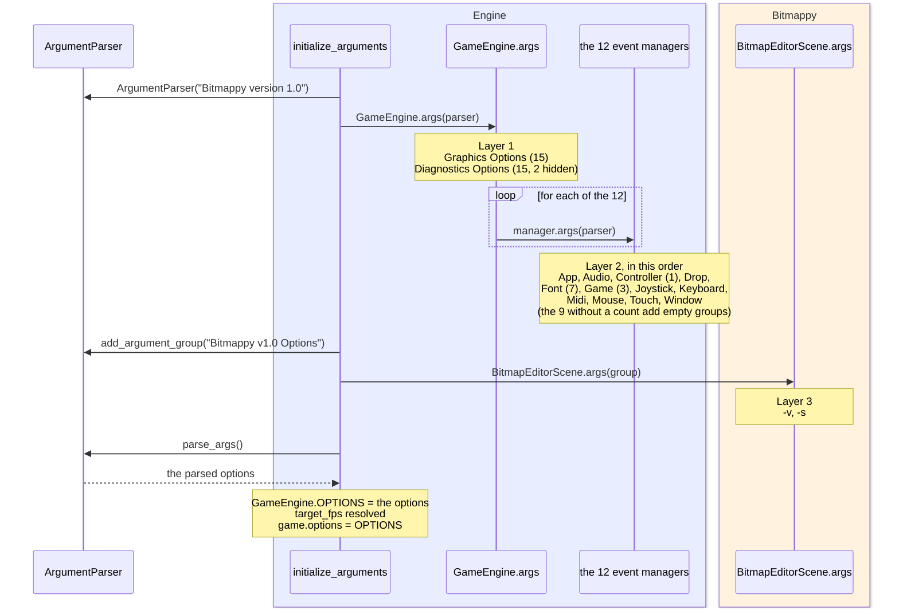
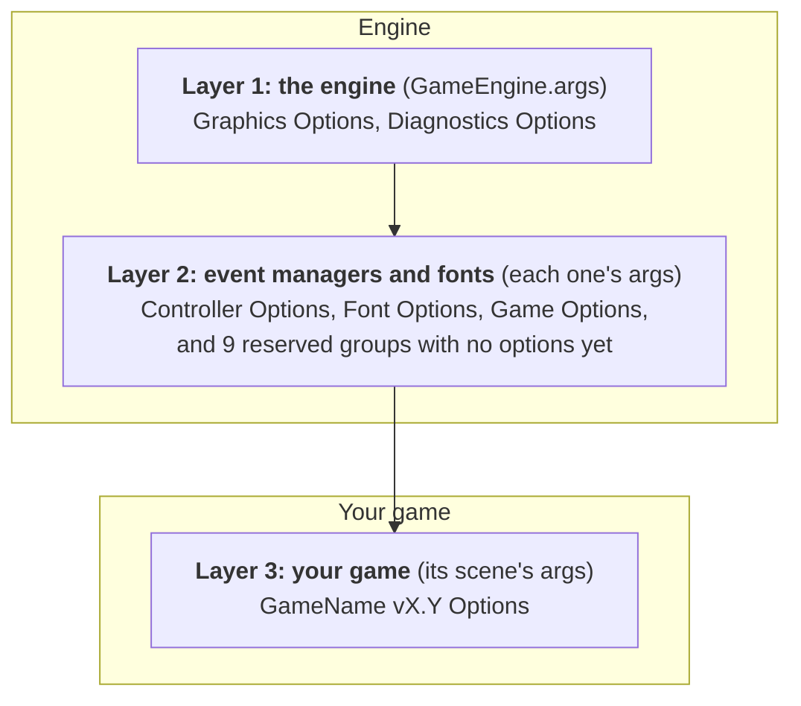
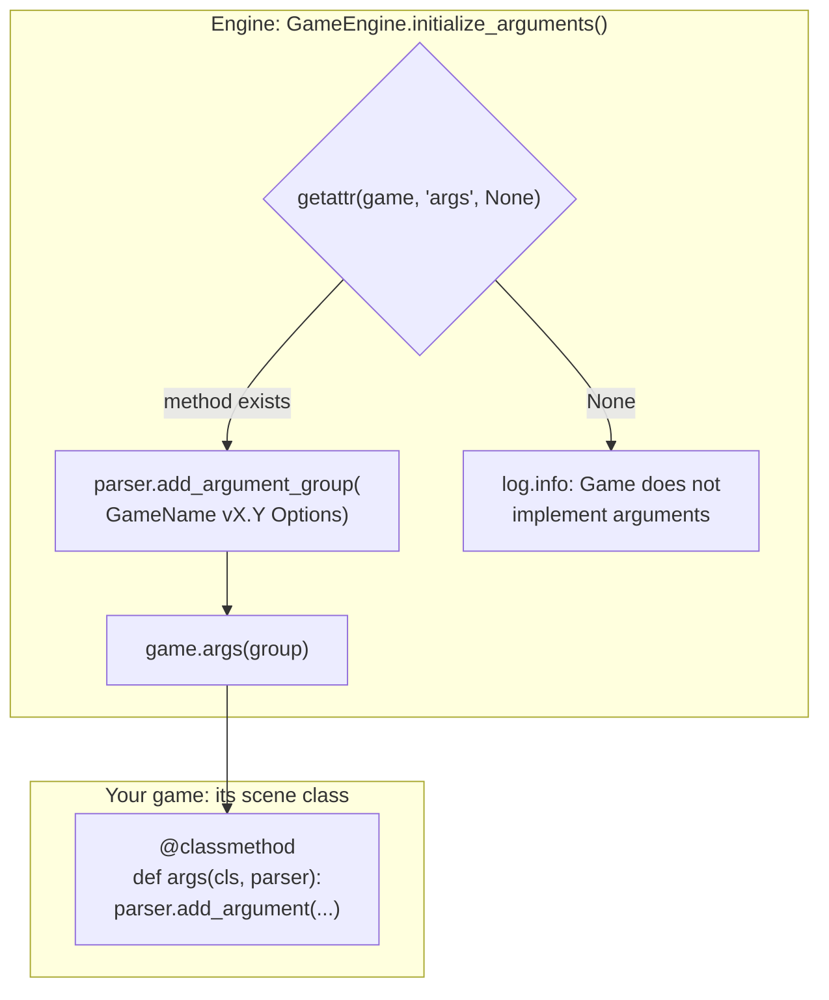
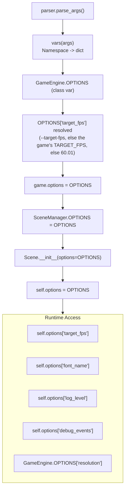

# Command-Line Argument System

GlitchyGames uses a composable argparse architecture where the engine, event managers,
font system, and individual games each contribute argument groups to a single parser.
Every game built on the engine automatically inherits all engine-level flags, and can
extend the parser with its own game-specific options.

## How Arguments Are Assembled

`GameEngine.initialize_arguments()`, called from `GameEngine.__init__()`, builds one parser from
three layers. Here is what happens when you run Bitmappy (`uv run bitmappy`): the Engine box
adds layers 1 and 2, the Bitmappy box layer 3, and argparse's `ArgumentParser` is outside both.



Every option each layer adds is listed in the [Complete Flag Reference](#complete-flag-reference).

## The Argument Group Hierarchy

Each layer adds its own `add_argument_group()`, so `--help` shows clearly separated sections, in
the order of the layers. The layers mirror the engine's architecture.



In `--help` (Bitmappy's or Paddle Slap's) the groups hold 15 Graphics, 15 Diagnostics (2 more
hidden), 1 Controller, 7 Font and 3 Game options, then the game's own; the nine empty groups
are left out. The [Complete Flag Reference](#complete-flag-reference) lists them all.

## How Games Add Arguments

A game adds arguments by defining a `@classmethod` called `args()` on its scene class.
The engine discovers this method via `getattr(game, 'args', None)` and calls it with
a dedicated argument group. If the game does not define `args()`, the engine logs an
informational message and continues.



### Pattern: Minimal Game

```python
class MyGame(Scene):
    NAME = 'My Game'
    VERSION = '1.0'

    @classmethod
    def args(cls, parser):
        parser.add_argument(
            '-v', '--version',
            action='store_true',
            help='print the game version and exit',
        )
```

### Pattern: Game with Custom Options

```python
class TimedDemo(Scene):
    NAME = 'Timed Demo'
    VERSION = '1.0'

    @classmethod
    def args(cls, parser):
        parser.add_argument(
            '--time', type=int, default=10,
            help='time in seconds to wait before quitting',
        )
        parser.add_argument(
            '-v', '--version',
            action='store_true',
            help='print the game version and exit',
        )
```

Note that the game receives an **argument group**, not the root parser. This means
game arguments appear under their own heading in `--help` output.

## OPTIONS Dictionary Flow

After parsing, the `Namespace` is converted to a plain dict and propagated to
every component that needs it.



## Complete Flag Reference

Every option, by the layer that adds it and grouped as `uv run bitmappy --help` prints it:
each with its type and default, then its help text.

### Layer 1: the engine

#### Graphics Options

Added by `GameEngine.args()` in `src/glitchygames/engine/game_engine.py`.

- `-f, --target-fps TARGET_FPS` (`float`): cap the framerate (default: the game's TARGET_FPS, else 60.01; 0 = uncapped)
- `--fps-log-interval-ms FPS_LOG_INTERVAL_MS` (`float`): how often to log the FPS counter in ms (default: 1000)
- `-w, --windowed, --no-windowed` (`bool`): run in a window; --no-windowed runs fullscreen (default: windowed)
- `-r, --resolution RESOLUTION` (`str`): the resolution to use (default: 800x480)
- `--use-gfxdraw` (`store_true`, default `False`): not used yet: stored, but nothing draws with pygame.gfxdraw because of it
- `--update-type {update,flip}` (`choice`): update or flip (default: update)
- `--timer-backend {auto,fast,pygame}` (`choice`): timer backend for draw loop pacing (default: auto, the fast backend with this machine's sleep delay measured, so each sleep wakes in time; fast assumes sleeps wake on time; pygame is the legacy backend)
- `--sleep-granularity-ns SLEEP_GRANULARITY_NS` (`int`, default `1000000`): how long before each frame deadline the fast backend is to wake from its sleep and spin (ns); 0 spins only
- `--windows-timer-1ms` (`store_true`, default `False`): on Windows, request 1ms system timer resolution
- `--random-seed RANDOM_SEED` (`int`): master seed for every engine random stream (default: a random 64-bit seed, logged in recordings)
- `--screen-shake-intensity SCREEN_SHAKE_INTENSITY` (`float`): screen shake strength from 0.0 (off) to 1.0 (default: 1.0)
- `--rumble-intensity RUMBLE_INTENSITY` (`float`): controller rumble strength from 0.0 (off) to 1.0 (default: 1.0)
- `--live-voice-pool LIVE_VOICE_POOL` (`int`): mixer channels reserved for real-time synth voices (default: 4)
- `--crt-power-on {auto,on,off}` (`choice`, default `auto`): show the game's canvas switching on like a CRT before the game starts: auto (default: when someone can see it, so not on SDL's dummy driver or before a replay, audit, rebaseline or recording), on (always; refused with a replay or a recording) or off
- `--default-background {test-pattern,channel-3}` (`choice`): the background of a scene that sets none: the TV test pattern or the channel 3 blue screen (default: test-pattern)
- `--video-driver {cocoa,offscreen,dummy}` (`choice`, default `None`): not applied yet: stored, but SDL picks its video driver from SDL_VIDEODRIVER (or --headless) instead

**`--video-driver` choices by platform** (SDL 2's video driver names, by `platform.system()`;
`--help` above is macOS's):

| Platform | Choices |
|----------|---------|
| macOS (`Darwin`) | `cocoa`, `offscreen`, `dummy` |
| Windows | `windows`, `offscreen`, `dummy` |
| Linux | `x11`, `wayland`, `kmsdrm`, `offscreen`, `dummy` |
| any other | `offscreen`, `dummy` |

#### Diagnostics Options

Added by `GameEngine.args()` right after the Graphics Options: how any run is watched,
recorded, replayed or diagnosed, whatever the game; they change no game settings. Recording and
replay are described in [Gameplay Recording and Replay](gameplay_replay.md). Two more are hidden
from `--help`: the watched replay's restart internals.

- `--log-timer-jitter` (`store_true`, default `False`): log frame pacing jitter statistics periodically
- `--perf-trim-percent PERF_TRIM_PERCENT` (`float`, default `5.0`): percent of frames to trim from top and bottom in global FPS report
- `--fps-histogram {equal-range,target-relative}` (`choice`, default `equal-range`): FPS histogram buckets in the shutdown report: equal-range (10 equal buckets spanning the analyzed min to max, default) or target-relative (10% steps of the target FPS)
- `--debug-overlay, --no-debug-overlay` (`bool`, default `False`): show the debug overlay at startup (F3 toggles, F4 cycles panels)
- `--debug-events` (`store_true`, default `False`): log a warning the first time each unhandled event type arrives (--no-unhandled-events raises on one instead)
- `--record-trace PATH` (`PATH`): record the session (sprites, frame times, input events, random seed) to a gzip JSON Lines trace for inspection and later replay (default: off)
- `--replay-trace PATH` (`PATH`): replay a --record-trace recording exactly through the engine, comparing every frame with it and reporting the first divergence (default: off)
- `--replay-fps {recorded,real}` (`choice`, default `None` (read as `recorded`)): with --replay-trace: post FPS events from the recorded frame times (recorded, the default: exact, and compared with the recording) or from this machine's measured frame times (real: what this machine achieves; FPS events are then not compared, and sprites that draw the FPS value may diverge)
- `--audit, --no-audit` (`bool`, default `False`): with --replay-trace: instead of replaying, replay the recording twice in fresh headless processes with different hash seeds and compare every frame with the recording and between the runs; exits 0 when both match, 3 otherwise, 70 if a run could not finish
- `--compare-processing` (`store_true`, default `False`): with --replay-trace --headless: measure each frame's processing time (its work, without presenting or pacing) and report how it compares with the recording's (only meaningful on the machine that recorded)
- `--max-processing-slowdown PERCENT` (`PERCENT`, default `None`): with --replay-trace --headless (implies --compare-processing): a replay that matched but took more than PERCENT longer than the recording's processing time exits 8; a recording without processing times exits 65
- `--replay-pause-at-frame N` (`N` (non-negative int), default `None`): with --replay-trace, watched: skip the start screen, run frames 0 to N - 1 without showing them, then pause with frame N next (what step back restarts with; ignored with --headless)
- `--rebaseline NEW` (`NEW`, default `None`): with --replay-trace OLD and --headless: replay OLD on the current code without stopping at divergences, write the run's recording (OLD's inputs, the current sprites) to NEW, print a summary of the frames and sprites that changed and exit 0
- `--replay-digest PATH` (`PATH`, default `None`): with --replay-trace: write a SHA-256 of every replayed frame, then the divergence, to PATH as JSON lines (used by --audit)
- `--list-input-devices` (`store_true`, default `False`): print every joystick and game controller the game would see (index, instance id, name, GUID, whether SDL maps it as a game controller, its axes, buttons, hats and balls; how many SDL counted before its queue was pumped and each device added or removed while listening, with when), then exit 0 without running the game. At a terminal, when none is found it asks you to plug one in and waits for it (Ctrl-C stops). Refused with --replay-trace or --record-trace
- `--headless` (`store_true`, default `False`): run on SDL's dummy video and audio drivers: no window, no sound. With --replay-trace the replay also runs unpaced and prints its report to stdout (exit 0 when it matches, 1 when it diverges, 65 for a truncated recording)

### Layer 2: event managers and fonts

#### Controller Options

Added by `ControllerEventManager.args()` in `src/glitchygames/events/controller.py` (see
[Event System](event_system.md#one-device-one-event-layer)).

- `--input-mode {auto,joystick,controller}` (`choice`): Which gamepads the game sees (default: auto, every device; a mapped pad sends controller events, any other device joystick events; joystick: every device sends joystick events; controller: mapped pads only)

#### Font Options

Added by `FontManager.args()` in `src/glitchygames/fonts/font_manager.py`.

- `--font-name FONT_NAME` (`str`): Font to use (default: the bundled Vera; the bundled variants are Vera, VeraBd, VeraIt and VeraBI; any other name is looked up among the system's fonts)
- `--font-size FONT_SIZE` (`int`): size of the default font, used by text that asks for no font of its own (default: 14)
- `--font-bold` (`store_true`, default `False`): not used yet: stored, but no text is drawn bold because of it
- `--font-italic` (`store_true`, default `False`): not used yet: stored, but no text is drawn italic because of it
- `--font-antialias` (`store_true`, default `False`): not used yet: stored, but each text widget chooses its own antialiasing
- `--font-dpi FONT_DPI` (`int`): the resolution, in dots per inch, freetype font sizes are scaled at (sets pygame.freetype's default resolution); the pygame font system ignores it (default: 72)
- `--font-system {pygame,freetype}` (`choice`, default `freetype`): Font system to use: freetype (enhanced, default) or pygame (built-in)

#### Game Options

Added by `GameEventManager.args()` in `src/glitchygames/events/game.py`.

- `-l, --log-level {debug,info,warning,error,critical}` (`choice`, default `info`): set the logging level
- `--no-unhandled-events` (`store_true`, default `False`): fail on unhandled events
- `-p, --profile` (`store_true`, default `False`): enable profiling

#### Reserved groups (empty, no arguments yet)

These event managers create their group as an extension point but add no options, so `--help`
leaves them out.

| Group Name | Source File | Manager Class |
|------------|------------|---------------|
| App Options | `events/app.py` | `AppEventManager` |
| Sound Mixer Options | `events/audio.py` | `AudioEventManager` |
| Drop Options | `events/drop.py` | `DropEventManager` |
| Joystick Options | `events/joystick.py` | `JoystickEventManager` |
| Keyboard Options | `events/keyboard.py` | `KeyboardEventManager` |
| Midi Options | `events/midi.py` | `MidiEventManager` |
| Mouse Options | `events/mouse.py` | `MouseEventManager` |
| Touch Options | `events/touch.py` | `TouchEventManager` |
| Window Options | `events/window.py` | `WindowEventManager` |

### Layer 3: the game

#### Bitmappy v1.0 Options

Added by `BitmapEditorScene.args()` in `src/apps/bitmappy/bitmappy/editor.py`; the heading is
`<NAME> v<VERSION> Options`.

- `-v, --version` (`store_true`, default `False`): print the game version and exit
- `-s, --size SIZE` (`str`): the canvas size in pixels, WIDTHxHEIGHT (default: 32x32)

#### Other games

The other games add their own options the same way:

| Game | File | Arguments |
|------|------|-----------|
| Paddle Slap | `src/games/paddleslap/src/paddleslap/__init__.py` | `-v, --version`, `-b, --balls` (int, default 1), `--ball-spawn-mode` (choice, default `paddle_only`) |
| DT Demo | `src/glitchygames/examples/dt_demo.py` | `-v, --version`, `-b, --balls` (int, default 1) |
| Clockwork Keep | `src/games/clockwork-keep/src/clockwork_keep/game.py` | `--floor` (int, default 0) |
| Brave Adventurer (both editions) | `src/games/brave-adventurer/src/brave_adventurer/game.py`, `src/games/brave-adventurer/src/brave_adventurer_papyrus/game.py` | `-v, --version` |
| Brave Adventurer's launcher | `src/games/brave-adventurer/src/brave_adventurer_modes/launcher.py` (read before the engine's parser, which never sees it), `title.py` (`TitleScene.args()` lists it in `-h`) | `--game {classic,papyrus}`, `-v, --version` |
| Joystick Demo | `src/glitchygames/examples/joystick_demo.py` | none (the engine's `--input-mode` chooses what it shows) |
| Bitrot Adventures | `scripts/bitrotadventures.py` | `-s, --some-game-specific-option` |
| Animation Demo | `scripts/animation_scene_full_demo.py` | `-v, --version` |

## What `--help` Looks Like

`uv run bitmappy --help` prints a usage line, the `options:` group (`-h, --help`), then each
group in the order the layers add them: Graphics, Diagnostics, Controller, Font and Game
Options, then `Bitmappy v1.0 Options`. argparse leaves out groups with no arguments (App, Sound
Mixer and the other reserved groups). Every option it prints, with its help text, is listed in
[Complete Flag Reference](#complete-flag-reference).

## How to Add Arguments to a New Event Manager

If you are adding arguments to a currently-empty event manager group, follow the
existing pattern:

```python
# In src/glitchygames/events/mouse.py

@classmethod
def args(cls, parser: argparse.ArgumentParser) -> argparse.ArgumentParser:
    group = parser.add_argument_group('Mouse Options')

    group.add_argument(
        '--mouse-sensitivity',
        type=float,
        default=1.0,
        help='Mouse sensitivity multiplier (default: 1.0)',
    )

    return parser
```

The engine already calls your manager's `args()` method — you just need to
add `add_argument()` calls to the existing group.

## How to Create a New Game with Arguments

```python
from glitchygames.engine import GameEngine
from glitchygames.scenes import Scene


class MyGame(Scene):
    NAME = 'My Game'
    VERSION = '1.0'

    @classmethod
    def args(cls, parser):
        """Add game-specific arguments.

        Args:
            parser: An argument group (not the root parser).
        """
        parser.add_argument(
            '-v', '--version',
            action='store_true',
            help='print the game version and exit',
        )
        parser.add_argument(
            '--difficulty',
            choices=['easy', 'medium', 'hard'],
            default='medium',
            help='game difficulty level',
        )

    def __init__(self, options):
        super().__init__(options=options)
        # Access your arguments via self.options
        self.difficulty = self.options['difficulty']


def main():
    GameEngine(game=MyGame).start()
```

Your arguments will automatically appear under **"My Game v1.0 Options"** in
the `--help` output, separate from all engine-level flags.
