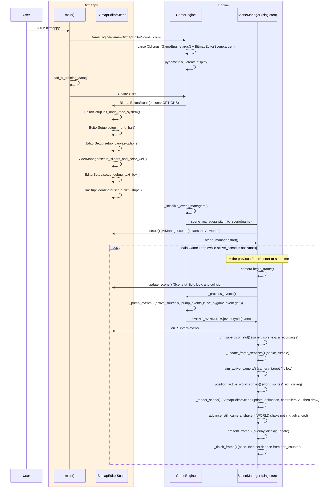
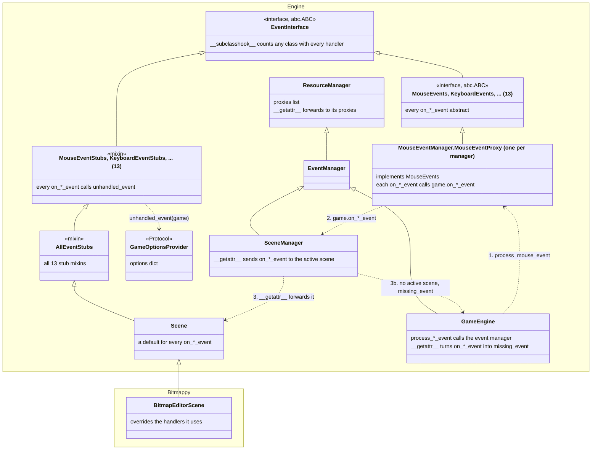
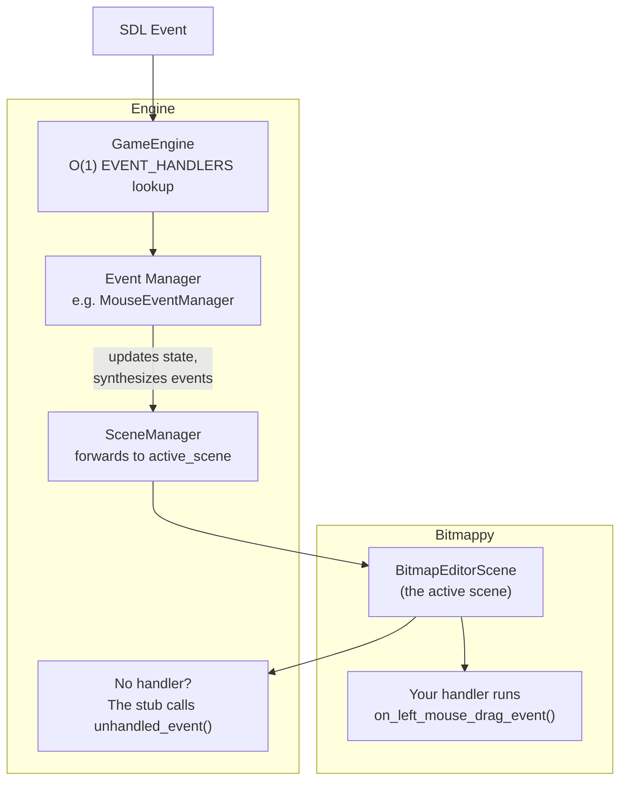
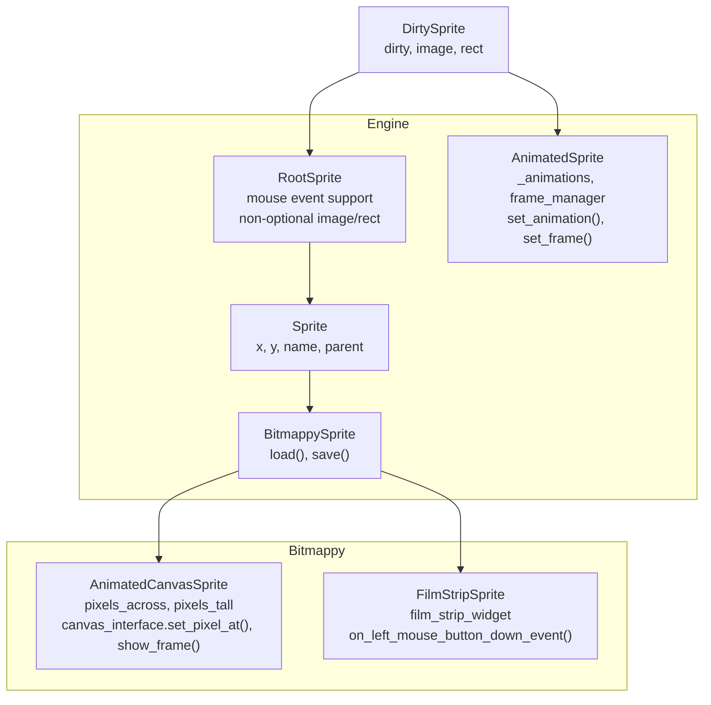
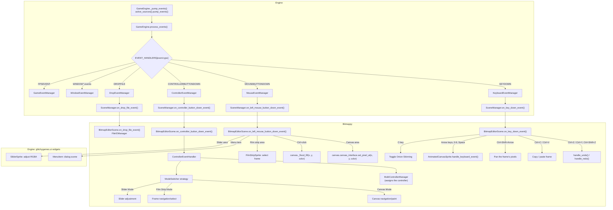
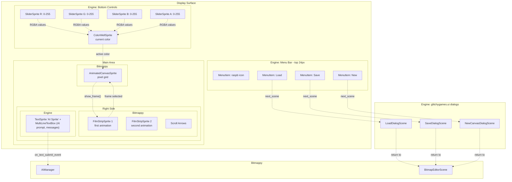
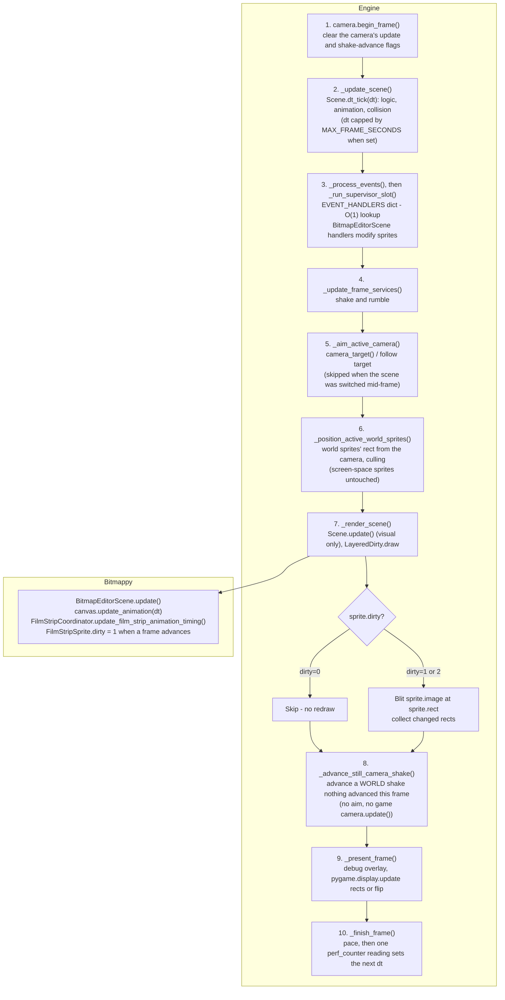
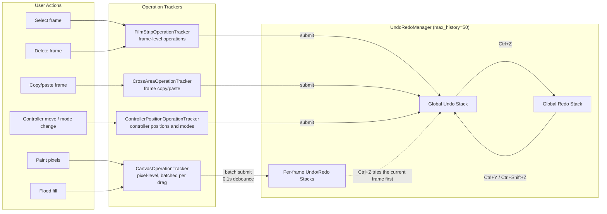
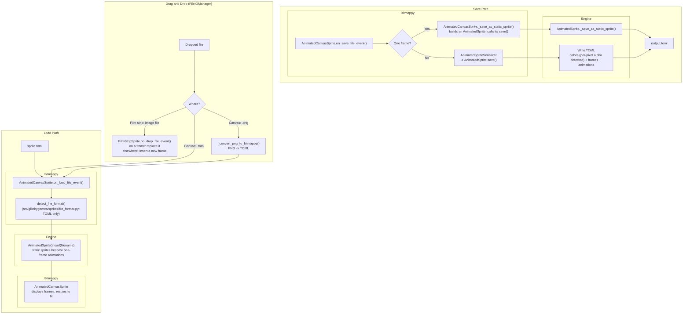
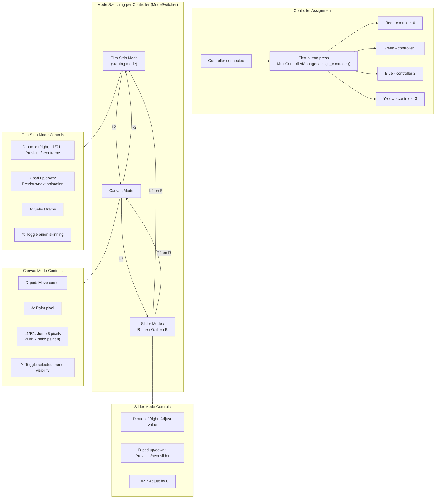

# Bitmappy Architecture

Bitmappy is GlitchyGames' pixel art editor. These diagrams show how it is wired up
through the engine, from bootstrap to rendering.

## Bootstrap & Main Loop

How Bitmappy starts up: entry point through `main()`, GameEngine initialization,
scene setup, and the main loop (one frame per pass, ended by `_finish_frame`). The Bitmappy box
is the editor's own code (`src/apps/bitmappy/bitmappy/`); the Engine box is what every game gets.

## Class Hierarchy

### Event dispatch chain (how events reach your scene)

Every scene has every `on_*_event()` handler, but it gets them a different way from the
engine. A `Scene` *inherits* them: `AllEventStubs` gives it a default for each one, which reports
the event as unhandled, and your scene overrides the ones it uses. `GameEngine` and
`SceneManager` inherit no handlers at all. They pass `on_*_event()` calls along at runtime
through `__getattr__`.

- Solid arrows are inheritance, pointing at the base class.
- Dotted arrows are the runtime calls, numbered in the order an event takes them.
- The Engine box is the engine's classes; the Bitmappy box is the editor's scene.

The interfaces are abstract base classes, not `typing.Protocol`s, but `EventInterface`'s
`__subclasshook__` makes them structural: any class with every handler of an interface counts as
one. `GameOptionsProvider` is a real `Protocol`: `unhandled_event()` needs only the scene's
`options`. Both scene classes also inherit `SceneInterface` (left out to keep the diagram
readable).

**Event flow** — how an SDL event reaches your handler in Bitmappy (the stub a missing handler
falls to is the engine's):

The `GameEngine` receives every SDL event and does an O(1) dict lookup to find
the right event manager. The event manager updates its internal state (button
tracking, axis values, drag detection) and may synthesize higher-level events
(drag, drop, chord). It then forwards to the `SceneManager`, which passes
everything to the `active_scene`. In Bitmappy, that's `BitmapEditorScene`,
which overrides handlers like `on_key_down_event()`,
`on_left_mouse_button_down_event()`, `on_left_mouse_drag_event()`, and
`on_controller_button_down_event()`. Events it doesn't override hit the stubs, which call
`unhandled_event()`: it does nothing by default, logs each event type once when `debug_events`
is on (the `--debug-events` flag, off by default), and raises `UnhandledEventError` under `--no-unhandled-events` (as the tests
run).

### Sprite hierarchy (renderable objects)

`DirtySprite` is pygame's base for all sprites that support dirty-rect
rendering. GlitchyGames extends it through `RootSprite` → `Sprite` → `BitmappySprite` to add
mouse events, non-optional `image`/`rect`, named parent tracking and TOML load/save.
`AnimatedSprite` derives from `DirtySprite` directly. `DirtySprite` is pygame's, outside both
boxes; the Bitmappy box holds the editor's own sprites.

## Event Flow

How pygame events propagate through the system: from `GameEngine._pump_events()` (live:
`pygame.event.get()`) through
the `EVENT_HANDLERS` dispatch table, into specialized event managers, through the
scene manager, and finally into Bitmappy's scene and sprite handlers. The top Engine box is the
dispatch every game gets, the Bitmappy box is the editor's handlers, and the bottom Engine box is
the engine's UI widgets (`glitchygames.ui`) the editor's clicks reach.

## UI Layout & Component Wiring

How the UI components are arranged on screen and how data flows between them.
Every line is dotted: data flow, and the scene switches to the dialogs (`next_scene`).
Each box says whose the widgets are: "Engine" for the engine's widgets and dialog scenes
(`glitchygames.ui`), "Bitmappy" for the editor's own sprites, scene and managers.

## Rendering Pipeline

The steps of each frame, in order (`SceneManager._run_scene_frame`, then `_finish_frame`).
Bitmappy has no world-space sprites, so steps 5 and 6 leave its widgets alone. Dirty-rect
optimization ensures only changed regions are redrawn and pushed to the display. The engine runs
every step; the Bitmappy box is the editor's `update()`, which step 7 calls.

## Undo/Redo & Operations

How user actions flow through operation trackers into the central undo/redo stack.
Canvas operations are batched per drag with 0.1s debounce for efficiency.

## Sprite Load/Save Pipeline

How sprites are loaded from TOML files, saved back, and imported via drag-and-drop. Inside each
path, the Bitmappy box is the editor's canvas and the Engine box is the engine's `AnimatedSprite`,
which reads and writes the file; drag and drop is all the editor's (`FileIOManager`).

## Multi-Controller System

Up to 4 color-coded controllers can operate simultaneously. Each controller
independently switches between film strip, canvas and slider (R, G, B) modes using the
triggers: L2 steps forward, R2 steps back (R2 does nothing in film strip mode). B undoes
and X redoes in film strip and canvas modes.

