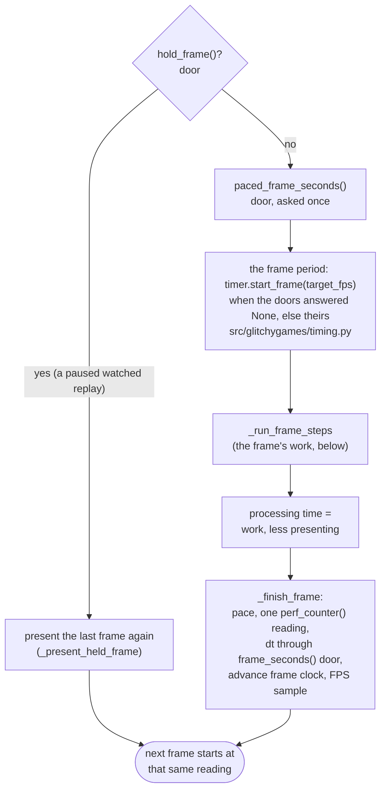
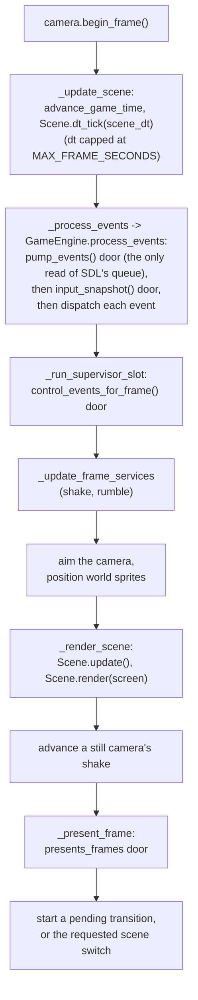
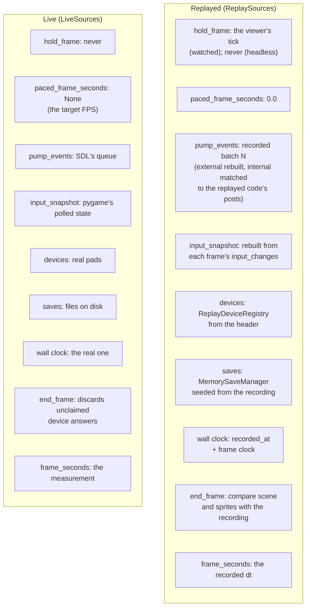

# How a Frame Runs

One frame of `SceneManager`, in the order the code runs it, and where each input comes from.
Everything here is in `src/glitchygames/scenes/scene.py` unless another file is named; the doors'
interface is `EngineSources` in `src/glitchygames/sources.py`.

## The loop

`SceneManager.start` is the blocking loop: `begin_frames`, then `run_frame_step` while
`should_run_frames`, then `end_frames`. A browser host runs the same steps itself, one per tick,
unpaced (`GameHost.run_async`, `src/glitchygames/host.py`).

- `begin_frames` takes the first `time.perf_counter()` reading. The first frame has no previous
  frame, so its `dt` is the short time since that reading (a replay's frame-time door returns the
  recorded first `dt` instead).
- `should_run_frames` goes on while a scene is active, no quit was requested and the doors do
  not ask to stop (`stop_requested`: a replay reached its end).

## One frame step

`run_frame_step` first asks the doors whether to hold (`hold_frame`): a paused watched replay
holds, and the last frame is presented again with the doors' overlay; nothing runs and the frame
clock stands still. Otherwise it asks `paced_frame_seconds` once (None: the target FPS; 0.0: no
pacing; a positive number: that period), runs the frame, measures its processing time and ends it
in `_finish_frame`.

## Inside the frame: `_run_frame_steps`

1. Start the processing-time clock (`measured_seconds()`, `src/glitchygames/clock.py`).
2. Enter a requested in-game playback scope, if any (`_enter_requested_playback`;
   `src/glitchygames/replay/playback.py`), and apply a recorded resume (`_apply_resume_bridge`).
3. Complete the active scene's start on its first logic frame (`_begin_scene_logic_frame`;
   `src/glitchygames/scene_start.py`) and begin the instant-replay journal's frame
   (`_begin_journal_frame`; `src/glitchygames/instant_replay.py`).
4. Begin the game-frame clock (`src/glitchygames/game_frames.py`), which pairs onion-skin frames.
5. Run the frame's contents: a transition frame, or a scene frame (`_run_scene_frame`, below).
6. The processing time is the work since step 1, less the time spent presenting
   (`_frame_present_seconds`).
7. End the frame at the doors (`_end_frame_at_doors` -> `end_frame`): a recorder samples the
   sprites and writes the frame here; a replay compares the frame here. Then the journal takes
   the frame (`_journal_frame`).

## A scene frame: `_run_scene_frame`

Points that matter for replay:

- Logic (`dt_tick`) runs **before** the event pump, so `dt_tick` reads the previous frame's
  polled-input snapshot. `GameEngine.process_events` (`src/glitchygames/engine/game_engine.py`)
  sets the snapshot right after the pump, so it agrees with this frame's events and stays fixed
  until the next pump.
- `scene_dt` is `self.dt` capped at the scene's `MAX_FRAME_SECONDS` when it sets one
  (`_scene_frame_seconds`); `self.dt` keeps the whole frame time for pacing, statistics and
  services.
- The supervisor slot runs after logic and events, before positioning, so what a supervisor
  changes is drawn this frame (`src/glitchygames/supervision.py`).
- Presenting asks the doors (`presents_frames`): a watched replay's inner frames are not
  presented; the viewer's outer tick presents the latest one.

## The end of the frame: `_finish_frame`

In this order: pace (the timer backend's deadline, else the pygame clock; a target of 0 or a
frame the doors leave unpaced never waits; `_handle_frame_pacing`); take one `perf_counter()`
reading, which ends this frame and starts the next; set `self.dt` from that start-to-start time
through the `frame_seconds` door (`_set_frame_time`, the one writer of `self.dt`); add it to the
frame clock (`advance_frame_clock`, `src/glitchygames/sources.py`); record the FPS sample and
post the FPS event when its interval of frame-clock time has passed.

So the `dt` that frame N's logic receives is the time frame N - 1 took, start to start.

## The doors read in a frame

| Door | Read in | Module that owns the read |
|---|---|---|
| `hold_frame`, `paced_frame_seconds` | `run_frame_step` | `src/glitchygames/scenes/scene.py` |
| `pump_events` | `GameEngine._pump_events` | `src/glitchygames/engine/game_engine.py` |
| `input_snapshot` | `GameEngine.process_events` | `src/glitchygames/input/state.py` holds it |
| `devices` | controller and joystick handling | `src/glitchygames/input/devices.py` |
| `saves` | a game opening its save store | `src/glitchygames/state/manager.py` |
| `wall_clock_time`, frame clock | `clock.wall_clock_time()`, `clock.elapsed_seconds()` | `src/glitchygames/clock.py` |
| random seed | the named streams | `src/glitchygames/randomness.py` |
| `control_events_for_frame` | `_run_supervisor_slot` | `src/glitchygames/supervision.py` |
| `presents_frames` | `_present_frame` | `src/glitchygames/scenes/scene.py` |
| `end_frame` | `_end_frame_at_doors` | the doors |
| `frame_seconds` | `_set_frame_time` | the doors |

Events a game posts go through `post_event` (`src/glitchygames/recording.py`), so a recording can
tell code-posted (`internal`) events from SDL's (`external`). Only the files the doors guard
allows read the raw clock or pygame directly (`tests/test_engine_doors.py`;
[How we test playback](testing.md#the-doors-guard)).

## The same frame, live and replayed

The frame's steps are identical; only what each door returns differs. A replay installs
`ReplaySources` (`src/glitchygames/replay/driver.py`) before the first frame.

Each replayed door is a rule of `src/glitchygames/replay/driver.py`'s docstring: the pump is rule
2, frame time rule 4, input rule 5, devices rule 6, saves rule 7, the end-of-frame comparison
rule 8, the clocks rule 9, pacing rule 13 and watching rule 14. The random streams are seeded
with the recorded seed at startup (rule 1). A recording made with `--record-trace` sits between
the live doors and the engine (`RecordingSources`, `src/glitchygames/recording.py`): it passes
every answer through and writes it down.

In-game playback (demos, instant replay, ghosts) uses the same mechanism inside a live game: a
scope pushes `PlaybackSources` on top of the live doors for its frames
(`src/glitchygames/replay/playback.py`; [In-game playback](../gameplay_replay.md#in-game-playback)).
