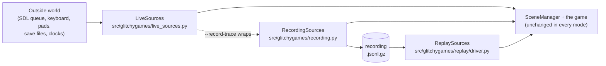

# Gameplay Playback

Playback is how GlitchyGames records a play session and runs it again, through the real engine,
frame for frame. It is what makes a bug report reproducible, a golden replay a regression test,
a demo or an instant replay possible, and a performance measurement repeatable: the same
recording, replayed on the same engine, draws the same sprites in every frame
(`src/glitchygames/replay/driver.py`, whose docstring is the replay's contract).

These pages explain how it works. For every flag, option and exit code, the command reference is
[Gameplay Recording and Replay](../gameplay_replay.md); these pages link into it rather than
repeat it.

## The idea in one picture

Everything the engine takes in from the outside world (events, frame time, polled input,
devices, saves, the clocks and the random seed) passes through one set of *doors*
(`src/glitchygames/sources.py`, `EngineSources`). Live play installs the live doors; a recording
wraps them and writes down what passes through; a replay installs doors that serve the recording
instead. Everything downstream of the doors, the game included, runs unchanged.

## The modes at a glance

| Mode | How it starts | Doors | Paced? | Compares? | Writes? |
|---|---|---|---|---|---|
| Live play | `<game>` | `LiveSources` | yes, to the target FPS | no | nothing |
| Record | `<game> --record-trace PATH` | `RecordingSources` around `LiveSources` | yes | no | the recording |
| Headless replay | `--replay-trace PATH --headless` | `ReplaySources` | no (`paced_frame_seconds` is 0.0) | every frame, stops at the first difference | nothing |
| Watched replay | `--replay-trace PATH` | `ReplaySources`, driven by the viewer | by the viewer's 60 Hz outer tick | every frame, pauses at a difference | a bookmarked copy, if asked |
| Live play against OLD | `<game> --compare-trace OLD` | the live host's doors, plus a headless child replaying OLD | yes | no (the onion skin only draws) | nothing (or `--record-trace`) |
| Rebaseline | `--replay-trace OLD --rebaseline NEW --headless` | `ReplaySources`, with a recorder over them | no | counts every differing frame, never stops | NEW |
| Measure | `glitchygames measure` | a rebaseline per recording, in a child | no | as a rebaseline | ledger rows |
| Verify | `glitchygames verify` | a headless replay per recording, in a child | no | as a headless replay | nothing |
| Audit | `--replay-trace PATH --audit` | two headless replays, in fresh processes | no | the two runs' frame digests | nothing |

Sources: the pacing column is `paced_frame_seconds` in `src/glitchygames/sources.py` and rule 13
of `src/glitchygames/replay/driver.py`; the watched replay's tick is
`CONTROL_TICKS_PER_SECOND` in `src/glitchygames/replay/controls.py`; live play against OLD is rule
9 of `src/glitchygames/replay/tools/compare.py`; the rebaseline is
`src/glitchygames/replay/rebaseline.py`; measure and verify are
`src/glitchygames/replay/tools/measure.py` and `verify.py`; the audit is
`src/glitchygames/replay/audit.py`.

## Which page answers what

1. [How a frame runs](how-a-frame-runs.md): the steps of one frame in `SceneManager`'s order,
   where each door is read, and where a replay's sources take over from the live ones.
2. [Speeds and timing](speeds-and-timing.md): live pacing, headless and watched replays, the
   catch-up rule, `--replay-fps real`, live play against OLD and step back. A frame's logic is
   the same at every speed; only the waiting differs.
3. [The recording file](recording-file.md): the `.jsonl.gz` layout, every field and why it is
   kept, what is deliberately not kept, and what is stored versus derived.
4. [How we test playback](testing.md): golden replays, golden traces, the replay-tool tests on
   stand-in games, verify, measure and rebaseline, the determinism audit, the doors guard and the
   memory guard.

Related: [Replay Performance](../../quality/performance.md) (the graphs built from measured runs)
and [Event System](../event_system.md).
