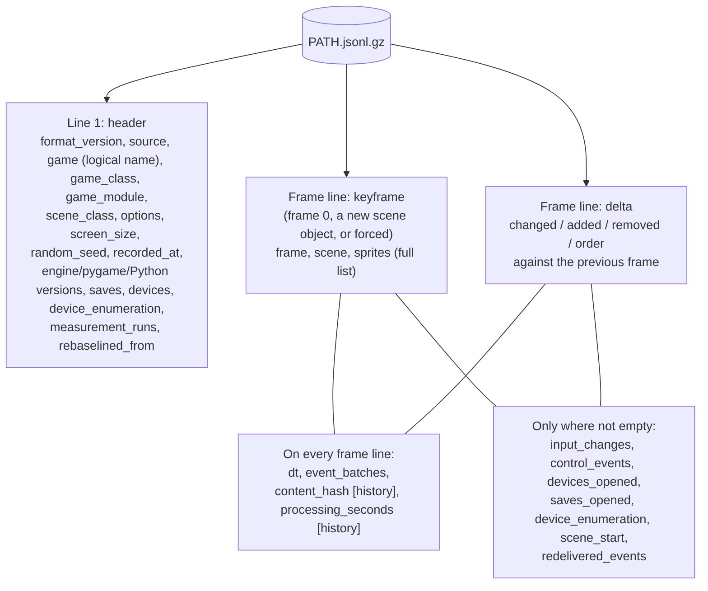
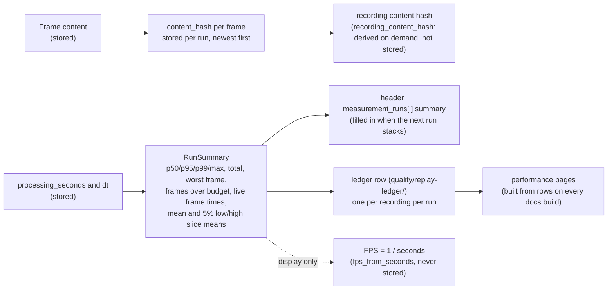

# The Recording File

A recording (`--record-trace PATH`, or a rebaseline's NEW) is a sprite trace in the format of
`src/glitchygames/tracing.py`, plus what an exact replay needs (`src/glitchygames/recording.py`,
whose docstring lists every field). The field-by-field command reference is
[Recording](../gameplay_replay.md#recording-record-trace-path) and
[Content hashes and measurement history](../gameplay_replay.md#content-hashes-and-measurement-history).
This page explains the layout, and why each part is kept.

## Layout

gzip-compressed JSON Lines (`tracing.py`): line 1 is the header, then exactly one line per
main-loop frame, numbered 0, 1, 2, ... Transition frames, paused frames, frames where nothing
changed, and a final frame with no active scene are all included (`recording.py`). The gzip
header has mtime 0 and no file name, so identical traces give identical bytes (`tracing.py`).

A frame's sprite record is `{"id": "<ClassName>#<n>", "rect": [x, y, width, height], "visible":
bool}` for every sprite in the scene's `all_sprites`, in draw order (`sample_scene_frame`,
`tracing.py`). Delta frames carry only what changed, and an integer `rect` change is written as
`rect_delta` (`tracing.py`).

## What each part is for

| Field | Why it is kept | Read by |
|---|---|---|
| `random_seed` | every random stream derives from it, so the replay draws the same numbers (`src/glitchygames/randomness.py`) | replay startup (driver rule 1) |
| `options`, `screen_size` | the replay applies the recorded options (all but the replay's own) and opens the recorded display size (driver rule 1) | replay startup |
| `game`, `scene_start.scene` (logical names) | the game and scenes are found by logical name, not by where their code lives (`src/glitchygames/logical_names.py`) | `check_recorded_game`, `find_scene_class` |
| `recorded_at` | the wall clock of the recording, and of its replay, is this stamp plus the frame clock (driver rule 9) | `clock.wall_clock_time()` |
| `saves`, `saves_opened` | save stores as they were first opened, so a replay never touches real saves (driver rule 7) | `MemorySaveManager` |
| `devices`, `devices_opened`, `device_enumeration` | the pads the run saw, and every enumeration answer (driver rule 6) | `ReplayDeviceRegistry` |
| `dt` | the frame time logic received; a replay serves it, so timers and physics replay exactly (driver rule 4) | `frame_seconds` door |
| `event_batches` | every read of SDL's queue in the frame, empty ones too, in order, with each event's `origin` (driver rule 2) | `pump_events` door |
| `input_changes` | the polled input (keys held, mouse, pads) as changes since the previous frame (driver rule 5) | `input_snapshot` door |
| `control_events` | the supervisor's actions in the frame (`src/glitchygames/supervision.py`), compared at the end of the frame (driver rule 8) | `end_frame` |
| `scene_start` | how a scene began (its arguments, random states and frame clock), so in-game playback can rebuild it (`src/glitchygames/scene_start.py`) | playback scopes |
| `scene`, `sprites` | what the frame drew, sampled: the comparison's fingerprint of the frame (driver rule 8) | `end_frame` |
| `measurement_runs` | each run's provenance (machine, paced or not, versions, commit, machine state) and its summary (`src/glitchygames/recording_history.py`) | `glitchygames report`, `measure` |
| `content_hash`, `processing_seconds` | per frame, newest run first: what the frame did and how long its work took, per run | `report`, the ledger |

## What is deliberately not kept

- **Pixels and audio.** A frame is compared by its scene class and each sprite's `rect`,
  `visible` and draw order. Pixels, audio, and game state that is not sampled are not compared,
  so they are not recorded (`src/glitchygames/replay/audit.py`; `sample_scene_frame`). Audio plays
  during a replay but is not compared ([the reference](../gameplay_replay.md)).
- **Wall-clock time per frame.** Only `recorded_at` is stored. Every later wall-clock reading is
  `recorded_at` plus the frame clock, and the frame clock is the sum of the recorded `dt`s
  (`src/glitchygames/clock.py`).
- **Measured durations as inputs.** `measured_seconds()` is real time for logs and metrics. It is
  never replayed, so it may never decide anything that is drawn, played or recorded (`clock.py`).
  Processing times are recorded as diagnostics, never compared and never served to the game
  (`src/glitchygames/replay/processing.py`).
- **The host name.** The machine is `platform.platform()`, with no host name, because recordings
  are shared and bundled demos ship in the wheel (`machine_description`, `processing.py`).
- **Pumps after the last frame.** Pumps while the engine shuts down belong to no frame
  (`recording.py`).
- **Anything the replay can recompute**, such as which events were delivered, discarded or
  unhandled. That follows from the batch and the game state, so the replay re-derives it
  (`recording.py`).

## Stored, and derived

The rule: **store what cannot be recomputed; derive the rest, and store a derived value only where
history would otherwise be lost.**

### Stored, because it cannot be recomputed

- The **inputs**: event batches with their origins, the input snapshots (`input_changes`), device
  answers, save snapshots and supervisor control events.
- **Frame times** (`dt`) and the **seed and options**. These are the run's conditions.
- **Logical names** (`game`, `scene_start.scene`). They name the code, not where it lived.
- The sampled **sprites** per frame: the comparison's fingerprint of what each frame drew.
- Per run, **processing times** (`processing_seconds[i]`) and **provenance**
  (`measurement_runs[i]`). They describe that run on that machine, and are gone once it ends.

### Derived: where each derived value lives, and why

- **Content hash** (`frame_content_hash`, `recording_history.py`): 64 bits of SHA-256 of a frame's
  content fields. It is stored per frame and per run, because a later rebaseline compares runs
  frame by frame (behavior changes, same-work speed comparisons:
  `src/glitchygames/recording_metrics.py`). The recording's own hash for a run is derived from
  those on demand and never stored (`recording_content_hash`).
- **Run summaries** (`RunSummary`, `recording_history.py`): processing p50/p95/p99/max, total, the
  worst frame and its scene, frames over budget, a live run's frame times (p50/p99/max, late
  frames), and the mean and the "5% low/high" slice means (`slice_frame_count` is the one
  definition of a slice). A summary could be recomputed from the frames, but each recording keeps
  only `MEASUREMENT_RUNS_HISTORY_DEPTH` = 10 runs, so the summary is stored twice to outlive them:
  - in the header, written when the next run stacks (`stacked_measurement_runs`; the newest run's
    summary is computed on read, `recording_run_summaries`);
  - in a ledger row, one per recording per run (`LedgerRow`, `recording_metrics.py`), each with a
    per-frame profile (`FrameProfile`).
- **FPS** is never stored. Summaries keep seconds, which average correctly, and FPS is one
  division away, done for display only (`fps_from_seconds`, `recording_metrics.py`).
- **The ledger and the performance pages** are built from rows: every docs build merges the row
  files, the published ledger and pending rows, and graphs them
  (`src/glitchygames/replay/tools/performance_pages.py`;
  [Replay Performance](../../quality/performance.md)).

### Adding a derived field

The mean and the 5% slices (2026-10-28) are the worked example:

1. **Readers accept its absence.** The new field defaults to None (`FrameTimeSummary` and
   `RunSummary` in `recording_history.py`), so every older header and ledger row still reads, and
   tools show nothing for it rather than failing. The `measure` and `report` lines, and the
   performance pages' FPS charts, leave such rows out.
2. **No format version.** Header and frame fields added later need none: readers pass through
   fields they do not use (`tracing.py`), and `measurement_runs` is read leniently and written
   strictly (`measurement_run_from`).
3. **Older recordings get it at their next rebaseline or stacked run.** When a run stacks, each
   earlier run without a summary gets one from the frames. A stored summary that lacks a newer
   field is completed from the frames too, keeping every value it already holds
   (`summary_lacks_fields`, `completed_summary`). Ledger rows already written are never
   rewritten, so they keep their absence.
4. **One definition, tested by hand.** A derived figure is defined in one function and tested
   with hand-computed vectors (`tests/test_recording_history.py`).
