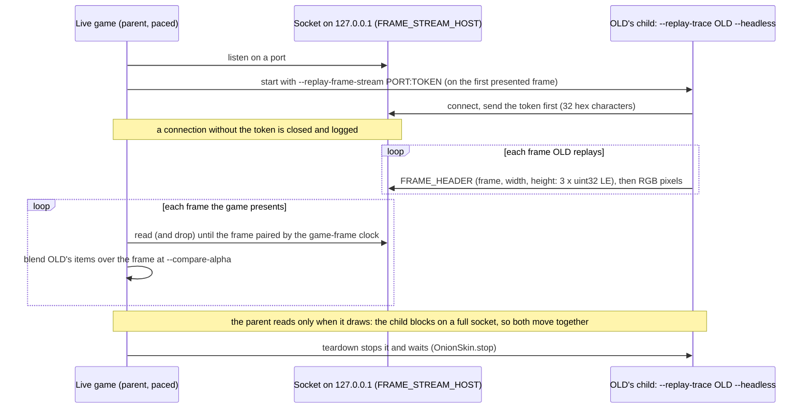
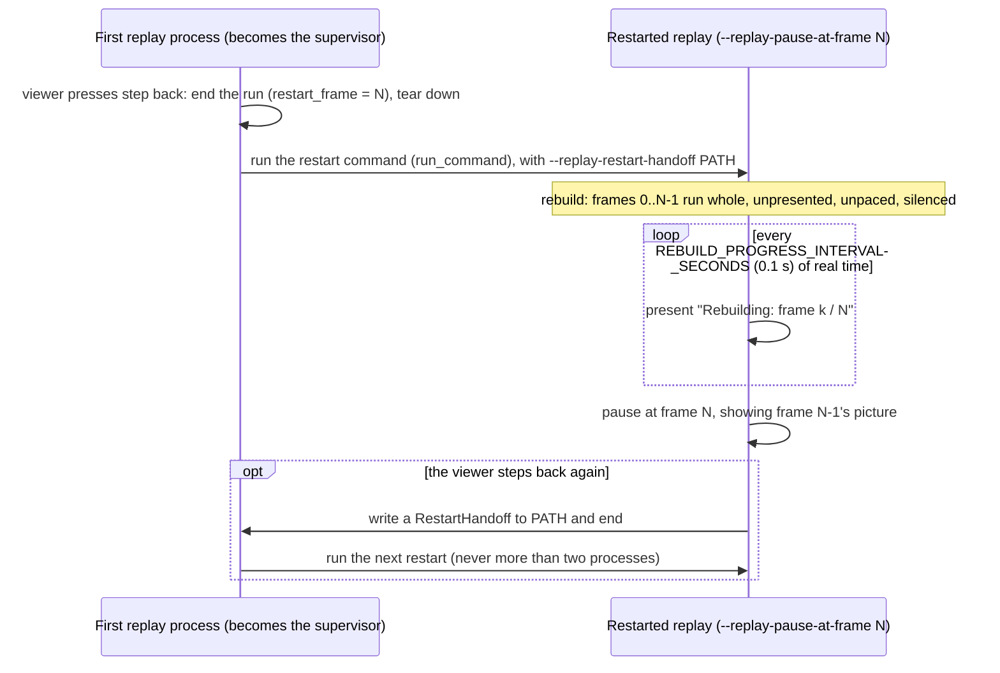

# Speeds and Timing

**A frame's logic is identical at every speed; only the waiting differs.** Every mode runs the same
`_run_frame_steps` ([How a frame runs](how-a-frame-runs.md)). What changes is whether
`_finish_frame` waits after the work, whether the doors hold the loop between frames, and which
`dt` the logic receives: the measured one live, the recorded one in a replay
(`frame_seconds`, rule 4 of `src/glitchygames/replay/driver.py`). A replay at 8x runs exactly the
frames a replay at 1x runs. It just runs more of them per real second.

In the timing charts below, the constants come from the code and are named. Bars labelled
*work* stand for however long a frame's work takes. Their lengths are illustrative, not
measurements. The charts' positions are whole milliseconds (Mermaid's time axis), so 16.667 ms is
drawn at 17.

## A paced live frame

Live play paces each frame to the target FPS (the default is 60.01 FPS, `DEFAULT_TARGET_FPS` in
`src/glitchygames/timing.py`). With the fast backend, `FastTimer.start_frame` turns the target into
a period in nanoseconds: 16,666,667 ns at 60 FPS, or about 16,664 µs at 60.01. After the frame's
work, `SceneManager._handle_frame_pacing` asks the timer for the next deadline
(`compute_deadline`) and sleeps until it (`sleep_until_next`):

- **Sleep.** The timer sleeps so that it is predicted to wake `DEFAULT_SLEEP_GRANULARITY_NS`
  (1 ms) before the deadline. Under `--timer-backend auto`, the engine's default, the sleep is
  shortened by this machine's measured `SleepModel` (how late its sleeps wake: a constant plus a
  fraction of the length).
- **Spin.** It spins the rest.

Then `_finish_frame` takes one `perf_counter()` reading, which ends this frame and starts the next.

```mermaid
gantt
    title One paced live frame at 60 FPS (period 16.667 ms, FastTimer.start_frame)
    dateFormat x
    axisFormat %L ms
    section Frame N
    work (_run_frame_steps, illustrative)        :w, 0, 6
    sleep (sized by the SleepModel)              :s, 6, 16
    spin (DEFAULT_SLEEP_GRANULARITY_NS = 1 ms)   :p, 16, 17
    section Frame N+1
    work (illustrative)                          :w2, 17, 22
```

The frame's *processing time* is the work alone, without presenting and without the pacing
(`_run_frame_steps`; `src/glitchygames/replay/processing.py`). Its frame time (`dt`) is the whole
period, start to start. Paced frames process more slowly than unpaced ones, because the processor
idles between them; `processing.py` explains this, and it is why paced and unpaced timings are
never compared.

## A headless replay

A replay never paces: `ReplaySources.paced_frame_seconds` returns 0.0, so `_handle_frame_pacing`
returns at once (no deadline, no clock tick), and a headless replay never holds. Frames run back
to back. Each frame's logic still receives the recorded `dt`, so the game "sees" the recorded
timing however fast the machine runs it (rules 4 and 13 of `src/glitchygames/replay/driver.py`).

```mermaid
gantt
    title Headless replay: no waits (paced_frame_seconds = 0.0)
    dateFormat x
    axisFormat %L ms
    section Frames
    frame 0 work (logic gets recorded dt 0)   :a, 0, 3
    frame 1 work (recorded dt 1)              :b, 3, 5
    frame 2 work (recorded dt 2)              :c, 5, 9
    frame 3 work (recorded dt 3)              :d, 9, 11
```

This is the mode every measurement uses: a rebaseline (and so `measure`) is headless, and its
per-frame processing times are pure work.

## A watched replay

A watched replay has two loops (`src/glitchygames/replay/viewer.py`, whose docstring is the
contract):

- **Outer.** The viewer ticks at a fixed real-time rate: `CONTROL_TICKS_PER_SECOND` = 60
  (`src/glitchygames/replay/controls.py`), on `measured_seconds()`, never replayed. Each tick
  reads the viewer's keys, refreshes the status line and presents one frame.
- **Inner.** The recorded game steps at its recorded frame times. Its frames run whole, but are
  not presented (`presents_frames` is False).

Before each inner frame the scene manager asks `hold_frame`:

1. **No tick open.** Sleep until the next tick (with `FastTimer` while frames run), then add the
   real time since the last tick, times the speed, to an accumulator.
2. **Tick open.** Run another inner frame while the accumulator holds that frame's recorded
   duration, and consume it. There are two limits per tick: at most `MAX_INNER_FRAMES_PER_TICK`
   = 32 frames, and only within `INNER_FRAME_BUDGET_SECONDS` = 0.011 s of real time, so keys and
   presenting stay at 60 Hz. The accumulator never owes more than one tick's worth: the excess is
   dropped, and the status bar shows the real speed while the viewer is behind
   (`BEHIND_SPEED_FRACTION` = 0.95).
3. **Otherwise** the tick closes and the frame is presented.

So at 1x a 60 FPS recording runs one inner frame per tick, at 8x eight, and at 1/4x one every
fourth tick (the viewer's docstring). The speed keys double or halve the speed
(`SPEED_STEP_FACTOR` = 2.0), within `MIN_SPEED` = 0.25 and `MAX_SPEED` = 8.0
(`ReplayControls`, `src/glitchygames/replay/controls.py`). The 32-frame cap is what lets the
viewer catch up after a stall, in one bounded burst.

```mermaid
gantt
    title Watched replay at 8x: one outer tick (1/60 s) runs several inner frames
    dateFormat x
    axisFormat %L ms
    section Outer tick 1
    keys + accumulator (hold_frame)         :k1, 0, 1
    inner frames, within the 11 ms budget   :i1, 1, 7
    present the latest frame                :p1, 7, 8
    sleep until the next tick               :s1, 8, 17
    section Outer tick 2
    keys + accumulator                      :k2, 17, 18
    inner frames (up to 32 per tick)        :i2, 18, 24
    present                                 :p2, 24, 25
```

The accumulator only decides **when** inner frames run, never what they do, so a watched replay
is as exact as a headless one (`viewer.py`).

## `--replay-fps real`

`--replay-fps` changes only which frame time the FPS statistics read, never the logic and never
the pacing. Under `recorded` (the default), the FPS events and performance statistics use the
recorded `dt`, so the FPS events are compared exactly. Under `real`, they use this machine's
measured frame time, and FPS events are not compared. Logic still receives the recorded `dt`
(rule 4 of `src/glitchygames/replay/driver.py`; `SceneManager._performance_frame_seconds`).
The timing chart is therefore the same as the headless or watched replay above. A rebaseline and
an audit refuse `real` (`src/glitchygames/replay/rebaseline.py` rule 1;
`src/glitchygames/replay/audit.py`). Flags:
[`--replay-fps`](../gameplay_replay.md#-replay-fps-recordedreal).

## Live play against OLD (the onion skin)

`<game> --compare-trace OLD` plays live, paced as usual, and draws OLD's items over each
presented frame. OLD is replayed headless by a child process that streams its frames back over a
loopback socket (`src/glitchygames/replay/tools/compare.py`, rules 2-5 and 9):

The token is `FRAME_STREAM_TOKEN_BYTES` = 16 random bytes from `secrets`, sent as
`FRAME_STREAM_TOKEN_LENGTH` = 32 hex characters. The child has `CHILD_CONNECT_TIMEOUT_SECONDS` =
60 s to connect; a child that stalls for `CHILD_READ_TIMEOUT_SECONDS` = 60 s ends OLD's ghost
there, while the game goes on. Frames are paired by the game-frame clock
(`src/glitchygames/game_frames.py`), so a pause on either side freezes the ghost rather than
drifting (rule 11). The child is headless, so it runs unpaced, as any headless replay does. The
parent's reads keep it in lockstep. Flags:
[Live play against OLD](../gameplay_replay.md#live-play-against-old-game-compare-trace-old).

## Step back: rebuild

A replay cannot run backwards, so step back (`,`), Home and D restart the replay in a fresh
process, paused at frame N (`src/glitchygames/replay/rebuild.py`, whose docstring is the
contract):

The rebuild is a headless-speed run of the same frames, with the same logic: only presenting,
pacing and sound are left out (`Rebuild.silence_frame`; `src/glitchygames/replay/silence.py`).
With an onion skin, the restarted process's child skips straight to the paired game frame
(`compare.py` rule 8). Keys: [Step back, Home and D](../gameplay_replay.md#step-back-home-and-d).

## Summary

| Mode | Waits after a frame | Holds between frames | Logic's `dt` | FPS statistics read |
|---|---|---|---|---|
| Live | to the deadline (sleep, then spin) | never | measured | measured |
| Headless replay | never | never | recorded | recorded (`--replay-fps real`: measured) |
| Watched replay | never | until the viewer's tick pays for the frame | recorded | as headless |
| Rebuild | never | only to show progress | recorded | as headless |
| Live vs OLD | to the deadline | never | measured | measured |
| OLD's child | never | never (blocks on a full socket) | recorded | recorded |
