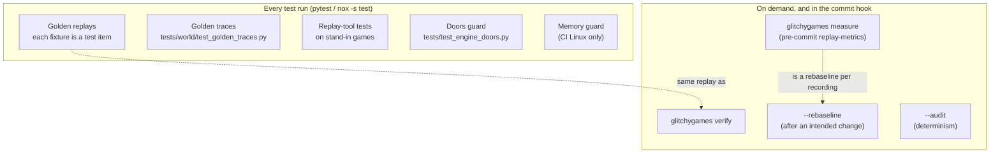
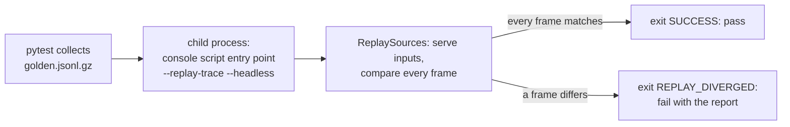
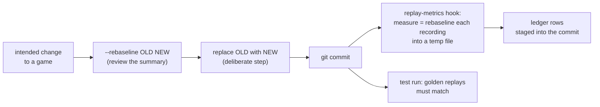
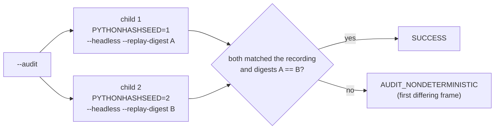

# How We Test Playback

Each tier checks something the others cannot see. The cheapest checks run on every test run;
the real games' replays run as test items too, in child processes, so the engine is exercised the
way a player's run exercises it.

## Golden replays

**Intent:** every game still plays its scripted session exactly as recorded, and every control it
binds still works.

- Each `src/<layer>/<member>/tests/fixtures/replays/golden*.jsonl.gz` (the `golden-globs` setting
  in `pyproject.toml`) is collected as one test item by the replay plugin
  (`src/glitchygames/testing/replays.py`, registered through the engine's pytest11 entry point).
- The item replays the recording **headless** in a child process, through the game's console
  script entry point (`--replay-trace PATH --headless --log-level warning`).
- It passes only if the child exits `SUCCESS`; otherwise it fails with the divergence report.
- `tests/replay/test_golden_replays.py` checks the fixtures themselves. Its controls rule is that
  every golden pauses and resumes, exercises every keyboard control the game binds, and ends with
  the game's own quit control (`test_every_golden_replay_exercises_every_control`), so a control
  that stops working makes its golden diverge.
- The goldens are recorded through the real engine by `scripts/record_scripted_session.py`, with
  `scripts/golden_inputs.py`.

## Golden traces

**Intent:** the games that existed before the world-space change still draw exactly what they drew
then (`tests/world/test_golden_traces.py`).

- The baselines in `tests/world/golden/` were recorded by `scripts/record_golden_traces.py` before
  the engine's world-space changes.
- Each test replays the same scripted run in-process, through the golden-trace harness
  (`src/glitchygames/replay/tools/golden_traces.py`), and compares every sprite's rect and
  visibility, frame by frame.
- A difference fails unless an `EXPECTED_DIFFERENCES` entry explains it, and an entry that
  explains nothing fails too, so the list cannot go stale.
- Later games are covered by their golden replays instead.

## Replay-tool tests on stand-in games

**Intent:** the engine's replay machinery works for **any** game, not just ours. Every tool, every
refusal, every exit code.

- Engine tests never import a workspace member (`tests/test_workspace_config.py`,
  `tests/test_suite_collection.py`), so they record and replay small stand-in games
  (`tests/stand_in_games.py`, `tests/stand_in_harness_games.py`).
- The end-to-end proof is `tests/replay/tools/test_an_unseen_game.py`: a stand-in game in its
  own git repository, run through every tool on both front ends.
- **Uncapped recordings, unless pacing is the point.** Stand-in live recordings
  (`record_stand_in_game`, in a headless child) are uncapped by default (`UNPACED_TARGET_FPS` =
  `'0'`): their frames never wait, and the engine skips measuring the machine's sleep model, so a
  20-frame recording costs its child's start-up and no more. The same frames and sprites are
  recorded either way. A test that reads the recorded frame times (a watched replay presents
  frames by them) or the run's pacing (`processing_paced`, its live frame times) asks for
  `paced=True`, which paces at `STAND_IN_GAME_TARGET_FPS` = `'60'` as a player's run is; each such
  call says why. Replays of either are unpaced, as every replay is
  (`tests/stand_in_games.py`).
- **Shared recordings.** A recording that tests only read is made once per test module
  (`record_stand_in_game_once`), and each test is handed its own copy of the file.
- **Unpaced engine runs.** Engine tests that need no pacing run uncapped (`--target-fps 0`, for
  example `tests/engine/test_engine_event_system.py`), so they never wait for a frame deadline.

## Verify, measure and rebaseline

- **`glitchygames verify`** replays every golden and bundled demo headless, each in a child (the
  same replay as the plugin's), one line each, then a summary. A replay still running after
  `REPLAY_TIMEOUT_SECONDS` = 300 s is stopped (`src/glitchygames/replay/tools/verify.py`,
  `children.py`). It always uses each recording's own seed and refuses `--random-seed`.
- **`--rebaseline NEW`** replays OLD's inputs on the current code, runs on past differences, and
  writes NEW with a summary of what changed (`src/glitchygames/replay/rebaseline.py`). It is how a
  golden follows an intended change. NEW replaces OLD only as a deliberate, reviewed step.
- **`glitchygames measure`** rebaselines each recording headless into a temporary file, in a
  child, and turns the result into ledger rows (`src/glitchygames/replay/tools/measure.py`).
  - The `replay-metrics` pre-commit hook (`scripts/measure_staged_replays.py`) runs it whenever
    this machine has not measured the staged code tree, so every commit carries its measurements.

Flags and exits: [Rebaselining](../gameplay_replay.md#rebaselining-rebaseline-new) and
[Tools for any game](../gameplay_replay.md#tools-for-any-game).

## The determinism audit

**Intent:** catch nondeterminism that slipped past the doors (`src/glitchygames/replay/audit.py`).

- `--replay-trace PATH --audit` runs the replay as **two fresh child processes**, headless, each
  with a different `PYTHONHASHSEED` (`AUDIT_HASH_SEEDS` = `'1'`, `'2'`) and a `--replay-digest`
  file: one SHA-256 per replayed frame.
- Fresh processes give fresh engine state, and different hash seeds expose set and dict ordering
  bugs.
- The audit fails if either run diverged from the recording, or if the two digest streams differ.
- It compares the sampled frame only (scene class, each sprite's rect, visibility and draw order),
  so nondeterminism that never moves, hides or reorders a sprite goes unnoticed.
- A child running longer than `AUDIT_REPLAY_TIMEOUT_SECONDS` = 3600 s is an `AuditRunError`.

Flags: [The determinism audit](../gameplay_replay.md#the-determinism-audit-audit).

## The doors guard

**Intent:** nothing in the engine reads input or time from outside the doors, so a replay reaches
all of it (`tests/test_engine_doors.py`).

- The test parses every engine source file and follows imports and aliases of the watched modules
  (`time`, `datetime`, `pygame` and its event, key, mouse, time and joystick modules, ...;
  `WATCHED_DOOR_MODULES`).
- It fails on any direct read outside `ALLOWED_BYPASSES` and `ALLOWED_FUNCTION_BYPASSES`, each of
  which names its reason.
- The allowed paths are those `src/glitchygames/clock.py` names: `measured_seconds()`, pacing, the
  performance statistics, the audio-glitch probe and the recording's own start stamp.

## The memory guard

**Intent:** a test that runs CI's 2 GB Linux container out of memory stops the run and names the
test, instead of the kernel killing the job silently (`tests/memory_guard.py`;
`tests/test_memory_guard.py`).

- It is on only when `GLITCHYGAMES_TEST_RSS_LIMIT_MB` is set; CircleCI's Linux job sets 1600.
- A background thread samples memory every `SAMPLE_INTERVAL_SECONDS`, and each test's start and
  end are checked too.
- It reads the container's memory (cgroup v2) where there is one, else this process's resident
  memory, and does nothing on macOS or Windows.
- It matters for playback because the golden replays and the tools' tests start child processes,
  and the container's figure counts them.
