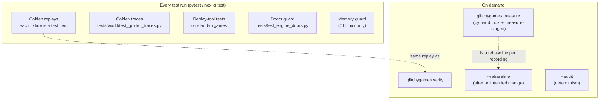
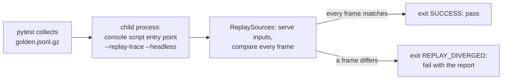
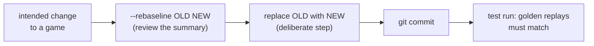
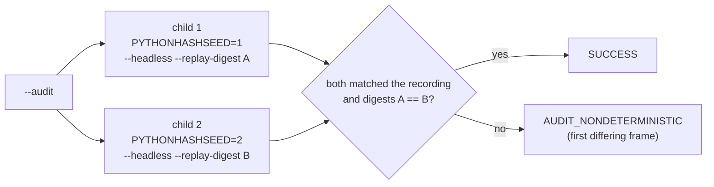

# How We Test Playback

Each tier checks something the others cannot see. The cheapest checks run on every test run;
the real games' replays run as test items too, in child processes, so the engine is exercised the
way a player's run exercises it.

## Golden replays

**Intent:** every game still plays its scripted session exactly as recorded, and every control it
binds still works.

- Each `src/<layer>/<member>/tests/fixtures/replays/golden*.jsonl.gz` (the `golden-globs` setting
  in `pyproject.toml`) is collected as one test item by the replay plugin
  (`src/glitchygames/testing/replays.py`, registered through the engine's pytest11 entry point).
- The item replays the recording **headless** in a child process, through the game's console
  script entry point (`--replay-trace PATH --headless --log-level warning`).
- It passes only if the child exits `SUCCESS`; otherwise it fails with the divergence report.
- `tests/replay/test_golden_replays.py` checks the fixtures themselves. Its controls rule is that
  every golden pauses and resumes, exercises every keyboard control the game binds, and ends with
  the game's own quit control (`test_every_golden_replay_exercises_every_control`), so a control
  that stops working makes its golden diverge.
- The goldens are recorded through the real engine by `scripts/record_scripted_session.py`, with
  `scripts/golden_inputs.py`.

## Golden traces

**Intent:** the games that existed before the world-space change still draw exactly what they drew
then (`tests/world/test_golden_traces.py`).

- The baselines in `tests/world/golden/` were recorded by `scripts/record_golden_traces.py` before
  the engine's world-space changes.
- Each test replays the same scripted run in-process, through the golden-trace harness
  (`src/glitchygames/replay/tools/golden_traces.py`), and compares every sprite's rect and
  visibility, frame by frame.
- A difference fails unless an `EXPECTED_DIFFERENCES` entry explains it, and an entry that
  explains nothing fails too, so the list cannot go stale.
- Later games are covered by their golden replays instead.

## Replay-tool tests on stand-in games

**Intent:** the engine's replay machinery works for **any** game, not just ours. Every tool, every
refusal, every exit code.

- Engine tests never import a workspace member (`tests/test_workspace_config.py`,
  `tests/test_suite_collection.py`), so they record and replay small stand-in games
  (`tests/stand_in_games.py`, `tests/stand_in_harness_games.py`).
- The end-to-end proof is `tests/replay/tools/test_an_unseen_game.py`: a stand-in game in its
  own git repository, run through every tool on both front ends.
- **Uncapped recordings, unless pacing is the point.** Stand-in live recordings
  (`record_stand_in_game`, in a headless child) are uncapped by default (`UNPACED_TARGET_FPS` =
  `'0'`): their frames never wait, and the engine skips measuring the machine's sleep model, so a
  20-frame recording costs its child's start-up and no more. The same frames and sprites are
  recorded either way. A test that reads the recorded frame times (a watched replay presents
  frames by them) or the run's pacing (`processing_paced`, its live frame times) asks for
  `paced=True`, which paces at `STAND_IN_GAME_TARGET_FPS` = `'60'` as a player's run is; each such
  call says why. Replays of either are unpaced, as every replay is
  (`tests/stand_in_games.py`).
- **Shared recordings.** A recording that tests only read is made once per test module
  (`record_stand_in_game_once`), and each test is handed its own copy of the file.
- **Unpaced engine runs.** Engine tests that need no pacing run uncapped (`--target-fps 0`, for
  example `tests/engine/test_engine_event_system.py`), so they never wait for a frame deadline.

## Verify, measure and rebaseline

- **`glitchygames verify`** replays every golden and bundled demo headless, each in a child (the
  same replay as the plugin's), one line each, then a summary. A replay still running after
  `REPLAY_TIMEOUT_SECONDS` = 300 s is stopped (`src/glitchygames/replay/tools/verify.py`,
  `children.py`). It always uses each recording's own seed and refuses `--random-seed`.
- **`--rebaseline NEW`** replays OLD's inputs on the current code, runs on past differences, and
  writes NEW with a summary of what changed (`src/glitchygames/replay/rebaseline.py`). It is how a
  golden follows an intended change. NEW replaces OLD only as a deliberate, reviewed step.
- **`glitchygames measure`** rebaselines each recording headless into a temporary file, in a
  child, and turns the result into ledger rows (`src/glitchygames/replay/tools/measure.py`).
  - `nox -s measure-staged` (`scripts/measure_staged_replays.py`) runs it by hand whenever this
    machine has not measured the staged code tree. It was the `replay-metrics` pre-commit hook
    until the owner stopped committing replay-ledger rows (2026-11-22; they move to S3).

Flags and exits: [Rebaselining](../gameplay_replay.md#rebaselining-rebaseline-new) and
[Tools for any game](../gameplay_replay.md#tools-for-any-game).

## The determinism audit

**Intent:** catch nondeterminism that slipped past the doors (`src/glitchygames/replay/audit.py`).

- `--replay-trace PATH --audit` runs the replay as **two fresh child processes**, headless, each
  with a different `PYTHONHASHSEED` (`AUDIT_HASH_SEEDS` = `'1'`, `'2'`) and a `--replay-digest`
  file: one SHA-256 per replayed frame.
- Fresh processes give fresh engine state, and different hash seeds expose set and dict ordering
  bugs.
- The audit fails if either run diverged from the recording, or if the two digest streams differ.
- It compares the sampled frame only (scene class, each sprite's rect, visibility and draw order),
  so nondeterminism that never moves, hides or reorders a sprite goes unnoticed.
- A child running longer than `AUDIT_REPLAY_TIMEOUT_SECONDS` = 3600 s is an `AuditRunError`.

Flags: [The determinism audit](../gameplay_replay.md#the-determinism-audit-audit).

## The doors guard

**Intent:** nothing in the engine reads input or time from outside the doors, so a replay reaches
all of it (`tests/test_engine_doors.py`).

- The test parses every engine source file and follows imports and aliases of the watched modules
  (`time`, `datetime`, `pygame` and its event, key, mouse, time and joystick modules, ...;
  `WATCHED_DOOR_MODULES`).
- It fails on any direct read outside `ALLOWED_BYPASSES` and `ALLOWED_FUNCTION_BYPASSES`, each of
  which names its reason.
- The allowed paths are those `src/glitchygames/clock.py` names: `measured_seconds()`, pacing, the
  performance statistics, the audio-glitch probe and the recording's own start stamp.

## The memory guard

**Intent:** a test that runs CI's 2 GB Linux container out of memory stops the run and names the
test, instead of the kernel killing the job silently (`tests/memory_guard.py`;
`tests/test_memory_guard.py`).

- It is on only when `GLITCHYGAMES_TEST_RSS_LIMIT_MB` is set; CircleCI's Linux and Raspberry Pi
  jobs set 1500 (1400 from 2026-11-19 until every machine collected the whole suite, #286).
- A background thread samples memory every `SAMPLE_INTERVAL_SECONDS`, and each test's start and
  end are checked too.
- It reads the container's memory (cgroup v2) where there is one, else this process's resident
  memory, and does nothing on macOS or Windows.
- It matters for playback because the golden replays and the tools' tests start child processes,
  and the container's figure counts them.

## A CI job split across machines

**Intent:** one CircleCI job ran past CircleCI's one-hour job limit running the whole suite on
one machine (Linux, jobs 3705 and 3707), so the Linux test job runs on six machines and the
Windows one on three (`parallelism`; two until 2026-11-20, Linux three until 2026-11-23), each
running a share (`tests/circleci_test_split.py`;
`tests/test_circleci_test_split.py`).

- It is on only when `GLITCHYGAMES_TEST_SPLIT` is `circleci`; the split jobs set it, and any
  other value stops the run. It needs CircleCI's `CIRCLE_NODE_TOTAL`, `CIRCLE_NODE_INDEX` and
  `circleci` command, so it is never set locally (`nox -s test-linux-ci` leaves it out).
- The share is chosen test by test, not file by file (the owner, 2026-11-23): whole files once
  put all 42 heavy inner-game replay cases on one machine (#285's Windows job 5051: 1,914 s
  against 1,312 and 1,297), concentrating the most taxing tests where load, timeouts and races
  bite. Every machine collects the whole suite (about 150 MiB more than collecting its own files,
  and a module-scoped fixture is set up on each machine that runs one of its tests: costs the
  owner accepted), then keeps its share.
- Tests marked `heavy_replay(reason=...)` are dealt first, round-robin in node-id order, so the
  machines' counts differ by at most one from their first run. Every other test, named as its
  JUnit report names it (`classname.name`, `junit_family=xunit1`, which the test session adds for
  a split job), goes sorted to `circleci tests split --split-by=timings --timings-type=testname`.
  Every collected test runs on exactly one machine. CircleCI's docs do not say which JUnit
  attributes `testname` matches: when none match, the splitter weighs the tests by name and says
  so in `test-results/test-split-messages-<pid>.txt`. The share is written to
  `test-results/test-split.txt`.
- No share reaches the 100% coverage rule alone, so the test session turns it off for a share;
  each machine keeps its `.coverage` in `coverage-data/<job>/`, and a `coverage-combine-*` job
  combines them on the job's Python and applies the rule (`nox -s coverage-combine-3.15`).

## Tests that time real work

**Intent:** a test that times real work against a tolerance measures the machine, not the code,
when other tests share its CPUs. #287's Windows job (5141) ran four workers on four CPUs, and a
timer accuracy test trailed the OS sleep by 19 ms against its 3 ms bound; the owner, 2026-11-23,
kept the workers and set these tests apart.

- Such a test carries `@pytest.mark.wall_clock(reason=...)` (registered in `tests/harness.py`).
  `tests/test_suite_collection.py` holds the swept files to it: a test there that reads the real
  clock is marked, or listed with why it bounds no duration.
- `nox -s test` runs the suite twice: every other test on its workers (`-m "not wall_clock"`,
  coverage rule off), then the marked tests alone, in one process (`-n 0 -m wall_clock`), given only the files that
  hold them (`noxfile.WALL_CLOCK_TEST_FILES`, held to the files using the marker by
  `tests/test_ci_config.py`) so the suite is not collected twice, appending to the first run's coverage, so the 100% rule is applied to both, and writing
  `test-results/junit-wall-clock.xml`. On a split CI machine each run is split on its own, and a
  machine dealt no marked test collects nothing (exit 5, which passes). `nox -s test-random`,
  the pre-push hook, splits its shuffled run the same way.

## The suite's order in CI

**Intent:** catch a test that passes only after, or only before, another on every CI platform and
driver, not only in the pre-push hook's shuffled run (`nox -s test-random`: 3.15, the dummy
drivers, the owner's Mac). Every ordinary run keeps the files' order (`-p no:randomly` in
`pyproject.toml`'s `addopts`).

- The test session reads `GLITCHYGAMES_TEST_ORDER`: unset or `fixed` keeps the files' order;
  `roll` flips a coin for fixed or shuffled and, for shuffled, draws a seed; a number shuffles
  with that seed. Anything else stops the run (`noxfile.choose_suite_order`).
- CircleCI's test jobs (macOS, Linux, Windows, the Raspberry Pi) set `roll`, so each machine of
  each job rolls for itself. On CircleCI nothing is drawn: SHA-256 of the workflow's workspace
  ID (`CIRCLE_WORKFLOW_WORKSPACE_ID`), the job and the machine index gives the coin and the seed.
  Each pipeline has a new workspace, so each push rolls anew, and "Rerun workflow from failed"
  keeps it, so a rerun repeats its first run's roll and a shuffle-only failure comes back rather
  than vanishing. That a rerun keeps the workspace ID (and gets a new `CIRCLE_WORKFLOW_ID`) is a
  community report, not CircleCI documentation: compare a rerun's order with its first run's
  before relying on it. Without a workspace (a local run) a roll is a random draw.
- The job's log names the order before the tests start ("Test order: shuffled, seed N" or
  "Test order: fixed"), with the workspace, the machine and whether the workflow is a first run
  or a rerun (its workflow ID differs from its workspace ID), and again after a failure, with the
  command that replays it. The same goes to `test-results/test-order.txt` (in the job's
  artifacts, uploaded even when the tests fail). A split machine shuffled only its share: name
  the tests kept in its `test-results/test-split.txt` to replay its order; a rerun may give a
  machine slightly different tests if CircleCI's timings changed in between.
- A shuffle only reorders (`--randomly-dont-reset-seed`, as `nox -s test-random`), so coverage,
  the driver comparison and each test's own randomness are unchanged.

- The first rolled run found one (CircleCI job 4458, seed 4083822362): the zombies game's
  scene-name test imported every module of the package, `__main__` included, and a later
  `python -m` test then tripped runpy's warning that `__main__` was already imported. The walk
  now skips `__main__`, and every `python -m` test runs through
  `glitchygames.testing.entry_points.run_package_as_main`, which removes `<package>.__main__`
  from `sys.modules` first; `tests/test_suite_collection.py` fails on any direct
  `runpy.run_module` in a test.

## Docs-only pull requests

**Intent:** a pull request that changes only Markdown (a plan, a bug file, the docs' prose, a
rule) needn't wait for the test jobs: a plan-only one waited hours for the single macOS queue,
holding back code pull requests (the owner, 2026-11-20).

- `.circleci/config.yml` is a setup configuration: its one small job lists the branch's change
  since it left main (`git diff --name-only --no-renames` against the merge-base, both sides of a
  rename) and runs `scripts/ci_change_scope.py`, which uses Python's standard library only, so
  nothing is installed first. It continues with `.circleci/continue_config.yml`, which holds every
  job, passing the `test-scope` parameter.
- "Markdown only" is the pre-commit hooks' own definition: every changed path matches their
  `exclude`, `\.md$` (a Markdown-only commit runs no hook). One definition:
  `tests/test_ci_change_scope.py` holds the script's pattern to the hooks' file.
- `test-scope` is `markdown` for such a branch: the macOS, Linux and Windows test jobs, the
  coverage combines and `checks-linux` (whose only Markdown check is the strict docs build) are
  left out (each carries `filters: pipeline.parameters.test-scope ==
  "all"`), and `markdown-checks` runs on one Linux machine instead: the strict docs build and the
  tests that read Markdown (`nox -s test-markdown`). Main, a tag, any other change, or a change git
  can't list gets `all`.
- The tests that read Markdown are `noxfile.MARKDOWN_TEST_FILES`, which
  `tests/test_ci_config.py` holds to exactly the test files that name a Markdown file in their
  code (a string ending `.md`, or a `*.md` pattern; docstrings and comments don't count), less
  `noxfile.MARKDOWN_NAMED_BUT_NOT_READ_TEST_FILES`: the files that name a Markdown file but read
  none of the repository's (a report they write themselves, such as the channel-fade audio test's
  and the logging-cost benchmark's, or a path quoted in a reason), each with its reason. A
  docs-only change doesn't run them
  (#295's `markdown-checks` job ran the audio test and lost it to the disk audio driver). An
  exception that no longer names a Markdown file fails as stale. A test that reads Markdown
  another way isn't detected: add it to the list by hand.
- The workflow is still `build-and-test`, the check main's ruleset requires, so a docs-only pull
  request can still merge.

## Memory by test file

**Intent:** when the guard stops a run, find which test files make the test process grow
(`tests/memory_by_file.py`; `tests/test_memory_by_file.py`).

- It is a plugin loaded on request, never by default:
  `GLITCHYGAMES_MEMORY_BY_FILE=rows.json pytest -p tests.memory_by_file -n 0`.
- Per file it writes `kept` (resident memory at the file's end less at its start, with garbage
  collected at both ends), `peak_rise` (the most above that start after any of its tests) and
  `after`, all in MiB. The rows are rewritten after every file, so a run the guard stops keeps
  the files it finished.
- It reads `/proc/self/statm` on Linux and `task_info` on macOS; elsewhere it says so once and
  does nothing. It counts this process only, not the children a test starts.
- macOS keeps freed memory differently from glibc: use its figures to rank files, and
  `nox -s test-linux-ci` for the numbers CI sees.
- To see which code holds Python memory after a file (by allocating line or by the engine
  frame that allocated it), use `uv run python -m scripts.memory_triage` (`collection`, `held`,
  `traced`, `per-test`). The November 2026 triage it came from is
  `bugs/2026-11-17-linux-test-memory-guard-stops.md`.
