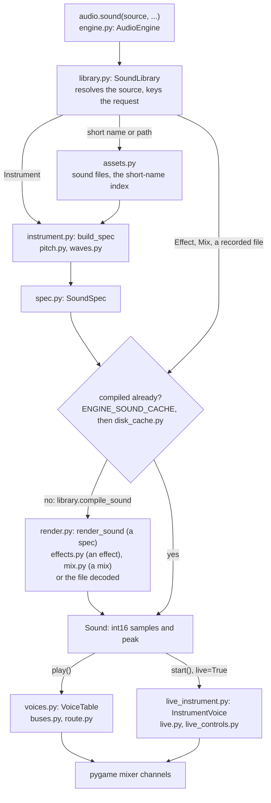

# Sound

The sound engine's first milestone (M1) gives every game one call for sound:
`scene_manager.audio.sound(...)`. It takes a short name, a path, an `Instrument` or a `Mix`,
compiles the sound the first time it is asked for, and hands back the same compiled sound on
every later request. Getting a sound never plays it.

The design is in two specifications:

- [Sound engine feature specification](../specs/2026-11-02-sound-engine-feature-spec.md): what
  the engine does, with the requirement ids (`AUD-*`) used below.
- [Sound engine implementation specification](../specs/2026-11-02-sound-engine-implementation-spec.md):
  how each requirement is met, the decision and risk registers, and the measurements.

M2 adds live instruments (sounds that follow game parameters: `Sound.start()` and its
`LiveSoundHandle`), moves the five games onto this API and removes the old sound paths:
`SoundBank`, `load_sound`, `live_audio.create_voice` and `LiveVoice` are gone (sound migration
step 7, plans/2026-11-14-sound-migration.md).

## One call

```python
from glitchygames.audio import Instrument
from glitchygames.scenes import Scene


class Game(Scene):
    def setup(self):
        audio = self.scene_manager.audio
        self.coin = audio.sound('coin')                        # a short name
        self.slap = audio.sound('sounds/sfx_slap.wav')         # a path
        self.zap = audio.sound(Instrument(wave='square'), pitch='C5', length=0.1)
        self.jingle = audio.sound('coin', notes='C5:0.1 E5:0.1 G5:0.2')

    def on_key_down_event(self, event):
        self.coin.play(volume=0.8, pan=-0.5)                  # a SoundHandle
```

- `audio.sound(source, *, pitch=None, notes=None, chord=None, length=None, transpose=0.0,
  parameters=None)` returns a compiled `Sound`. What it is (the source and those arguments) is
  its identity: the same identity is compiled once and cached.
- `Sound.play(*, volume, pan, bus, priority, loop, persist, ...)` plays it and returns a
  `SoundHandle`: `stop(fade=...)`, `cancel()`, `release()` (a loop ends after its pass),
  `set_volume(volume, fade=...)`, `set_pan(pan)` and `is_playing`. Every method answers False
  once the voice has ended, and never touches a later voice on the same channel.
- `audio.play(source, ...)` is `audio.sound(source, ...).play(...)` in one call, and
  `audio.beep(pitch='A4', wave='square', length=0.1)` plays a basic wave.
- Pitches may be note names (`'A4'`, `'C#5'`), hertz (`Hz(440.0)` or a float), MIDI numbers
  (`Midi(69)`) or scale steps (`Scale('C', 'major').step(2)`, step 0 being the root in octave
  4), mixed freely. A4 is 440 Hz.
- Waves are named (`sine`, `square`, `saw`, `triangle`, the pulse widths, ...), and new ones can
  be mixed, blended, drawn as points or built from harmonics (`Wave`, `Harmonics`,
  `WavePoint`, with the `CYCLE` and `LEVEL` named positions). Each engine context has its own
  wave registry.

Declare every sound the game plays on the scene class it hands `GameEngine`, as `SOUNDS`
(effects, a sound file's `path#name` entries, mixes, live instruments and unpitched ones; a
pitched sound needs a sound file's entry or a mix's part, which holds its notes): the engine
compiles them when the game starts,
in the CRT power-on's spare time, a slice a frame, and finishes them before the game is built (at
once where the power-on is skipped). The game's own requests then find each one compiled. A game
that declares none makes no audio engine for them. A sound first asked for during gameplay still
compiles in that frame, and the engine counts it and lists it by name in the Audio panel as a
gameplay compile, so you can add it to `SOUNDS`. A setup whose compiles take more than 50 ms logs
one INFO line naming its slowest sounds.

## Short names and paths

A short name (`'coin'`) is looked up in the active scene's `SOUND_DIRECTORY` (a class attribute,
`'sounds'` by default), relative to the scene's package directory. Every sound file there
contributes its `[sounds.*]` and `[effects.*]` tables by name (a version 0 file, its
`[recipes.*]`); two files defining the same name are an error naming both. A
recorded file is a short name too: `sounds/sfx_slap.wav` is `'sfx_slap'`.

A path (`'sounds/pickups.toml#coin'`, `'sounds/sfx_slap.wav'`) is relative to the scene's package
directory and always works, whatever the short-name index holds.

A sound file is TOML (version 1):

```toml
[glitchygames]
kind = "sounds"
version = 1

[instruments.pickup]
profile = "chip"
envelope = { attack = 0.002, decay = 0.04, sustain = 0.0, release = 0.02, curve = "steps(16)" }

[instruments.pickup.sources.tone]
wave = "pulse_25"

[sounds.coin]
instrument = "pickup"
notes = "B5:0.06 E6:0.18"
bus = "effects"
volume = 0.6
```

Version 0 recipe files (`[recipes.*]`) still load and sound exactly as before;
`glitchygames sound-migrate FILE` converts one to version 1.

## Effects

An effect is a synthetic sound effect: tones mixed straight, exact and cheap (blips, sweeps,
crunches, jingles). It is one of the two kinds of sound; instruments are the other, the layered
renderer for music and live sounds. Both play through `audio.sound(...)`.

```python
from glitchygames.audio import Effect, Envelope, Tone, Waveform

JUMP = Effect(
    name='jump',
    volume=0.35,
    tones=(
        Tone(waveform=Waveform.SQUARE, start_frequency=330.0, end_frequency=660.0, duration=0.1,
             envelope=Envelope(attack=0.005, decay=0.03, sustain_level=0.6, release=0.05)),
    ),
)
audio.sound(JUMP).play()   # plays at its own volume unless play(volume=...) says otherwise
```

In a sound file, an effect is an `[effects.<name>]` table, the same fields as data:

```toml
[effects.jump]
volume = 0.35

[[effects.jump.tones]]
waveform = "square"
start_frequency = 330.0
end_frequency = 660.0
duration = 0.1
envelope = { attack = 0.005, decay = 0.03, sustain_level = 0.6, release = 0.05 }
```

Like a `[sounds.*]` table, it is a short name (`'jump'`) as well as a path
(`'sounds/jumps.toml#jump'`); one file may not use a name for both.
`audio.sounds.add_effects([...])` registers effects by name, looked up before the sound directory.
Each tone is oscillator, distortion, filters, tremolo, envelope, volume; the tones are mixed at
their offsets and normalized to `peak`, or left exactly as summed with `normalize=False`.

## Mixes

A `Mix` is several instrument parts compiled into one sound (`src/glitchygames/audio/mix.py`):
a score's layers, say, played as one buffer on one channel instead of a sound and a channel each.
Its parts are rendered and added at their volumes, and the result is cached as every sound is
(the process's memory, then the disk layer, else compiled and written), so the first request
builds it and every later request, in this launch or a later one, gets the built copy.

```python
from glitchygames.audio import Mix, MixPart, instruments

loop = audio.sound(Mix(
    name='stage',
    parts=(
        MixPart(instrument=instruments.get('theremin'), notes='D5:1 A4:1 _:2', volume=0.3),
        MixPart(instrument=instruments.get('timpani'), notes='D2:1 _:3', volume=0.3),
    ),
    loop_seconds=2.0,
))
loop.play(loop=True, bus='music')
```

With `loop_seconds` the mix is exactly that long, so `play(loop=True)` repeats it in time, sample
for sample. A melody rendered alone can't loop in time: its length drops a trailing rest and adds
the instrument's release tail. A looping mix keeps the rest as silence and adds every frame past
its end back onto its start, as a tail would ring into the next pass. Without `loop_seconds` it is
as long as its longest part, tail included.

Its identity is a digest of its name, its parts' own keys, their volumes, the loop and the mixer's
rate, so
changing any part's notes or volume builds a new mix. Each part is seeded from
`<mix name>-part-<index>`. A mix takes no `pitch`, `notes`, `chord`, `length` or `transpose`
(its parts carry their notes), and a live instrument can't be a part. A mix may be declared in
`SOUNDS`, so a score on catalog instruments is built while the game starts. Zombies Ain't My
Neighbors' score is three mixes, declared so (feature plan 11).

## Live sounds

A live sound is rendered while it plays, chunk by chunk, so the game can move it: an engine
whose pitch follows its speed, a projector whose flutter follows the action. It is an
`Instrument(live=True)` with **parameters** the game sets and **routes** that map each onto what
the sound does:

```python
from glitchygames.audio import Instrument, Parameter, Route, Tremolo
from glitchygames.audio.instrument import Filter

MOTOR = Instrument(
    wave='saw',
    live=True,
    filter=Filter('low_pass', 600.0),
    tremolo=Tremolo(rate_hz=8.0, depth=0.4),
    parameters={'speed': Parameter(range=(0.0, 1.0), default=0.0)},
    routes=[
        Route(source='speed', destination='pitch', curve='exponential', output=(45.0, 110.0)),
        Route(source='speed', destination='level', output=(0.2, 0.85)),
    ],
)

motor = audio.sound(MOTOR).start(owner=ride)   # a LiveSoundHandle
motor.set('speed', 0.7)                        # each frame, or whenever it changes
motor.release()                                # fades it out over 100 ms
```

- **Parameters** clamp to their range (each clamp counted, `handle.clamp_count`) and glide to a
  new value: one-pole, with `smoothing_ms` (30 by default) as its time constant, or with
  `glide='linear'` a straight line that arrives in `smoothing_ms`. Any number of `set` calls before a chunk count as the last one.
- **Routes** (at most 8) map a parameter onto `pitch` (Hz), `level` (multiplied in),
  `filter.cutoff`, `tremolo.rate`, `tremolo.depth` or `sources.<name>.level`, by a curve:
  `linear`, `exponential`, `logarithmic`, `smoothstep` or `steps(n)`. Levels multiply; pitch,
  cutoff and the tremolo take one route each. A route needs the filter or tremolo it moves.
- **Sources** are sine, square, saw, triangle and white noise for now, each with its own level
  and `semitones`/`detune_cents`. `chunk_seconds` (0.03-0.5, default 0.1) is its latency.
- **`start(parameters=, volume=, owner=, persist=, pan=, bus=, priority=)`**: the owner (the
  scene that starts it, by default; a transition keeps it playing through the ride) decides when
  it pauses and ends, as for baked plays; `persist=True` outlives the owner. Pan, bus and priority
  default to the sound file's; every sound pans by the constant-power law, so centred is 3 dB
  down on each side. A full live pool (`--live-voice-pool`, 4) steals the lowest-priority voice
  at or below the new one's, else refuses with `ValueError`.
- **The handle:** `set`, `release()`, `stop(fade=)`, `cancel()` (at once, the chunk already
  queued included), `set_volume(volume, fade=)`, `set_pan`, `pause()`/`resume()` (a pause holds
  whatever the scene rules say), and `set_frequency`, `set_cutoff` (None removes the filter) and
  `set_tremolo` (None removes it) for what no route moves. Like a `SoundHandle`, every method
  answers False once the sound has ended; both kinds are a `PlayingSound`.
- `play()` refuses a live sound and `start()` a baked one. A live sound compiles nothing, so it
  costs nothing to declare in `SOUNDS`.
- **Its chunks:** a live voice keeps one chunk playing and one queued on its pool channel, and
  holds its own reference to each until the channel has moved past it (at most two;
  `LiveStream.held_chunks`). pygame-ce 2.5.8 frees a queued Sound twice when pygame's channel
  table holds the only references
  (`bugs/2026-11-24-pygame-mixer-frees-a-queued-sound-twice.md`, `docs/quality/upstream_issues.md`).
- **A game's end releases its live voices**, persisting ones included: `SceneManager.terminate`
  releases them, since nothing updates them once the game has ended. A voice dropped without
  being released is stopped by its stream's finalizer and reported, in the log and in its
  engine context's registry of live streams (`LIVE_STREAMS_SLOT`, a diagnostic the test harness
  reads after every test). A test that starts live voices releases them (`release_voice`,
  `release_every_voice`, `stop_now`), or ends the game through `SceneManager.terminate`; the
  harness fails a test that leaves one unreleased.

In a sound file:

```toml
[instruments.motor]
live = true
tremolo = { rate_hz = 8.0, depth = 0.4 }

[instruments.motor.sources.main]
wave = "saw"

[instruments.motor.filter]
type = "low_pass"
cutoff = 600.0

[instruments.motor.parameters.speed]
range = [0.0, 1.0]
default = 0.0

[[instruments.motor.routes]]
from = "speed"
to = "pitch"
curve = "exponential"
output = [45.0, 110.0]

[sounds.motor]
instrument = "motor"
```

Route outputs are numbers (hertz for pitch). Live voices, their parameters and routes:
`audio/live_instrument.py`, `audio/live_controls.py`; their channel and pool: `audio/live.py`.

## Cache modes

`--sound-cache` chooses how compiled sounds are kept (replay-local: a recording replays under any
mode):

| Mode | What happens |
| --- | --- |
| `ram` | Compiled sounds stay in memory. Above `--sound-cache-memory` (256 MB) the least recently played sounds that are not playing are dropped, and compiled again on their next request (counted). |
| `none` | Nothing is kept: every `play()` compiles in its frame. This is the switch that shows what compiling in gameplay costs. Getting a sound renders nothing, and a sound played 5 times compiles 5 times. What a game reads of a sound never depends on the cache (a replay may run under another mode): a synthesized sound's `length` is worked out without rendering, exactly as a compile would size it; whatever only a compile can tell (every `peak`, and a recorded file's `length` and rate) comes from one compile (a recorded file's, a decode) on its first read, counted like any compile, then kept. A play's compile gives them too, so a read after a play compiles nothing more. |
| `disk` (default) | As `ram`, and each compiled sound is also kept as a file in the game's own folder, `<root>/<game package>/sounds/<render version>/<key[:2]>/<key>.wav`, so a later launch reads it back instead of compiling (faster on every machine measured, a Raspberry Pi's SD card included: `scripts/benchmark_sound_cache.py`). A read writes nothing; each game's folder is limited to 64 MB, oldest written files pruned at startup. `GLITCHYGAMES_SOUND_CACHE_ROOT` names the root (unset: the platform's cache folder; empty: no disk layer, so `ram`; the test harness sets it empty). In the browser it works the same way: the page mounts IndexedDB at the cache root (`browser/boot.py`) and writes each burst of new sounds back to it, so a later visit reads them instead of compiling (Zombies Ain't My Neighbors' title setup: about 0.6-0.7 s of compiling on a first visit, under 50 ms on the next, in Chromium and WebKit). Compiled sounds are also shared by every engine context in a process (an Arcade tile's restart compiles nothing). |

Whichever way a sound is made, compiled or read from the disk, it keeps only its int16 samples
(and its peak): the float64 render is dropped once those are made from it
(`Sound.release_float_samples`), as it was four times their size and only an offline render reads
it, which compiles a copy. Playing makes one more copy, the mixer's stereo 16-bit sound.
`uv run python -m scripts.measure_sound_memory` reports what each game's declared sounds hold and
where (the zombies game: 9 MiB on a first launch, down from 20 MiB with the float64 renders kept).

A game's start also removes its own folders for older render versions: only an older engine
wrote them. A newer version's folder is kept, since another engine on the machine (a branch with
a bumped render version) may share the root.

### Managing the disk cache

Five tools work on the cache, each a flag on every game (acting on that game's own folder) and a
`glitchygames` subcommand. With no game named, the subcommand works on the whole root; with
`--game GAME` (given once per game) it starts each game with the flag. All five refuse (exit 64)
when `GLITCHYGAMES_SOUND_CACHE_ROOT` is empty, since there is then no disk cache.

| Command | What it does |
| --- | --- |
| `glitchygames sound-cache-list` | One line per game and render version (sounds, size, whether stale), a line per listening folder, then the total. |
| `glitchygames sound-cache-size` | The whole cache in one line, stale versions counted apart, the listening files after. |
| `glitchygames sound-cache-verify` | Reads every file back and lists each damaged one and why; removes nothing (a game's read already replaces a damaged file, silently). Exits 65 when a file is damaged. |
| `glitchygames sound-cache-clear [--stale-only] [--listening]` | Removes cache folders, and never anything else under the root (it may be a folder of the player's). `--stale-only` removes only older render versions. `--listening` removes the listening WAVs (below) instead of the games' sounds; nothing else ever removes them. |
| `glitchygames sound-cache-fill` | Compiles each game's declared sounds (`SOUNDS`) and the CRT power-on's into its folder, so even a first launch reads them all. With no `--game` it fills the project's `[tool.glitchygames] games`. Live sounds and recorded files are never cached. Running it twice writes nothing more. |

The logic is one engine API, `glitchygames.audio.cache_inventory` (`inventory`, `clear`,
`verify`, `fill`, returning frozen models), which the tools, the tests and the sound editor all
call.

## Voices, channels and buses

The mixer's channels are partitioned once at startup: the live voice pool (`--live-voice-pool`,
4), then the sound library's channels (`--sound-channels`, 32), then pygame's 8 for legacy
`Sound.play()` callers. Neither side can take the other's channels.

A play takes the lowest free library channel its bus may use. When none is free it steals a
playing voice of lower or equal priority (releasing voices first, then the lowest priority, the
earliest play): the stolen channel fades with `Channel.fadeout(10)` and the new sound starts on
another free channel, or on the stolen one a frame later (a *delayed play*). A play with nothing
to steal is dropped. Steals, delayed plays and drops are counted.

What a game sees never depends on the audio device: `is_playing` and voice endings follow each
voice's played time, which advances by the frame's served `dt` (the recorded `dt` in a replay),
so a replay sees the same answers. Frames run in silence (a watched replay's step-back rebuild,
an instant replay's fast-forward) only quiet the channels: their voices go on by frame time, so
`is_playing`, voice endings and steals are the same as when those frames were heard.

Buses form a tree under `master`: `music`, `effects`, `ui`, `ambience` and `dialogue` always
exist (`ui` and `music` keep two channels each that a storm of effects cannot take), and
`audio.buses.add(name, parent=...)` adds more. A bus has a `volume`, `mute` and `solo`; changes
reach every playing voice of the bus at the next frame. `audio.stop_all(fade=..., bus=...)` fades
a bus and the buses under it, or everything.

Plays belong to the scene that started them. When a scene is switched away from directly, its
voices fade over 50 ms unless they were played with `persist=True`; behind a pause screen they
pause and resume.

### Fades on the device (measured)

SDL_mixer (2.8.2 with pygame-ce 2.5.8) changes a channel's level only between mixer chunks, 512
frames (11.6 ms) at 44.1 kHz. Measured through SDL's disk audio driver
(`tests/audio/test_channel_fades.py`; the steal's ordering, which depends on when the mixer
thread runs, in `tests/benchmarks/test_channel_fade_relations.py` under `--benchmark-only`):

- `Channel.fadeout(10)` (a steal) is one plateau or an immediate halt, and `Channel.play` straight
  after it replaces the fading sound at the next chunk, so the engine keeps its one-frame wait.
- The wait orders the fade before the stealer only if the mixer thread mixes a chunk during that
  frame. A mixer thread kept off the CPU for longer than a frame mixes the stealer into the fade's
  first chunk, the same cut as playing at once, so the delayed benchmark needs only
  `MINIMUM_DELAYED_STEAL_TRIALS` of its trials to show the wait. Both steal benchmarks report
  every trial, passing or not (the action chunk, both tones' levels in it, and whether the
  stealer is absent from it and sounds after it), to `test-results/channel-fade-steal-delayed.md`
  and `channel-fade-steal-immediate.md`, so a flaky run can be diagnosed afterwards.
- A volume or bus fade stepped once per frame over 50 ms reaches the channel as three gain steps
  of a third, each at a chunk boundary.
- The CRT skip's `Channel.fadeout(20)` is one or two plateaus and then a halt.

None of these is a smooth ramp by the feature spec's discontinuity metric (16.1), so steals,
short fades and the CRT skip can click. Whether they are heard is the owner's listening check;
the fallback, fades rendered into the sound by the engine, is the owner's decision (impl spec
risks R4 and R5).

## Inner games

An outer game (the Arcade) runs other games inside itself as inner games
([Engine context](engine_context.md), "Inner contexts"), and only the one it watches is heard (Arcade
sub-plan 4, `plans/2026-11-13-arcade-4-sound.md`; `src/glitchygames/audio/route.py` and the
docstring of `src/glitchygames/audio/voices.py` are the contract):

- **One audio route per engine context.** The default context (an ordinary game, or the Arcade
  itself) is audible; a new inner game is silent, and its host makes one heard with
  `InnerGame.set_audible(audible=True)` (`InnerGame.audible` tells which). Keeping one heard is
  the host's job: the engine lets two be heard at once, one per heard set (the next made heard
  before the last is silenced, a crossfade), and refuses a third (`InnerGameChannelsError`). What a game sees
  (`is_playing`, voice endings, steals, a live voice made or refused) is the same heard or
  silent, so every tile replays as it does alone.
- **Declared once, before anything plays.** An ordinary game's partition is exactly as above.
  A host declares how many inner games it runs: `INNER_GAMES = 6` on its scene class (its
  engine declares them at construction, before the CRT power-on plays), or
  `glitchygames.audio.reserve_inner_game_channels(games=..., heard_set_channels=32,
  live_channels_per_game=4)` after `GameEngine(...)` and before `start()` (it has that engine
  partition first, so the inner games' channels lie above its partition; without an engine the
  mixer must be partitioned already, or the declaration is refused). The mixer grows that
  once, right above the default partition, to two **heard sets** of library channels and a
  **live pool** per inner game, with the legacy channels above them all; it never grows again
  (growing it while a sound plays corrupts pygame's channel table: BUGS.md #145, so a growth
  then is refused, by the declaration and by any partition, `MixerBusyError`). A second host's
  declaration while inner games hold channels raises `ChannelsHeldError`; finish them first.
  A host finishes every inner game it drops (`InnerGame.finish()`): an unfinished one keeps
  its live pool, so a host looping tiles without finishing them runs out of its declaration.
- **An inner build never partitions the mixer.** Its sound library has its recording's
  `--sound-channels` as slots, so its steals and drops are the game's alone, and plays them on
  a heard set only while it is heard: the two sets alternate, so the game switched away from
  fades out on its set while the newly heard one starts on the other. Its live voices take a
  live pool (`--live-voice-pool` up to the declared size). A tile built with nothing declared,
  or past the declared count, fails alone (`InnerGameChannelsError`); one whose
  `--sound-channels` outnumber a heard set's channels replays silent and refuses to be heard.
- **A silent tile touches no channel.** Its voice table makes no mixer call; while it builds,
  steps or finishes every channel is reserved, so a plain `pygame.mixer.Sound.play()` (a game's
  own) returns None and starts nothing, as on a busy mixer; its live voices play
  chunks at volume 0 on its own pool.
- **Switching.** A heard tile's plain plays are heard, and followed: each step notes the
  unreserved channels it started a sound on. Switching it silent (or its finish) fades its
  voices over 50 ms, stops its plain plays still playing that very sound and mutes the chunks
  on its live pool at once; the host's sounds and another tile's are never touched. A tile
  switched heard is heard from its next sound (its live voices from their next chunk).
- **Silenced frames** (`FrameSilencer`) in an inner context stop only that context's channels
  (its heard set, live pool and plain plays), never `pygame.mixer.stop()` and never the music.
- `pygame.mixer.music` is still one per process (no game uses it).

The proof is `tests/test_every_recording_replays_inside_an_inner_game.py`: every golden and
bundled demo, as a tile beside another, matches its solo replay's digests and pixels with every
tile silent and with the first tile heard for the middle third of its recording; while no tile
is heard nothing a tile played sounds. The stops and mutes are hard cuts, which may click when
heard games are switched quickly (the owner's listening check, `plans/future-work.md`).

## Accounting

Every compile, file decode and cache read is timed. Each frame's audio work goes to the
recording doors as `audio_seconds` (the total) and `audio_work` (`(kind, name, microseconds)`
entries, at most 32 a frame: past that, the 32nd is `other`, the rest summed), so a recording holds what audio cost
frame by frame; the times are measurements and never change what is drawn or played.

`audio.diagnostics()` returns the totals: voices playing and the voice limit; compiles and their
milliseconds, split into setup and gameplay; the last 32 gameplay compiles with their frames;
stolen voices, delayed plays and dropped plays; the device format; and the cache's hits, misses,
compiles and bytes held.

## The Audio panel

The debug overlay (`--debug-overlay`, F3; F4 cycles panels) has an Audio panel after
Performance. `--sound-diagnostics` opens the overlay on it. It shows the cache mode, the mixer's
format and the voice counts; an audio-time graph stacked by kind of work (compile red, decode
orange, live blue, cache grey) on the same time axis as the frame-time graph; a strip with one
cell per channel (idle, playing, fading, paused; a stolen channel flashes); the bus meters (a
soloed bus is marked); and the compile log, with gameplay compiles in red. Under the All panel
only its header lines are drawn. The panel is built from `AudioEngine.snapshot()` only while
the overlay is visible, and never appears in screenshots.

## The CRT power-on sound

The CRT power-on sequence (`src/glitchygames/crt_power_on.py`) plays with a sound
(`src/glitchygames/crt_power_on_sound.py`, feature spec 12.1): a power click and a 60 Hz degauss
thump at the switch, the flyback whine from the dot, static as the picture opens, then the bars'
1 kHz tone (or channel 3's hiss). All are `Instrument`s requested through
`audio.engine_sound(...)`, the engine's own sounds' `audio.sound`.

They compile once per process, on the first power-on that plays its sound, and every later
power-on reuses them: a second game run in one process (the Arcade, the test harness's repeated
engines) and every engine context compiles nothing for the CRT. The compiled samples are kept in
the engine's process-wide cache (`glitchygames.audio.library.ENGINE_SOUND_CACHE`), keyed by each
sound's identity key, which holds the mixer's rate and the tuning: a mixer restarted at another
rate compiles them anew. Only the samples are shared, read-only; each context gets its own
`Sound` over them (its own player and pygame sound), and game sounds stay in each context's
library. The cache is exempt from the memory limit's eviction and from `--sound-cache none` (the
CRT is the engine's, not something a game benchmarks): under `none` the CRT's plays compile
nothing. The first compile is counted and attributed like any compile in the context that
triggered it; every reuse is a cache hit. Headless runs, tests that never power on and
`--crt-power-on-sound off` compile nothing.

The cues follow the progress that draws the picture, each starting on the frame nearest its point,
so at a steady 60 frames a second or more every onset is within 10 ms of its point (AUD-CRT-001);
a hitch can delay a cue by a frame.

A key or button skips the sequence and fades every CRT voice over 20 ms (on the device: a plateau
or two and a halt, as measured above). Otherwise the tail loops into the game and fades over
500 ms from frame 0's first audio update. `--crt-power-on-sound off` plays the picture silently;
the sound never plays where the picture does not (`--headless`, tests, replays, recordings).

## The instrument catalog

`glitchygames.audio.instruments` holds 707 ready-made instruments in 23 families. Each is an
ordinary `Instrument`, built from the engine's own parts (waves from overtone series, noise,
layers with their own envelopes and pitches, filters and drive), so it compiles, caches, plays
and renders offline like any other:

```python
from glitchygames.audio import instruments

violin = instruments.get('violin')                       # built once, then kept
tune = audio.sound(violin, notes='G3:0.5 D4:0.5 A4:1')
instruments.entry('alto saxophone').playing_range        # (Note('Db3'), Note('Ab5'))
instruments.names(family=instruments.Family.BRASS)       # every brass instrument
instruments.names(tag=instruments.Tag.MECHANICAL)        # every entry carrying a tag
instruments.names(tag=instruments.Tag.CHIP)              # every sound-chip voice
instruments.get('slapstick')                             # an alias: the same instrument as 'whip'
```

| Family | Entries | Examples |
| --- | --- | --- |
| `flutes` | 33 | piccolo to contrabass flute, wooden flutes, sopranino to subcontrabass recorders, whistles, shakuhachi, ocarinas, and 3 sound-alikes (csakan, subcontrabass recorder, ryuteki) |
| `clarinets` | 10 | E-flat to contrabass clarinet, basset horn, chalumeau, and 1 sound-alike (c clarinet) |
| `saxophones` | 11 | sopranino to contrabass, C melody, and 3 sound-alikes (soprillo saxophone, tubax in eb, heckelphone clarinet) |
| `double reeds` | 25 | oboe family, bassoon and contrabassoon, heckelphone, sarrusophone, shawms, crumhorns, suona, zurna, duduk, and 2 sound-alikes (contraforte, piccolo heckelphone) |
| `bagpipes` | 9 | Highland, uilleann, smallpipes, gaita, gaida, musette, sackpipa (drones built in) |
| `free reeds` | 13 | accordions (dry, musette, bass), bandoneon, concertina, harmonium, harmonicas, melodicas, sheng (no sound-alikes yet) |
| `brass` | 44 | piccolo trumpet to contrabass tuba, alto to contrabass trombone, mutes, historic and folk horns, and 2 sound-alikes (bass wagner tuba, soprano trombone) |
| `bowed strings` | 29 | violin to double bass, sections, pizzicato, viols, erhu, hurdy-gurdy, and 2 sound-alikes (viola pomposa, bowed psaltery) |
| `plucked strings` | 92 | guitars (nylon, steel, twelve-string, electric clean to distortion), basses, ukuleles, banjos, mandolins, lutes (angelique), sitar, koto, qanun, tar, ruan, chapman stick, and 27 sound-alikes |
| `harps` | 7 | concert, celtic (lever), wire-strung, triple harp, lyre, kora, harp guitar (no sound-alikes yet) |
| `struck strings` | 5 | hammered dulcimer, cimbalom, santur, yangqin, berimbau (no sound-alikes yet) |
| `keyboards` | 11 | pianos, fortepiano, harpsichords, virginal, clavichord, celesta, toy piano (no sound-alikes yet) |
| `organs` | 19 | pipe organ stops and plenum, positive, combo and theatre organs, calliope, stopped diapason, cornet and organ clarinet, and 7 sound-alikes (bourdon, salicional, voix céleste, oboe, krummhorn, tuba, post horn) |
| `electromechanical` | 11 | electric pianos (tine, reed), Clavinet, Pianet, tonewheel organ registrations and percussion |
| `electronic` | 26 | theremin, ondes Martenot, leads, pads, basses, chiptune pulses, sound-chip voices (NES triangle, AY-3-8910, SID sawtooth, SN76489, PC speaker) and drum-machine voices (TR-808 tom, conga, cowbell, clave, maracas; Syndrum); 10 of the 26 are sound-alikes of other entries |
| `tuned percussion` | 36 | glockenspiel, xylophone, marimba, vibraphone, bells, steel pans, timpani, gamelan, boomwhackers, gangsa, and 11 sound-alikes |
| `plucked idiophones` | 4 | kalimba, mbira, music box, sansula |
| `friction instruments` | 3 | glass harmonica, glass harp, terpodion |
| `drums and percussion` | 237 | kits (kicks, snares, toms, hi-hats, cymbals), hand drums (daf, dhol, kendang, mridangam), gongs, shakers, blocks, and 131 sound-alikes |
| `noise makers` | 5 | whip crack, diaphone, air horn, vehicle horn, party horn |
| `sound effects` | 8 | thunder sheet, rain machine, ocean drum, cannon, crash box, coconut shells, door slam |
| `voices` | 56 | soprano, mezzo, alto, treble, countertenor, tenor, baritone, bass and basso profundo on ah, eh, ee, oh, oo and humming; whistling; and 1 sound-alike (basso buffo, of bass ah) |
| `choirs` | 13 | soprano, alto, tenor and bass sections on ah, oh and oo; children's choir |

- Names and families are lowercase words separated by spaces (`'tenor saxophone'`, `'double
  reeds'`). `get`, `entry`, `names` and `entries` lowercase what they are given, so
  `instruments.get('Tenor Saxophone')` is the same instrument.
- A `Tag` marks a quality that cuts across families (the set is closed): `Tag.MECHANICAL`, on
  the music box, and `Tag.CHIP`, on the voices of sound chips (an integrated circuit made to
  produce a computer's, console's or arcade machine's sound: the four generic `chip ...` entries
  and `nes triangle`, `ay 3 8910`, `pc speaker`, `sid sawtooth`, `sn76489`; nine in all), each
  stays in the family the instrument sounds like.
  `instruments.names(tag=...)` and `entries(tag=...)` list the entries carrying it, and combine
  with `family=`.
- `instruments.ALIASES` (read-only, as `instruments.CATALOG` is) maps another name to its catalog
  name: `slapstick` to `whip`, `contralto` to `alto ah`, `boy soprano` to `treble ah`, `zanza` to
  `mbira`, `cylinder music box` and `disc music box` to `music box`, `wurlitzer electronic piano`
  to `reed electric piano`, `fender rhodes` to `tine electric piano`, `hohner clavinet` to
  `clavinet`, `rain box` to `rain machine`, `horse hooves` to `coconut shells`, `tavil` to `thavil` and `riq` to `daf`, `richter harmonica` to `harmonica`, `pedal harp` to `concert harp` and `lever harp` to `celtic harp`, and thirteen names (`hackbrett`, `dulcemele`, `dultzimar`, `darushimaa`, `hakkebord`, `hakkebraet`, `hakkebrett`, `hackbraede`, `hammarharpa`, `oprekelj`, `cimbale`, `cymbaly`, `chimbaly`) to `hammered dulcimer`, and `soprillo` and `sopranissimo saxophone` to `soprillo saxophone` (140 in all, among them
  `kanun` to `qanun`, `ud` to `oud` and `neapolitan mandolin` to `mandolin`). `get` and `entry`
  resolve an alias, while `names` and `entries` list catalog names only.
- A sound-alike is not an alias: it is a verified instrument that sounds like an existing entry
  (`bamboula` and `conga`, `tombak` and `darbuka doum`), so it is an entry of its own, listed by
  `names` and `entries`, whose `CatalogEntry.sounds_like` names the parent whose build it
  shares (`instruments.get('bamboula') == instruments.get('conga')`; the parent may be in
  another family). A pitched sound-alike (the plucked strings' `requinto guitar`, `liuqin`)
  gives its own sourced range, since it may play another span than its parent; it is pitched
  exactly when its parent is, and an unpitched one has none. `sound_changes` (set on one entry so
  far, the organ stop `bourdon`: its footage) holds keyword overrides of the parent's builder,
  for a sound-alike that a source sets apart by one trait; each needs a cited source.
  Assembly refuses a `sounds_like` that names no entry, itself or another sound-alike. The 131
  drum ones are in `drum_sound_alikes.py`, the family's builds in `drums.py`; the 27 plucked
  string ones are in `plucked_sound_alikes.py`, the builds in `plucked_strings.py`; the 11
  tuned percussion ones are in `tuned_sound_alikes.py`, the 10 electronic ones in
  `electronic_sound_alikes.py` and the 2 bowed string ones (`viola pomposa`, `bowed psaltery`) in
  `bowed_sound_alikes.py`, the builds in `bowed_strings.py`; the voices' one (`basso buffo ah`, of
  `bass ah`) is in `voice_sound_alikes.py`, the builds in `voices.py`; the flutes' 3 (`csakan`, `subcontrabass recorder`, `ryuteki`) are
  in `flute_sound_alikes.py`, the builds in `flutes.py`; and the brass's 2 (`bass wagner tuba`, of
  `wagner tuba`, and `soprano trombone`, of `trumpet`) are in `brass_sound_alikes.py`, the builds in
  `brass.py`; and the double reeds' 2 (`contraforte`, of `contrabassoon`, and `piccolo heckelphone`,
  of `heckelphone`) are in `double_reed_sound_alikes.py`, the builds in
  `double_reeds.py`; the clarinets' 1 (`c clarinet`, of `clarinet`) is in `clarinet_sound_alikes.py`, the builds in `clarinets.py`; the organs' 7 (`bourdon`, `salicional`, `voix celeste`, `organ oboe`, `organ
  krummhorn`, `organ tuba`, `posthorn`) are in `organ_sound_alikes.py`, the builds in `organs.py`;
  the bagpipes' table (`bagpipe_sound_alikes.py`) is empty so far, and so are the keyboards'
  (`keyboard_sound_alikes.py`, the builds in `keyboards.py`) and the free reeds'
  (`free_reed_sound_alikes.py`, the builds in `free_reeds.py`), the harps' (`harp_sound_alikes.py`, the builds in `harps.py`) and the struck
  strings' (`struck_sound_alikes.py`, the builds in `struck_strings.py`); the saxophones' 3
  (`soprillo saxophone`, of `sopranino saxophone`, `tubax in eb`, of `contrabass saxophone`, and
  `heckelphone clarinet`, of `alto saxophone`) are in `saxophone_sound_alikes.py`, the builds in
  `saxophones.py`. `electromechanical.py` holds the
  electromechanical instruments that shared that module. There are 200 sound-alikes in all. A bagpipe's drones are fixed pitches inside its build, so a bagpipe
  sound-alike in another tuning would carry its own drones as `sound_changes` (each at the pitch
  its source gives, equal-tempered like the chanter).
- Each entry has a `title`, a `family` and its playing range, `lowest` and `highest` (sounding
  pitch; folk instruments' are typical of the common keys). Drums and other unpitched entries
  have no range: their tones are fixed, so give any pitch (`pitch='A4'`); it does not change
  the sound.
- They are synthesized approximations. The engine has no recorded samples, vibrato or moving
  filters yet, so sustained tones are steady, and a voice's vowel is truest in the middle of its
  range (its formants are placed for that pitch and move with the note elsewhere).
- The ranges and models were audited against published references (orchestration texts, the
  Vienna Symphonic Library, makers' specifications, Fletcher and Rossing, the Csound formant
  table) on 2026-11-03 and corrected. An organ's range is its keys at 8' pitch (C2-C7; a stop sounds at its
  footage, a 16' an octave lower, a 4' an octave higher). Paired strings double every note, though a twelve-string
  guitar's or a bouzouki's octave pairs are only on its lower courses, and a church bell leaves
  out its weak quint, as an instrument has at most four sources.
- `uv run glitchygames listening-instruments [--family FAMILY] [--only TEXT]` renders every
  instrument climbing its range (or four hits) to `instruments/<family>/<name>.wav` in the
  listening folder, with `instruments/index.txt` (every instrument, its family and range).
- `uv run glitchygames listening-pipes [--only TEXT]` renders the pipe demos to `pipes/`
  (a Highland bagpipe, uilleann pipes with and without regulators, *Sí Bheag, Sí Mhór*, and a
  chanter note of each), and plays the 20 public-domain tunes in
  `src/glitchygames/audio/listening/tunes/` (ABC notation, sources in its `index.json`), each on
  the pipes that suit it (a Scottish tune that fits on the Highland pipes, any other on the
  uilleann pipes), to `pipes/tunes/`.
- The listening folder is `<cache root>/listening/<render version>/`, beside the games' sound
  folders (about 300 MB in all, so no size limit applies and nothing prunes it). Each tool
  renders only the files missing and prints every file's path (written or already there) on
  standard output, the summary on standard error. `glitchygames sound-cache-list` and
  `sound-cache-size` show it apart from the games', and only `glitchygames sound-cache-clear
  --listening` removes it. The code is `glitchygames.audio.listening` (`renders.render_instruments`
  and `render_pipes`).

## The Sound Board

`uv run sound-board-demo` (`src/demos/sound-board-demo/`) plays every built-in wave and noise:
one row per wave, the eight notes of C major on keys 1-8, Up and Down to pick a row, L to switch
the labels between note names, hertz and scale steps (the same pitches play), and C for a C major
chord. It starts with the Audio panel open; every sound is requested in `setup()`, so playing a
key never compiles anything.

## Offline rendering

`glitchygames.audio.render_to_file(sound, path, ...)` writes a sound to a WAV file with no audio
device; `glitchygames sound-render SOURCE --sound-output PATH [--sample-format int16|float32]`
does the same from the command line (16-bit PCM by default; it prints the frames, rate, peak and
how many samples clipped). A sound rendered alone is its compiled buffer, bit for bit.

## Inside the package

`src/glitchygames/audio/` is about thirty modules. A game reaches them through one object,
`SceneManager.audio`, the current engine context's `AudioEngine`; the rest are what it is built
from. Each module's docstring is its contract.

### How a sound flows



1. **The request.** `AudioEngine.sound(...)` (`engine.py`) hands what the sound is to its
   `SoundLibrary` (`library.py`). A short name is looked up in the scene's sound directory and a
   path is read; a sound file (TOML) is loaded by `assets.py` (its waves, instruments, sounds and
   effects tables), and a recorded file (WAV or OGG) is a sound of its own. An `Instrument`,
   given directly or from a file, becomes a `SoundSpec` through `instrument.build_spec`, which
   resolves pitches (`pitch.py`) and waves (`waves.py`, through the context's wave registry).
   Whatever the source, the request gets an identity key that names the sound.
2. **The compile.** The library looks the key up in the process-wide store
   (`library.ENGINE_SOUND_CACHE`), then the disk layer (`disk_cache.py`; never for a recorded
   file); only when neither has it does it compile. A spec renders through `render.py` (pure: the
   same spec always gives the same samples), an effect through `effects.py`, a mix by rendering and
   adding its parts (`mix.py`), and a recorded file is decoded. `library.compile_sound` is that one
   compile path, also used by offline renders. Each compile, decode and cache read is timed by
   `accounting.py`. (Under `--sound-cache none` nothing is kept: [Cache modes](#cache-modes).)
3. **The play.** `Sound.play()` gives the sound to the context's `VoiceTable` (`voices.py`), which
   owns the library's mixer channels, steals, scene ownership and fades. A voice's gain is its
   own volume times its bus's (`buses.py`), and `route.py` says whether this context is heard at
   all. A live instrument's `Sound.start()` makes an `InstrumentVoice` (`live_instrument.py`) on
   the scene's live pool (`live.py`), which renders it chunk by chunk with the parameters and routes
   of `live_controls.py`.

At start, `startup.py`'s `StartupSounds` requests the game's declared `SOUNDS` through the same
`audio.sound`, in the CRT power-on's spare time (above, "One call").

### The modules

| Module | Its job |
| --- | --- |
| `engine.py` | `AudioEngine`: `sound`, `play`, `beep`, `stop_all`, `update`, `diagnostics`, `snapshot`; one per engine context (`AUDIO_ENGINE_SLOT`). |
| `startup.py` | `StartupSounds`: a game's declared sounds, compiled in slices during the power-on, then the rest. |
| `library.py` | `SoundLibrary` and `Sound`: requests, identities, the cache modes, the one compile path, `ENGINE_SOUND_CACHE`. |
| `assets.py` | Sound files: the version 1 schema, version 0 recipes, `load_sound_file` and the short-name index. |
| `instrument.py` | `Instrument`, `Source`, `Noise`, `Filter`, `PitchCurve`, and `build_spec`, from the public API to a `SoundSpec`. |
| `spec.py` | `SoundSpec` and its parts: frozen data that decides how a sound sounds; `identity_key`; `AUDIO_RENDER_VERSION`. |
| `pitch.py` | `Note`, `Hz`, `Midi`, `Scale`, `Tuning`, and `resolve_pitch`, the one conversion to hertz. |
| `waves.py` | `Wave`, `Harmonics`, `WavePoint`, the band-limited tables and the per-context wave registry. |
| `effects.py` | `Effect` and `Tone`: synthetic sound effects, tones mixed straight. |
| `mix.py` | `Mix` and `MixPart`: instrument parts compiled into one sound, optionally an exact loop. |
| `render.py` | `render_sound`: a `SoundSpec` in, mono float64 samples out. |
| `synth.py` | The numpy toolkit under the renderers: oscillators (PolyBLEP for the built-in saw, square and pulses), envelopes, filters, mixing, `to_pcm16`. |
| `disk_cache.py` | The disk layer: one WAV per sound, its peak, the per-game folder and limit. |
| `cache_inventory.py` | The cache's operations (`inventory`, `clear`, `verify`, `fill`), the one API the tools and the tests call. |
| `accounting.py` | `AudioAccountant`: each frame's audio work and the compile log, for the recording and the Audio panel. |
| `voices.py` | The mixer's channel partition and the `VoiceTable`: plays, steals, delayed plays, scene ownership, an inner game's channels. |
| `buses.py` | The bus tree under `master`: volume, mute, solo and channel reservations. |
| `route.py` | Whether a context's sound is heard (one context at a time; [Inner games](#inner-games)). |
| `live.py` | `LiveStream` (a live voice's channel, chunks and lifecycle), `FilterState`, and `LiveAudio`, a context's live pool. |
| `live_instrument.py` | `InstrumentVoice`: a live instrument rendered chunk by chunk. |
| `live_controls.py` | `Parameter` and `Route`: a live instrument's exposed parameters, their curves and smoothing. |
| `offline.py` | `render_to_file`: sounds mixed at exact offsets into a WAV file, with no device. |
| `instruments/` | [The instrument catalog](#the-instrument-catalog): one module per family and its sound-alikes, `catalog.py`, `registry.py`, `aliases.py`, `timbres.py`. |
| `listening/` | The listening WAVs (`listening-instruments`, `listening-pipes`): `files.py` (where they go), `renders.py`, `instrument_demos.py`, `pipes.py`, `pipe_tunes.py` and the `tunes/` folder. |
| `exceptions.py` | `GlitchyGamesAudioError`, the base of every audio error. |
| `diagnostics.py` | Glitch analysis of rendered samples and the mixer thread's wait for the GIL (BUGS.md #27; `scripts/audio_glitch_probe.py`). |
| `controller_audio.py` | A DualSense controller's audio device: its speaker, microphone and audio-driven haptics. |
| `tts.py` | Text to speech (macOS `say` for now). |
| `voice_assistant.py` | A push-to-talk AI voice assistant on a controller's microphone and speaker. |

The last three are apart from the sound engine: they play files on a controller's own audio
device, not through the mixer's channels.

## Outside a game

A tool, test bench or script can have an audio engine of its own, without a `GameEngine` or
scene manager: reserve the mixer's channels, make a live pool on the live ones, make the engine,
and call its `update` once a frame. That one call moves the baked voices by the frame's time
(they end by played time, so without it a one-shot never ends) and applies the owner rules to
the live voices.

```python
import pygame

from glitchygames.audio import AudioEngine, Instrument, LiveAudio
from glitchygames.audio.voices import reserve_channels

pygame.mixer.init()
partition = reserve_channels(live_pool=4, library_channels=32, legacy_channels=8)
tool = object()  # owns the tool's sounds, as a scene owns a game's
pool = LiveAudio(channel_indices=partition.live)  # one pool: the engine asks for it at each start
audio = AudioEngine(partition=partition, scene_source=lambda: tool, live_pool=lambda: pool)

audio.sound('sounds/ui.toml#click').play()
drone = audio.sound(Instrument(wave='sine', live=True), pitch='A2').start()

while running:
    audio.update(dt=1 / 60, active_scene=tool, previous_scene=None, active_transitions=())
```

A sound handed out by a bare `SoundLibrary`, with no engine, plays nothing (a warning says so
once per sound).
