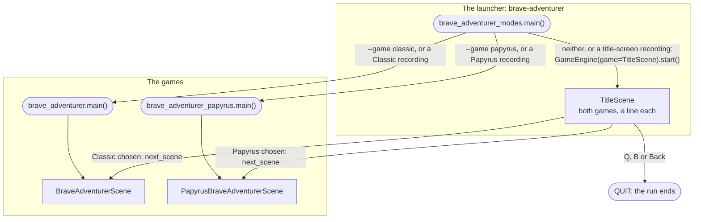
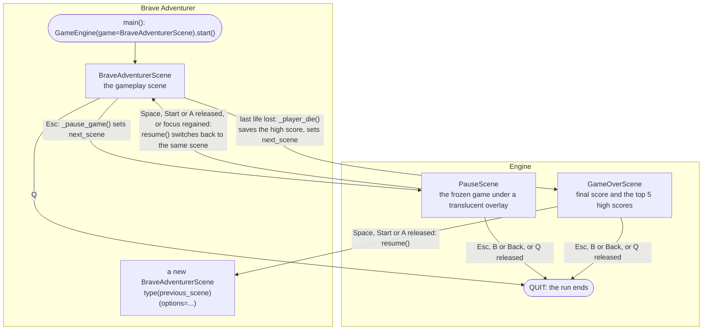
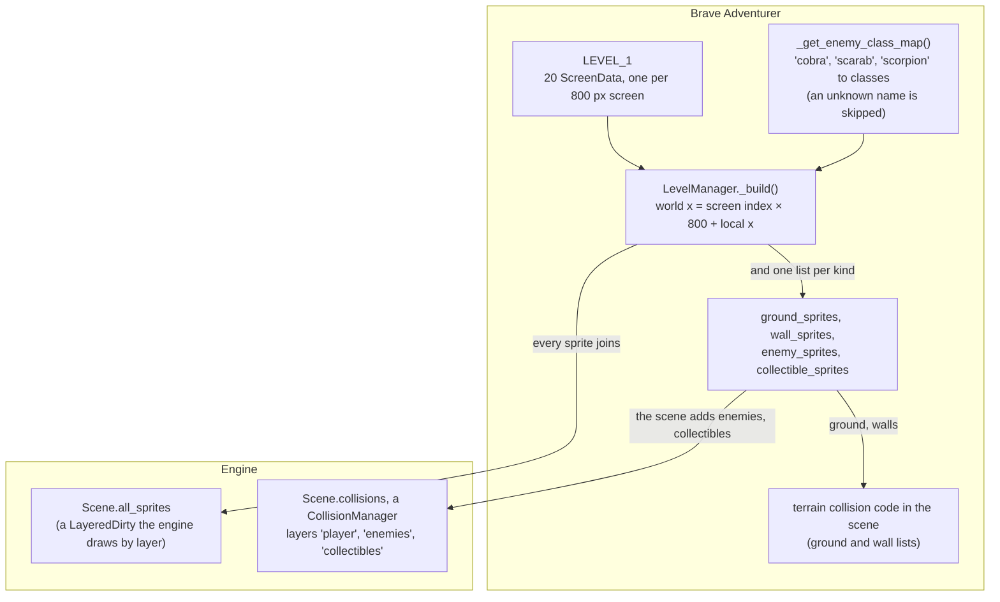
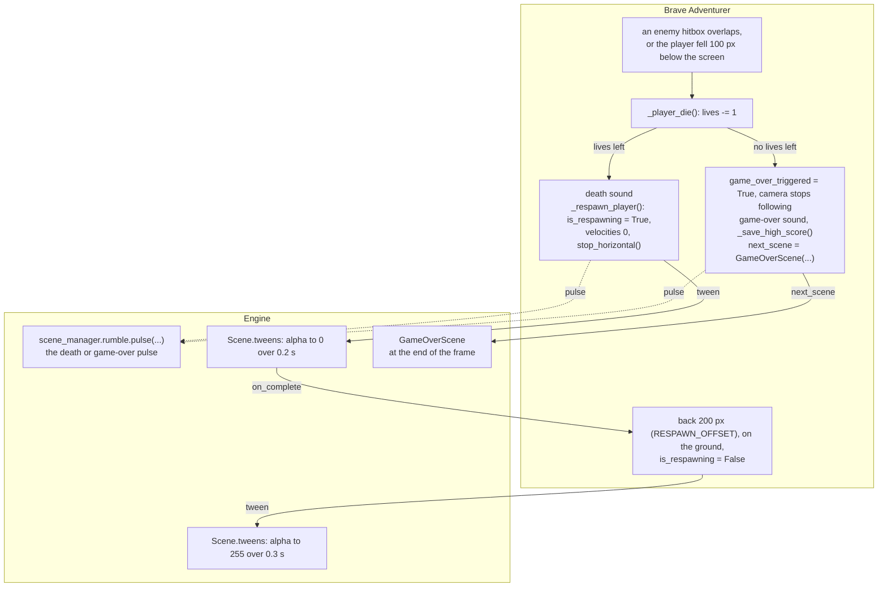
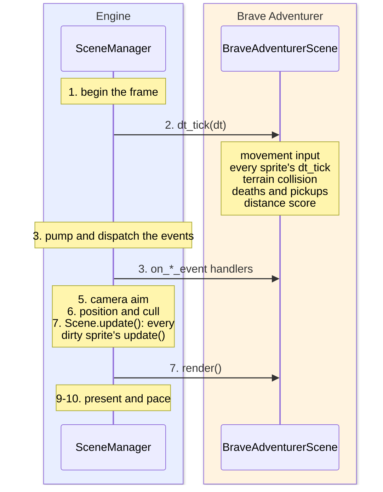
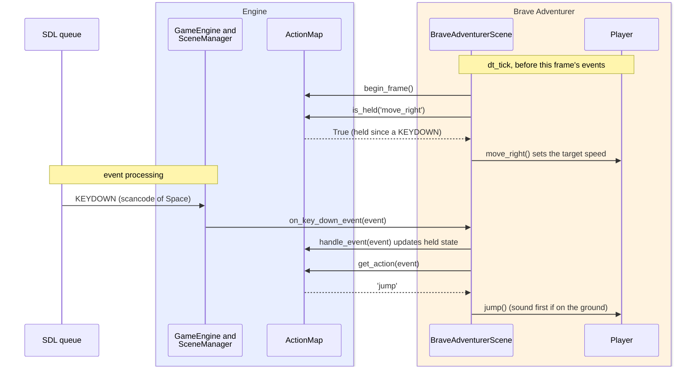
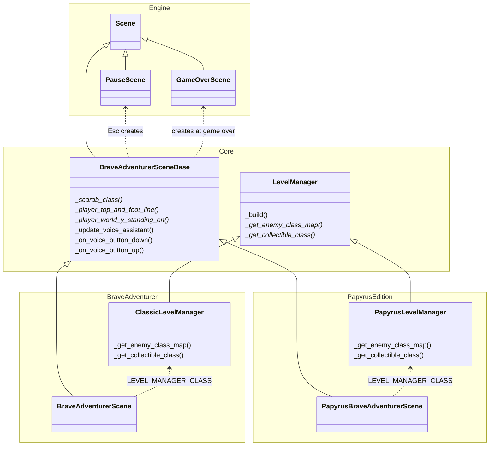
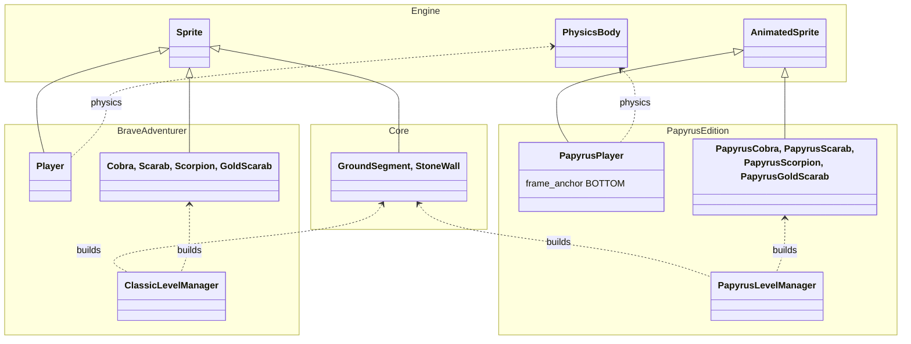

# Brave Adventurer Architecture

Brave Adventurer is a Pitfall-style side-scrolling platformer set in ancient Egypt: the
adventurer runs right across 20 screens of desert, jumps stone walls and pits, avoids cobras,
scarab beetles and scorpions, and picks up gold scarabs. Every picture is drawn from pygame
primitives and every sound is synthesized at startup, so the game ships no asset files.

The **Papyrus Edition** is the same game with hand-drawn TOML pixel art for the player, the
enemies and the collectibles (see [The Papyrus Edition](#the-papyrus-edition) below). One
command plays both: its title screen offers Classic and Papyrus (see
[The launcher and its title screen](#the-launcher-and-its-title-screen)).

This page is for a developer who wants to understand the game or build one like it. It shows
which engine features the game uses and where its code puts each of them: world-space sprites,
camera follow and parallax layers, the pose rule, hitbox-based terrain collision, ActionMap
input, synthesized sounds, saves, recording and replay.

## Running it

```bash
uv run brave-adventurer                  # the title screen: choose Classic or Papyrus
uv run brave-adventurer --game classic   # Classic at once: every sprite drawn in code
uv run brave-adventurer --game papyrus   # Papyrus at once: the Egyptian edition, sprite-sheet art
```

`brave-adventurer` is the project's one console script (`src/games/brave-adventurer/`, see
[Its package](#its-package)): the launcher, `brave_adventurer_modes.main()`. With `--game` it
runs that game's own `main()`, which runs `GameEngine(game=BraveAdventurerScene).start()` (or
`PapyrusBraveAdventurerScene`); without it, the title screen. The window is 800 x 480
(`SCREEN_WIDTH`, `SCREEN_HEIGHT` in `brave_adventurer_core/constants.py`). The browser build
(`/play/brave-adventurer/`) starts the title screen.

### The launcher and its title screen

`brave_adventurer_modes.main()` (`launcher.py`) chooses what to start, in this order:

1. `--game classic|papyrus`: it reads the flag (`parse_known_args`), removes it from
   `sys.argv`, and runs that game's own `main()` unchanged. The game's arguments, scene flow,
   recording header and recordings are its own, exactly as when it had its own command. With a
   recording as well, the flag still decides, and that game's replay refuses another game's
   recording.
2. A recording to replay (`--replay-trace PATH`): the recording's header names the scene it
   was made in by logical name, and the launcher starts that game's own `main()` without the
   title screen (`game_for_recording`). The golden-replay plugin, the replay-metrics ledger's
   rebaselines, watched replays and their restarts all start games this way, so each reaches
   its own game through the one command. A recording made from the title screen names the
   title screen (`games.brave_adventurer_modes.title:TitleScene`) and is replayed from there.
   Another game's recording is refused with `ExitCode.UNUSABLE_INPUT`, and so is one made
   before logical names (name its game with `--game`). One whose header cannot be read goes to
   the engine, which refuses it as it refuses any missing or unusable recording.
3. Otherwise the title screen, `TitleScene` (`title.py`), runs.

The title screen draws the games' own sky and pyramids (`brave_adventurer_core.drawing`), the
title, a card for each game with a line on how it differs, and a line of help. It reads its
controls through its own `ActionMap` (`TitleScene._create_action_map`), keyboard by scancode,
as the games do:

| Action | Keyboard (by position) | Gamepad | When |
|---|---|---|---|
| choose the other game (wraps round) | Up or Left, Down or Right | D-pad | press |
| start the chosen game | Space or Return | A or Start | release, after a press on this screen (as the pause and game-over screens go on), so the game never gets that release |
| quit | Q | B or Back | press (Esc does nothing here, on press or release: the browser's touch Pause button sends it) |

Starting a game sets `next_scene` to a new scene of that game, built with the run's options, in
the same engine: the game then runs as it does from its own `main()`. Its game-over screen
restarts that game, not the title screen. A recording made from the title screen holds the
title screen's frames first, then the game's.

### Controls

The gameplay scene binds every control through one `ActionMap`
(`BraveAdventurerSceneBase._create_action_map`; the classic edition's adds the mic button).
Keyboard controls are bound by **scancode**, a physical key position, so they sit in the same
place on every keyboard layout.

| Action | Keyboard (by position) | Gamepad | Read how |
|---|---|---|---|
| `move_right` | Right arrow | D-pad right | held: `is_held()` in `dt_tick` |
| `move_left` | Left arrow | D-pad left | held: `is_held()` in `dt_tick` |
| `jump` | Space or Up arrow | A | press: `get_action()` in the handler |
| `pause` | Esc | none | press |
| `quit` | Q | none | press: `scene_manager.quit()` posts QUIT |
| `mic_toggle` (primitives edition only) | none | DualSense mic button (controller button 15, joystick button 16) | press starts listening, release answers |

The built-in screens the game switches to have their own keys, by key code:

| Screen | Keys |
|---|---|
| Pause (`PauseScene`) | Space or a gamepad's Start or A (on release, after a press there) resumes; Esc or a gamepad's B or Back (on the press) quits, Q (on release) quits; regaining window focus more than 0.5 s after pausing resumes too |
| Game over (`GameOverScene`) | Space or a gamepad's Start or A (on release, after a press there) starts a new game; Esc or a gamepad's B or Back (on the press) quits, Q (on release) quits |

The analog sticks move nothing: no axis is bound (`TestButtonsAndAxesHoldMovement` pins it).

### Options

The launcher reads `--game`; each scene's `args()` adds `-v`; everything else is the engine's
(see [Argument System](../architecture/argument_system.md)).

| Option | Where | Effect in this game |
|---|---|---|
| `--game {classic,papyrus}` | the launcher (`launcher.py`; listed in `-h` by `TitleScene.args()`) | Starts that game at once, without the title screen |
| `-v`, `--version` | `TitleScene.args()`, `BraveAdventurerScene.args()`, `PapyrusBraveAdventurerScene.args()` | Prints the name and version and exits before anything starts (argparse's `version` action): `Brave Adventurer 1.0` (the title screen's, and Classic's with `--game classic`); with `--game papyrus`, `Brave Adventurer: Papyrus Edition 1.0` |
| `--input-mode {auto,joystick,controller}` | engine | Passed to the `ActionMap`: which gamepad event family the D-pad, A and mic bindings answer |
| `--screen-shake-intensity` | engine | Passed to `Camera2D(shake_intensity=...)`; the game itself starts no shakes |
| `--rumble-intensity` | engine | Scales the death and game-over rumble pulses |
| `--target-fps` | engine | The scene sets no `TARGET_FPS`, so the default 60.01 applies |
| `--debug-overlay` (or F3, F4) | engine | Hitboxes by collision layer, physics, camera and performance panels |
| `--record-trace`, `--replay-trace`, `--headless` | engine | Record and replay a session (see [Recording, replay and golden tests](#recording-replay-and-golden-tests)) |

## Scenes and how they switch

The game is one gameplay scene plus the engine's built-in pause and game-over screens. Every
switch is a plain `next_scene` assignment or `switch_to_scene`; the game uses no transitions.

In the diagrams on this page, the Engine box is what every game gets from `glitchygames`; the
Brave Adventurer box (or the PapyrusEdition box) is what this game adds. Here the game's own
code is its `main()` (which starts the engine's `GameEngine`) and the gameplay scene; the pause
and game-over screens are the engine's, which the game constructs and hands to `next_scene`, and
the engine ends the run on QUIT.

Before the game, the launcher (`brave_adventurer_modes`) either runs a game's own `main()` or
starts the engine on its title screen, which switches to the chosen game's scene:



From there each game runs its own scenes:



Resuming from the pause screen switches back to the *same* scene object, so the game picks up
where it stopped; its `setup()` runs again (it only rebuilds the HUD font and re-follows the
player; the sounds are generated once). The pause screen's `debug_subject` is the paused game,
so the debug overlay keeps showing the game's hitboxes over the frozen picture.

The game-over screen does not resume the old scene: `GameOverScene.resume()` builds a new
instance of the previous scene's class with the same options, so a restart is a clean game
(and the Papyrus Edition restarts as the Papyrus Edition).

## The world

### World-space sprites and the camera

Every game object is a world-space sprite: it declares
`COORDINATE_SPACE = CoordinateSpace.WORLD` and keeps float `world_x` / `world_y`. The game
never writes a sprite's `rect`; the engine places each world sprite from the camera every
frame, snapping with the scene's default `PIXEL_SNAP_MODE` (`NEAREST_HALF_UP`), and culls the
ones off screen. Only the HUD is drawn in screen space, straight onto the display in `render()`.

The camera is a `Camera2D` built in `__init__`:

| Setting | Value | Effect |
|---|---|---|
| `lead_x` | `CAMERA_LEAD` = 250 | The camera aims 250 px left of the player, so the player runs at about x = 250 on screen with the view ahead of it |
| `set_bounds(min_x=0.0)` | left bound only | The camera never shows the world left of x = 0; there is no right or vertical bound |
| `follow(target=self.player, axes=FollowAxes.X)` | in `setup()` | The engine aims the camera at the player on x only: the camera stays at the top of the world |
| smoothing | the default `smooth_factor` 0.1 | The camera eases toward its goal; with no `snap_to()` in `setup()` it eases in from the origin |
| `follow(target=None)` | at game over | The world and the camera stand still behind the game-over switch |

The scene never calls `camera.update()`: the engine aims the camera after logic and events, and
then positions the sprites (frame steps 5 and 6 in the next section).

### Parallax layers

Four background layers are added with `camera.add_background_layer(...)`, drawn by the
functions in `brave_adventurer_core/drawing.py` (both editions draw the same backgrounds). Each
draw function depends only on its arguments (the layer's
offset), so the engine redraws a layer only when its offset changes; none needs
`animated=True`.

| Depth | Layer | `scroll_factor` | Draw function | What it draws |
|---|---|---|---|---|
| 0 | sky | `PARALLAX_SKY` = 0.0 | `draw_sky` | A blue-to-haze vertical gradient (built once per surface size) |
| 1 | far | `PARALLAX_FAR` = 0.1 | `draw_pyramids` | A sand plane from y = 300 and three pyramids repeating every 2400 px |
| 2 | mid | `PARALLAX_MID` = 0.3 | `draw_dunes_and_oasis` | Dunes from three summed sine waves, oases repeating every 3000 px |
| 3 | near | `PARALLAX_NEAR` = 0.7 | `draw_near_ground_details` | Rocks and grass tufts every 60 px, placed by a hash of the world x (no randomness) |

The sprites sit above them on layers 4 to 7: terrain, collectibles, enemies, then the player
(`LAYER_*` in `brave_adventurer_core/constants.py`).

### Levels and screens

A level is a list of `ScreenData`, one per 800 px screen. Each screen lists its content in
screen-local x (and y for collectibles):

| `ScreenData` field | Entries | Becomes |
|---|---|---|
| `ground_segments` | `(local_x, width)` | `GroundSegment` at `GROUND_Y` = 400, 80 px tall |
| `walls` | `(local_x, height)` | `StoneWall`, 32 px wide, standing on the ground |
| `enemies` | `(type_name, local_x, kwargs)` | `Cobra`, `Scarab(speed=...)` or `Scorpion(patrol_range=...)` |
| `collectibles` | `(local_x, local_y)` | `GoldScarab` |

`LEVEL_1` ("The Path of the Pharaoh") has 20 screens of rising difficulty: flat ground with
scarabs to collect, a first short wall (screen 2), a first pit (screen 4), the first cobra
(5), scarab (7) and scorpion (10), then combinations, a triple pit (16), a gauntlet (18) and a
collectible run (19). The scene's level manager (`ClassicLevelManager`, `PapyrusLevelManager`)
builds it once, in the scene's `__init__`: the shared `LevelManager._build()` (in
`brave_adventurer_core/levels.py`) makes each screen's ground segments, walls, enemies and
collectibles in that order, and each game gives its enemy classes (`_get_enemy_class_map()`)
and its gold scarab (`_get_collectible_class()`). The level data, the builder and the terrain
code are the game's; the sprite group and the collision layers they feed are the engine's
`Scene` services:



The scene adds the player to the `'player'` layer and every enemy and collectible to theirs;
sprite-against-sprite contact goes through `self.collisions.check_overlap(...)`. Ground and
walls are not in collision layers: the scene resolves terrain itself (below).

There is no goal at the end of the level: past screen 19 there is no ground.

### Pits and walls

**Pits** are the gaps between consecutive ground segments. Nothing in the world represents a
pit; `render()` draws each one (`_draw_pits`) after the sprites, between the drawn rects of the
two segments either side, so the pit edges always meet the ground even at a half-pixel camera
position. Every visible enemy that overlaps a pit (a scarab that rolled in) and then the
player are blitted once more, so they show in front of the pit fill.
Inside a pit the edges of the neighbouring segments act as walls, so the player cannot walk
out; falling more than `PIT_DEATH_THRESHOLD` (100 px) below the screen costs a life.

**Walls** (`StoneWall`) are both platform and obstacle: a player whose feet land within 16 px
of a wall's top stands on it; otherwise a player overlapping the wall's body is pushed out to
the side it came from (see [Collision](#collision)).

### Enemies and collectibles

| Sprite | Behaviour (in `dt_tick`) |
|---|---|
| `Cobra` | Stationary; strikes for 0.3 s every 2 s (`STRIKE_INTERVAL`, `STRIKE_DURATION`) |
| `Scarab` | Rolls at `roll_speed` (negative is left) under gravity; the scene lands it on ground segments or on a pit floor and reverses it at walls |
| `Scorpion` | Walks at 60 px/s between its origin and origin + `patrol_range`, turning at each end |
| `GoldScarab` | Bobs 4 px up and down (`sin(time × 3)`); worth `COLLECTIBLE_SCORE_BONUS` |

Touching any enemy costs a life. The primitives edition's enemies follow the pose rule (below)
too: each draws its first pose as it is made and redraws it at the end of its `dt_tick`, so its
visible-pixel hitbox is this frame's when the scene checks collision.

## The player

### Movement and physics

`Player` composes a `PhysicsBody` (`glitchygames.physics`) instead of moving itself. Its
`world_x`, `world_y`, `velocity_x`, `velocity_y`, `on_ground` and `facing_right` are properties
that read and write the body.

| Part | Setting | Effect |
|---|---|---|
| `GravityBehavior` | `GRAVITY` = 1200 px/s², `MAX_FALL_SPEED` = 800 px/s | Falls, with a terminal speed |
| `AccelerationBehavior` | `PLAYER_ACCELERATION` = 1600, `PLAYER_DECELERATION` = 1200 px/s² | Ramps toward a target speed: `move_right()` / `move_left()` set ±`PLAYER_RUN_SPEED` (200 px/s), `stop_horizontal()` sets 0 |
| `BoundsConstraint(min_x=...)` | the world's left edge | Refitted to the hitbox every tick (`_fit_world_edge_to_hitbox`), so the hitbox, not the image's transparent margin, stops at x = 0 |
| `jump()` | `JUMP_VELOCITY` = -500 px/s | Only when `on_ground` |

There is no ground constraint in the body: the scene decides whether the player stands on
something. An `AnimationStateMachine` (rules written in code in the primitives edition) picks
the pose from the body's animation context: idle, running, jumping or falling. Running off a
ledge turns to falling (`running` to `falling` when `velocity_y > 10` and not on the ground),
as idle and jumping do.

### The pose rule

The player draws its pose, and so its hitbox, in `dt_tick`, after physics and the state
machine and before the scene's collision runs. Its hitbox is the image's visible pixels
(the engine trims transparent margins), so drawing the pose in `update()` would make collision
use the previous frame's pose: a player turning toward a wall would sit inside it for a frame
(BUGS.md, the pose fix). After drawing, the world-edge bound is refitted to the new hitbox and
applied again. `update()` does visual work only: the respawn fade
(`image.set_alpha(...)`).

### Collision

The scene resolves terrain in `dt_tick`, from the player's collision rect
(`get_sprite_collision_rect`) and offset (`collision_rect_offset`), never from its `rect` or its
drawn size:

| Check | Rule |
|---|---|
| Standing support | The player's support span is `common_hitbox_x_range()`: the columns **every** pose covers for the current facing, measured once by drawing every pose over two seconds of animation. A wider pose (falling is wider than idle) cannot catch a ledge the idle pose has left, so a player at an edge never falls, lands and falls again |
| Ground | The trailing foot (the back edge of the support span; the middle when still) must be over a segment, the hitbox bottom at or below `GROUND_Y`, and the player not rising. Then it is set so the hitbox bottom (the visible feet) rests on the ground |
| Pit edges | While below ground and not supported, moving into a segment's side puts the hitbox flush against it |
| Wall top | Feet within 16 px of the top, head above it, not rising, and the support span over the wall |
| Wall side | Pushed out on the side the hitbox was on before this frame's move (`velocity_x × dt` back), so a dt hitch cannot carry a fast player through; if it already overlapped (a wider pose), the side of the wall's centre decides (`_entered_wall_from_left`) |
| Snapping | Terrain edges are taken where the engine draws them (`snapped_world_position`), so collision agrees with the picture |
| Enemies | `check_overlap('player', 'enemies')`: one death per pass even when touching two enemies; none while respawning |
| Collectibles | `check_overlap('player', 'collectibles')`: `bonus_points` (kept in the score), sound, the scarab removed from the group, its list and its layer |

### Death and respawn

The game decides what a death does; the engine's scene tweens run the fades, its rumble
controller sends the pulses, and its `GameOverScene` is the screen the game switches to:



While `is_respawning` is set, movement input, enemy contact and the pit-death check are
skipped. Both editions also clear the walk target (`stop_horizontal()`), so the player stands
still while it fades instead of walking on toward its last direction. The fades are scene tweens (`self.tweens`), which `Scene.dt_tick` advances by the
frame's dt. Once `game_over_triggered` is set, `dt_tick` returns at once, so nothing moves on
the last frame before the switch.

## One frame

The engine runs the frame (CLAUDE.md, SceneManager); the scene's `dt_tick` does all the game
logic in a fixed order, and its `render()` draws. The Engine box is the `SceneManager`'s frame;
the Brave Adventurer box is the scene's code it calls:



| Step | Who | What happens in Brave Adventurer |
|---|---|---|
| 2, movement input | the scene | `Scene.dt_tick` (dt, tweens; the scene returns here once game over is set), then `actions.begin_frame()` and `is_held('move_right' / 'move_left')` set the player's target speed (skipped while respawning); the primitives edition also collects voice assistant responses |
| 2, every sprite's `dt_tick` | the sprites | Player physics, state machine and pose; enemy movement; collectible bobbing |
| 2, terrain collision | the scene | Ground (then the landing sound), walls, then scarabs against ground and walls |
| 2, deaths and pickups | the scene | The pit-death check and enemy contact (both skipped while respawning), then collectibles |
| 2, score | the scene | `max_distance`, then `score = round(max_distance / 10) + bonus_points` |
| 3 | the handlers | Jump, pause, quit and the mic button (`on_*_event`) |
| 5, 6 | the engine | Aims the camera at the player (x only), then positions and culls every world sprite |
| 7 | `Scene.update()`, `render()` | The player's fade; then sky fill, sprites, pits, any enemy in a pit and the player again, the HUD |
| 9, 10 | the engine | Present the frame, pace it |

(Steps 4 and 8, shake and rumble and the still-camera shake, do nothing visible here: the game
starts no shakes, and its rumble pulses run on their own.)

Two things follow from this order:

- `dt_tick` runs before the frame's events, so movement uses the `ActionMap` state from the
  previous frame's events, and a jump pressed this frame takes effect in this frame's handler
  (its physics in the next `dt_tick`).
- Collision runs before the engine positions the sprites, so this frame's picture already
  shows the resolved positions. Game logic never reads a world sprite's `rect` (it holds where
  the sprite was last drawn); only `_draw_pits`, in the render phase, does.

`render()` replaces `Scene.render`: it fills the sky colour, draws the `LayeredDirty` group,
draws the pits, then any enemy that overlaps a pit and the player on top, then the HUD (score top left, lives top right, each with
a 1 px shadow), and sets `self.rects = None` so the whole screen is presented.

## Input

The engine delivers the events and keeps the `ActionMap`'s held state; the game's scene reads
the map and drives its player. SDL, outside both boxes, is where the events come from:



Held actions (`move_right`, `move_left`) are read once per frame in `dt_tick` with
`is_held()`; one-shot actions (`jump`, `pause`, `quit`, `mic_toggle`) are read from the event
in the handlers with `get_action()`. Every handler first calls `actions.handle_event(event)`,
key-up and button-up handlers included, so the held state follows the device. The handlers are
`on_key_down/up_event`, `on_controller_button_down/up_event`, `on_joy_button_down/up_event`
and `on_joy_axis_motion_event` (which only feeds the map). A key that maps to no action falls
through to `Scene.on_key_down_event`.

**Gamepads.** The D-pad and A are bound as `controller_button=...`; the `ActionMap` built with
the scene's `input_mode` turns that into controller events, joystick events or both. The scene
reads `self.options.get('input_mode', 'joystick')`; the engine's `--input-mode` default is
`auto`, so a normal run binds both families and the engine delivers each press once.

**Microphone (primitives edition).** `VoiceAssistant.discover()` (in `__init__`) looks for a
controller with both a microphone and a speaker (a DualSense) and returns `None` when there is
none. It runs only when the engine's doors serve the real devices (live play, or a recording):
in a replay (or a rebaseline or playback) the voice assistant stays `None`, so a replay never
enumerates audio devices and a recorded mic press neither listens nor calls the AI service
(`_discover_voice_assistant`). Pressing the mic button starts listening; releasing it sends the recording through
speech-to-text, an AI model and text-to-speech back to the controller's speaker, and
`dt_tick` collects finished responses (`voice_assistant.update()`). The DualSense reports its
mic button as 15 on the controller API and 16 on the raw joystick API, so both are bound
(`MIC_BUTTON_CONTROLLER`, `MIC_BUTTON_JOYSTICK`). The Papyrus Edition has no voice assistant.

## Sound

`brave_adventurer_core/sounds.py` generates five effects once, in `setup()` (`GameSounds.initialize()`), with the
engine's synthesizer toolkit (`glitchygames.audio.synth`: `oscillator`, `frequency_curve`,
`apply_envelope`, `concatenate`, `to_sound`), at the mixer's sample rate:

| Sound | Made of | Played when |
|---|---|---|
| jump | a 0.12 s sine sweep, 220 to 660 Hz | jump pressed while on the ground |
| land | a 0.06 s 80 Hz thud | airborne before this frame's physics, on the ground after collision |
| collect | C5, E5, G5, 0.06 s each | a gold scarab is picked up |
| death | a 0.3 s sweep, 500 to 80 Hz | a life is lost |
| game over | E4, C4, then a longer A3 | the last life is lost |

If audio is unavailable (`AudioUnavailableError`), no sound is set and the game plays silent
rather than with some of its sounds; every `play_*()` checks for `None`. The game uses plain
one-shot `pygame.mixer.Sound`s: no `SoundRecipe` files and no live voices.

## State, score and saves

| State | Where | Rule |
|---|---|---|
| Lives | `player.lives`, from `STARTING_LIVES` = 3 | One per death; game over at 0 |
| Score | `player.score` | The distance score plus the bonus points, set at the end of every `dt_tick`: `round(max_distance / DISTANCE_SCORE_DIVISOR)` (the furthest world x reached, over 10) + `player.bonus_points`, where each collected gold scarab adds `COLLECTIBLE_SCORE_BONUS` (100) to `bonus_points` |
| High scores | `open_saves(app_name='brave-adventurer')` (Papyrus: `'brave-adventurer-papyrus'`), save `'high_scores'` | `{'scores': [{'score': n}, ...]}`, the ten best, descending; written at game over and shown (top 5) on the game-over screen |

`open_saves` returns the door's `SaveManager`: a `DiskSaveManager` live, an in-memory one in a
replay, so a replayed game over never touches real saves.

## Engine features it uses

| Feature | How Brave Adventurer uses it |
|---|---|
| World space and culling | Every game sprite is `CoordinateSpace.WORLD`; the engine positions and culls them |
| Camera follow and parallax | `follow(target=player, axes=FollowAxes.X)`, a left bound, four parallax layers |
| Physics | `PhysicsBody` with `GravityBehavior`, `AccelerationBehavior`, `BoundsConstraint` |
| Collision layers and hitboxes | `'player'`, `'enemies'`, `'collectibles'` with `check_overlap`; visible-pixel hitboxes |
| Tweens | The respawn fade (`self.tweens.tween(target=player, property_name='alpha', ...)`) |
| Rumble | `scene_manager.rumble.pulse(...)` on death (0.7 / 0.4, 0.35 s) and game over (1.0 / 0.6, 0.8 s); the game-over pulse is finite, so it outlives the switch |
| Screen shake | Only the camera's `shake_intensity` setting; the game calls no `shake()` |
| Random streams | Not needed: nothing in the game is random (the near-ground details are a hash of the world x) |
| Saves | High scores through `open_saves` |
| Built-in scenes | `PauseScene`, `GameOverScene` |
| Debug overlay | F3 / F4: the collision layers' hitboxes, the player's velocities and ground state, the camera; no `debug_draw` of its own |
| Recording and replay | Every input comes through the engine's doors (ActionMap events, saves), so `--record-trace` and `--replay-trace` reproduce a session exactly |
| Transitions, instant replay, demos | Not used |

## Recording, replay and golden tests

Because the game takes input only from engine events, and has no randomness and no clock reads
of its own, a recording replays it exactly:

```bash
uv run brave-adventurer --record-trace /tmp/session.jsonl.gz
uv run brave-adventurer --replay-trace /tmp/session.jsonl.gz            # watch it
uv run brave-adventurer --replay-trace /tmp/session.jsonl.gz --headless # check it
```

Two kinds of golden test pin the game's behaviour frame by frame:

| Golden | File | Made by | What it checks |
|---|---|---|---|
| Golden replay | `src/games/brave-adventurer/tests/fixtures/replays/golden-classic.jsonl.gz` (and `golden-papyrus.jsonl.gz`), both replayed through the launcher, `brave-adventurer`, which starts the game each header names | `scripts/record_scripted_session.py --game brave_adventurer --frames 400` through the real engine loop: the golden input script, then a controls tail (walk left, jump with Space, quit with Q): 472 frames | Replayed in a child process with `--replay-trace PATH --headless` by the replay pytest plugin; any divergence fails. `tests/replay/test_golden_replays.py` also checks that every bound control is exercised, or listed with the reason it is not (no gamepad on the dummy driver) |
| Golden trace | `tests/world/golden/brave_adventurer.jsonl.gz` (and `brave_adventurer_papyrus.jsonl.gz`) | `scripts/record_golden_traces.py`, before the world-space change | `tests/world/test_golden_traces.py` replays the script and compares every sprite's rect and visibility with that baseline; every difference must be explained by exactly one `ExpectedDifference` rule (engine culling, separate snapping, the pose fix, scarabs resting on their drawn underside, and the player falling into the screen-4 pit in its falling pose instead of its running pose) |

The golden script (`brave_adventurer_script()` in `scripts/golden_inputs.py`) runs right
over screens 0 and 1 jumping for the higher scarabs, pauses and resumes, then places the
player at x = 2400 (a 900-frame run cannot reach the first pit from the start) and jumps the
two screen-3 walls and the screen-4 pit before walking back. Re-record either golden only
deliberately, after finding out why it changed (the scripts' docstrings give the commands).

## Tests

| Test file | What it pins |
|---|---|
| `src/games/brave-adventurer/tests/core/test_brave_adventurer_both_editions.py` | Both editions (the scene fixtures are parametrized over both scenes): rumble on death and game over; terrain from the hitbox (walls flush, wider frames pushed back out, fast players pushed back the way they came, ledges); the world left edge; feet on the ground; stable support at ledge and wall-top edges; one death per hit; world space at the scene (the camera follows on x and stops at game over, terrain snaps as drawn); the pose rule (`TestPoseBeforeCollision`); pits meet the ground at a half-pixel camera; scancode controls; game over freezes the world; high scores; jump, quit and D-pad hold; the HUD; both `main()` entry points replaying their golden recordings; both level managers; the score keeping gold scarab bonuses; respawn standing still; scarabs in a pit drawn over it; running to falling; `-v/--version` |
| `src/games/brave-adventurer/tests/core/test_brave_adventurer_core.py` | The shared primitives: the terrain sprites are world sprites; parallax layer pixel digests |
| `src/games/brave-adventurer/tests/core/test_brave_adventurer_sounds.py` | The synthesized sounds against stored goldens (`tests/core/brave_adventurer_golden/*.npy`): length, envelope and pitch; silent play without a mixer |
| `src/games/brave-adventurer/tests/classic/test_brave_adventurer_classic.py` | The classic edition: its sprites declare world space and no module (its own or the core's) positions or culls sprites; culled enemies keep animating; the mic button and no voice assistant in a replay; enemy poses drawn in `dt_tick`; its player's running to falling |
| `src/games/brave-adventurer/tests/papyrus/test_brave_adventurer_papyrus.py` | The Papyrus Edition: facing-left hitboxes and foot anchoring; falling transitions in TOML; world space (its sprites, and no module of its own or the core's positions, culls or rounds); the sprite utilities; its player's running to falling |
| `src/games/brave-adventurer/tests/test_brave_adventurer_modes.py` | The launcher: `--game` runs that game's own `main()` without the flag, an unknown game is an error, a recording starts its own game without the title screen (the replay plugin replays both goldens through `brave-adventurer`, as `brave-adventurer/golden-classic` and `brave-adventurer/golden-papyrus`), another game's recording is refused; the title screen: its logical name, both cards, choosing with the keyboard (through the real engine) and a gamepad, Q, B and Back quitting, Esc doing nothing, `-v`, `-h`, and a recording made from it replaying through the launcher |
| `src/games/brave-adventurer/tests/test_brave_adventurer_logical_names.py`, `test_brave_adventurer_install_location.py`, `test_brave_adventurer_recording_history.py` | The move into one project: both scenes keep their logical names, the old example packages are gone, both goldens keep their history |
| `src/games/brave-adventurer/tests/core/test_brave_adventurer_shared_core.py` | The shared core: both scenes share one base and give only their hooks, the core imports neither game, each level manager builds its own gold scarab |
| `tests/world/test_golden_traces.py` | The golden traces above |
| `tests/replay/test_golden_replays.py` and the golden replay items | The golden replays above, and which controls they exercise |
| `tests/collision/test_collision.py` | The Cobra's hitbox follows its drawing; Papyrus hitboxes scale with `SPRITE_SCALE` |
| `src/games/brave-adventurer/tests/papyrus/test_brave_adventurer_papyrus_sprite_files.py` | The Papyrus TOML sprites pass the engine's sprite-file checks (`glitchygames.testing.sprite_files`: equal rows; timings, hitboxes, pixels, metadata and `[[transition]]` sections survive a save round trip), and their state machines reload in order |

## The Papyrus Edition

`brave_adventurer_papyrus` keeps the game and changes its characters. It shares the level
data, terrain, background drawing, sounds and constants with the classic edition
(`brave_adventurer_core`, below both games), and replaces the sprites that have pixel art.

| Shared with the classic edition (`brave_adventurer_core`, unchanged) | Changed in Papyrus |
|---|---|
| `LEVEL_1` and `ScreenData` (re-exported by its `levels.py`) | The player, the three enemies and the gold scarab are `AnimatedSprite`s loaded from TOML files in `sprites/` |
| `GroundSegment` and `StoneWall` (variable-width primitives, which do not suit fixed pixel art) | Sprites are scaled 2x (`SPRITE_SCALE`); TOML hitboxes are in native pixels, so `hitbox_scale` is set to 2 |
| The four parallax draw functions and the pits | The player stands on a fixed foot line, `PAPYRUS_PLAYER_HEIGHT` = 27 × 2 px below its snapped world y, instead of its hitbox bottom |
| `GameSounds` and every sound | Animation state machines come from the TOML `[[transition]]` sections (the player's, the cobra's timed strike) |
| Physics, camera, layer, parallax, scoring and colour constants (re-exported by its `constants.py`) | Its own save namespace (`brave-adventurer-papyrus`) and scene `NAME` |
| The controls (move, jump, pause, quit) | No voice assistant and no mic binding |

### How it is structured

The level manager and the scene are both shared by subclassing. The Engine box is
what both editions get from `glitchygames`, the Core box is what both share
(`brave_adventurer_core`), the BraveAdventurer box is the classic edition and the
PapyrusEdition box is what the Papyrus Edition adds. Solid arrows are inheritance, pointing at
the base class; dotted arrows are runtime use (one class building or calling another). Both
scenes also import the core's `drawing.py`, `sounds.py` and constants (left out to keep the
diagrams readable).

#### Scenes



#### Sprites



- **`PapyrusLevelManager`** gives `_get_enemy_class_map()` (the Papyrus enemy classes) and
  `_get_collectible_class()` (`PapyrusGoldScarab`); the shared `LevelManager._build()` builds
  them, as `ClassicLevelManager`'s give `Cobra`, `Scarab`, `Scorpion` and `GoldScarab`.
- **`BraveAdventurerSceneBase`** (`brave_adventurer_core/scene.py`) is the gameplay both
  scenes play by: the camera and parallax, the level and player built in that order (recordings
  number sprites by creation order), the controls, the `dt_tick` order, terrain, wall and enemy
  collision, death, respawn and high scores, the input handlers, `render()`, the pits and the
  HUD. Each game's scene stays in its own `game.py` under its own name (recordings name a scene
  by its module and class) and gives only what differs: `NAME`; `LEVEL_MANAGER_CLASS`,
  `PLAYER_CLASS` and `PLAYER_START_WORLD_Y`; `SAVE_APP_NAME` (`brave-adventurer`,
  `brave-adventurer-papyrus`); `_scarab_class()` (the enemy that follows the terrain); and the
  foot line, `_player_top_and_foot_line()` and `_player_world_y_standing_on()`: the classic
  edition's hitbox bottom (a `float` world y), Papyrus's `_snapped_player_top()` +
  `PAPYRUS_PLAYER_HEIGHT` (an `int`). The classic edition adds the voice assistant: it is
  discovered after the shared `__init__`, its mic button is bound after the shared controls,
  and it fills the base's voice hooks, which Papyrus leaves empty.
- **`PapyrusPlayer`** has the same `PhysicsBody` and move methods as `Player`. Each `dt_tick`
  ticks physics, evaluates the TOML state machine, advances the TOML animation
  (`AnimatedSprite.update(self, dt)`), rescales the frame (`apply_transparency_and_scale`), and
  mirrors image and hitbox when facing left (`hitbox_flip_x`), then refits the world-edge
  bound. That keeps the pose rule: the frame collision uses is the one drawn this frame.
  `frame_anchor = FrameAnchor.BOTTOM` draws each frame lower by its `draw_offset`, so frames
  whose feet end on rows 24 to 27 all stand on the 27-row foot line. Its standing support uses
  the engine's `AnimatedSprite.common_hitbox_x_range()` (the x-span every frame's hitbox
  shares) where the original measures its procedurally drawn poses.
- **The Papyrus enemies and gold scarab** do the same, animating in `dt_tick`, and make
  `update()` a no-op (`Scene.update()` would call it without a dt: BUGS.md #115).
- **`sprite_utils.py`**: `prepare_papyrus_sprite()` converts every loaded frame from the
  magenta colour key to per-pixel alpha (so transparency survives scaling and flipping) and sets
  `hitbox_scale`; `apply_transparency_and_scale()` scales the current frame's source surface
  each tick, never the already scaled image.

| Papyrus TOML sprite | Animations | Hitbox | State machine |
|---|---|---|---|
| `player.toml` (20 x 28) | idle, running, jumping, falling | per frame | 8 `[[transition]]`s on velocity and `on_ground` (falling last, mirroring `FALLING_VELOCITY_THRESHOLD`) |
| `cobra.toml` | idle (looping), strike (once) | per frame | idle to strike after 2 s, back after 0.3 s |
| `scarab.toml` | roll | sprite | none |
| `scorpion.toml` | walk | sprite | none |
| `gold_scarab.toml` | shimmer | sprite | none |

`scripts/audit_hitboxes.py` audits the Papyrus sprites' hitboxes against their pixels.

## Its package

Both editions are one package beside the engine, `src/games/brave-adventurer/` (distribution
`brave-adventurer`), in a src layout of layered import packages: `brave_adventurer_core` (the
constants, terrain, level data and level manager, background drawing, sounds and the gameplay
scene's base both games share; it imports neither game), `brave_adventurer` (the classic edition),
`brave_adventurer_papyrus` (the Papyrus Edition) and `brave_adventurer_modes` (the launcher and
its title screen, the project's one console script). How such a package is laid out, installed,
tested and built, and how a game is moved into one, is in
[Games as Their Own Packages](../architecture/game_packages.md).

Its recordings name the scenes `games.brave_adventurer.game:BraveAdventurerScene` and
`games.brave_adventurer_papyrus.game:PapyrusBraveAdventurerScene`, as before the move (the title
screen is `games.brave_adventurer_modes.title:TitleScene`); its golden replays are
`src/games/brave-adventurer/tests/fixtures/replays/golden-classic.jsonl.gz` and
`golden-papyrus.jsonl.gz`, both replayed by the launcher, which starts the game each header
names; and its one browser page, the title screen, ships all four archives, the core first.

## Where things live

| File | What it holds |
|---|---|
| `src/games/brave-adventurer/pyproject.toml` | The project: distribution `brave-adventurer`, its console script (the launcher), the four packages |
| `src/games/brave-adventurer/src/brave_adventurer_modes/launcher.py` | `main()` (the `brave-adventurer` console script): `--game`, a recording's game (`game_for_recording`), or the title screen; `GAMES_BY_NAME` |
| `src/games/brave-adventurer/src/brave_adventurer_modes/title.py` | `TitleScene`, its cards (`GameChoiceCard`) and `GAME_CHOICES`: each game's name, line and scene |
| `src/games/brave-adventurer/src/brave_adventurer_core/constants.py` | Screen, physics, camera, parallax, layer, scoring, terrain and background colour, HUD, lives and rumble constants both games share |
| `src/games/brave-adventurer/src/brave_adventurer_core/terrain.py` | `GroundSegment`, `StoneWall` |
| `src/games/brave-adventurer/src/brave_adventurer_core/levels.py` | `ScreenData`, `LEVEL_1` (20 screens), `LevelManager` (the shared builder, with the enemy and collectible hooks) |
| `src/games/brave-adventurer/src/brave_adventurer_core/drawing.py` | The terrain drawing and the four parallax layers |
| `src/games/brave-adventurer/src/brave_adventurer_core/sounds.py` | The synthesized effects and `GameSounds` |
| `src/games/brave-adventurer/src/brave_adventurer_core/scene.py` | `BraveAdventurerSceneBase`: camera, parallax, level, controls, `dt_tick` order, terrain and enemy collision, death and respawn, high scores, input handlers, `render()`, pits, HUD; the hooks each game fills |
| `src/games/brave-adventurer/src/brave_adventurer/__init__.py` | Exports `main` (the launcher's `--game classic`) |
| `src/games/brave-adventurer/src/brave_adventurer/game.py` | `BraveAdventurerScene`: the shared scene's hooks (its sprites, save name, hitbox foot line) and the voice assistant; `main()` |
| `src/games/brave-adventurer/src/brave_adventurer/player.py` | `Player`: physics body, state machine, the pose drawn in `dt_tick`, the common pose x-range |
| `src/games/brave-adventurer/src/brave_adventurer/terrain.py` | `GoldScarab` |
| `src/games/brave-adventurer/src/brave_adventurer/enemies.py` | `Cobra`, `Scarab`, `Scorpion` |
| `src/games/brave-adventurer/src/brave_adventurer/levels.py` | `ClassicLevelManager` |
| `src/games/brave-adventurer/src/brave_adventurer/drawing.py` | The classic sprites' primitive drawing: the player, the gold scarab, the enemies |
| `src/games/brave-adventurer/src/brave_adventurer/constants.py` | The classic sprites' sizes and colours, the arm and leg swing |
| `src/games/brave-adventurer/src/brave_adventurer_papyrus/game.py` | `PapyrusBraveAdventurerScene`: the shared scene's hooks (its sprites, save name, fixed foot line); `main()` |
| `src/games/brave-adventurer/src/brave_adventurer_papyrus/player.py` | `PapyrusPlayer` |
| `src/games/brave-adventurer/src/brave_adventurer_papyrus/enemies.py` | `PapyrusCobra`, `PapyrusScarab`, `PapyrusScorpion` |
| `src/games/brave-adventurer/src/brave_adventurer_papyrus/terrain.py` | `PapyrusGoldScarab`; re-exports the shared `GroundSegment` and `StoneWall` |
| `src/games/brave-adventurer/src/brave_adventurer_papyrus/levels.py` | `PapyrusLevelManager`; re-exports `LEVEL_1` |
| `src/games/brave-adventurer/src/brave_adventurer_papyrus/sprite_utils.py` | Colour key to alpha, 2x scaling, `hitbox_scale` |
| `src/games/brave-adventurer/src/brave_adventurer_papyrus/constants.py` | Re-exports the shared constants; `SPRITE_SCALE`, the Papyrus heights, `SPRITES_DIR` |
| `src/games/brave-adventurer/src/brave_adventurer_papyrus/sprites/*.toml` | The pixel art, hitboxes and state machines |
| `src/glitchygames/scenes/builtin_scenes/pause_scene.py`, `game_over_scene.py` | The engine's pause and game-over screens |
| `src/games/brave-adventurer/tests/` (`core/`, `classic/`, `papyrus/`) | The games' tests |
| `src/games/brave-adventurer/tests/fixtures/replays/golden-*.jsonl.gz` | The golden replays |
| `tests/world/golden/brave_adventurer*.jsonl.gz` | The golden traces |
| `scripts/record_scripted_session.py`, `scripts/record_golden_traces.py`, `scripts/golden_inputs.py` | The scripts that record them, and the input scripts |
