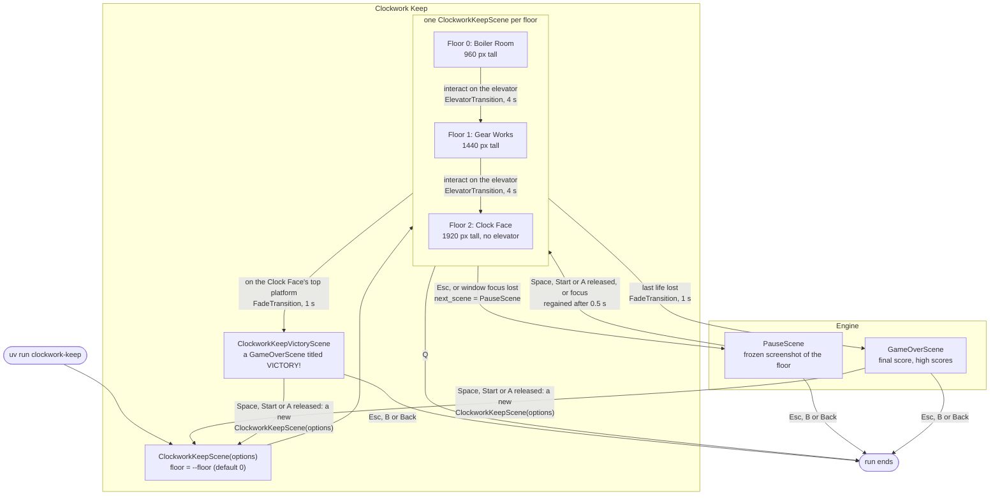
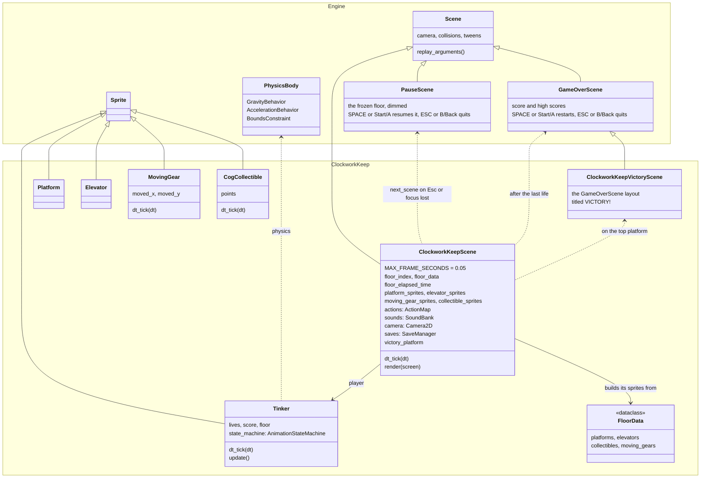
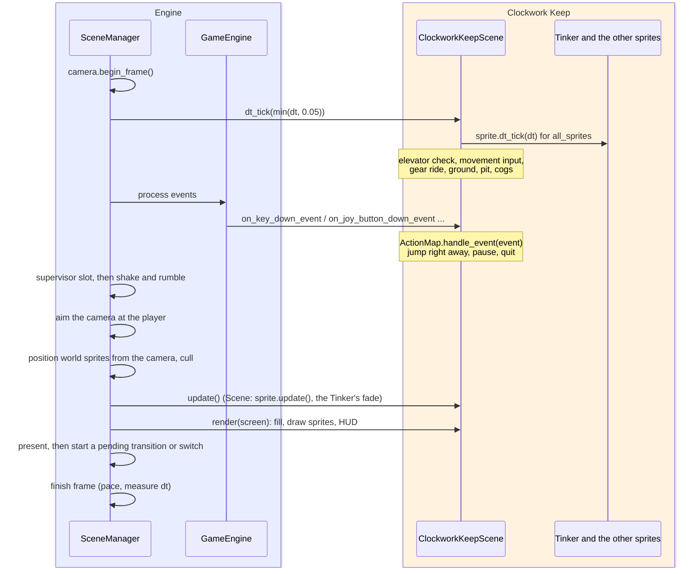
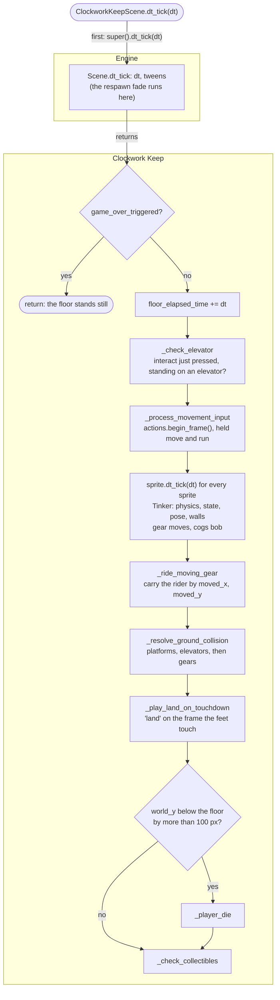
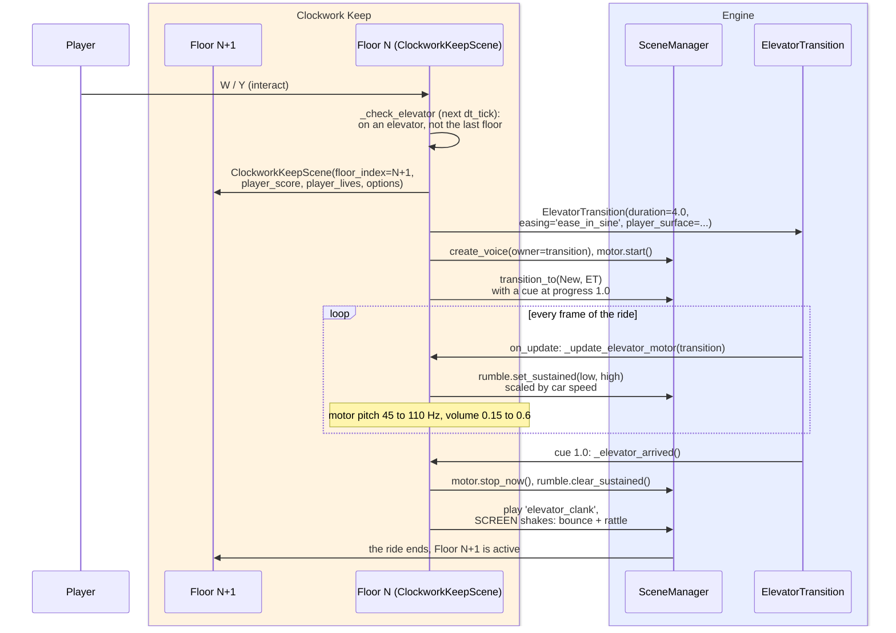
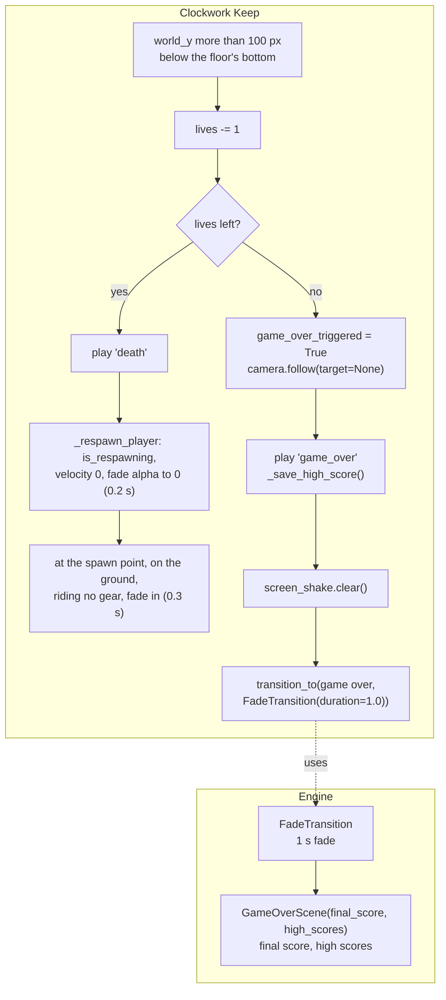

# Clockwork Keep Architecture

Clockwork Keep is a steampunk tower climb, one of GlitchyGames' example games. You play the
Tinker, a goggled mechanic, climbing three floors of a clockwork tower: jump from platform to
platform, collect cogs for points, and ride the elevator at the top of a floor to the next one.
The last floor has no elevator: standing on its top platform, under the victory cog, wins the
game.

Everything is drawn from pygame primitives (no image files), every sound is synthesized, and the
game is small enough to read in one sitting (about 2,700 lines in
`src/games/clockwork-keep/src/clockwork_keep/`). It is also one of the engine's reference games: its
golden trace and golden replay pin world space, transitions, pausing and replay, so the page
below shows both how the game works and which engine features it leans on.

## Running it

```bash
uv run clockwork-keep                 # start on the Boiler Room (floor 0)
uv run clockwork-keep --floor 2       # start on the Clock Face
uv run clockwork-keep --debug-overlay # F3 toggles the overlay, F4 cycles its panels
```

The game adds one option of its own (`ClockworkKeepScene.args`):

| Option | Values | Effect |
|---|---|---|
| `--floor` | `0`, `1`, `2` (default `0`) | The first floor: 0 = Boiler Room, 1 = Gear Works, 2 = Clock Face. Anything else is refused by argparse (`choices=range(len(ALL_FLOORS))`) |

Every engine option applies too. The ones the game reads or depends on:

| Option | Used for |
|---|---|
| `--input-mode {auto,joystick,controller}` | The gamepad event family its `ActionMap` binds (engine default `auto`) |
| `--screen-shake-intensity` | Passed to the floor's `Camera2D` (`shake_intensity`) |
| `--rumble-intensity` | Scales the elevator's rumble (the scene manager's `RumbleController`) |
| `--random-seed` | Seeds the engine's `shake` stream, the only randomness in a session (the rattle shake) |
| `--record-trace PATH` / `--replay-trace PATH` | Record a session / replay it exactly (see [Engine features it uses](#engine-features-it-uses)) |
| `--target-fps` | The game sets no `TARGET_FPS`, so the engine default (60.01) applies |

### Controls

Every keyboard control binds a physical key position (a scancode), so it is in the same place
on every keyboard layout. The names below are the US QWERTY keys at those positions.

| Action | Keyboard | Gamepad | Read how |
|---|---|---|---|
| `move_left` / `move_right` | Left / Right arrow | D-pad left / right | Held, each `dt_tick` |
| `jump` | Space or Up arrow | A | On the press, in the event handler |
| `run` | Left Shift | X | Held: run speed, and a higher jump |
| `interact` | W | Y | Pressed this frame, at the top of `dt_tick` (rides the elevator) |
| `pause` | Esc | none | On the press: switches to the pause screen |
| `quit` | Q | none | On the press: `scene_manager.quit()` ends the run |

No stick axis is bound (`test_joystick_axis_motion_moves_nothing`). On the pause screen Space
or a gamepad's Start or A (on its release, after a press there) resumes, and Esc or a gamepad's
B or Back (on the press) quits; on the game-over and victory screens the same buttons restart
and quit. The engine's screens answer both gamepad event layers (controller and joystick).
Losing window focus pauses the game too.

## Scenes and how they switch

Each floor is its own `ClockworkKeepScene` instance. The engine builds the first one from options
alone (`floor_index=None`, which takes `--floor`); the elevator builds the next one with the
floor, score and lives it carries. Pausing and game over use the engine's built-in
`PauseScene` and `GameOverScene`. In the diagram, the Clockwork Keep box is the game's own scene;
the Engine box holds the engine's built-in scenes it switches to.



| Switch | Code | How |
|---|---|---|
| Next floor | `_check_elevator` → `_go_to_next_floor` | `transition_to(next_scene, ElevatorTransition(...))`; the engine starts the transition after the frame is presented |
| Pause | `on_key_down_event` (`pause`), `on_window_focus_lost_event` | `self.next_scene = PauseScene(options=...)`; focus loss after game over does not pause |
| Resume | `PauseScene.resume()` | Switches back to the paused floor, which keeps all its state |
| Game over | `_player_die` on the last life | `transition_to(GameOverScene(final_score=..., high_scores=...), FadeTransition(duration=1.0))` |
| Victory | `_win`, when the Tinker stands on `victory_platform` (the Clock Face's highest platform) | Saves the high score, then `transition_to(ClockworkKeepVictoryScene(final_score=..., high_scores=...), FadeTransition(duration=1.0))`: the engine's `GameOverScene` with its title replaced by VICTORY! |
| Restart | `GameOverScene.resume()` (also the victory screen's) | `type(previous_scene)(options=...)`: a fresh first floor (the `--floor` one), score 0, 3 lives |
| Quit | `scene_manager.quit()` | Posts QUIT; the run ends after teardown (BUGS.md #202) |

The floor never sets `next_scene = None` to quit: the scene manager reads that as "no switch
pending", so `quit` goes through `scene_manager.quit()`.

### replay_arguments: rebuilding a floor

`replay_arguments()` returns the constructor arguments the floor was built with, besides
`options`:

```python
{'floor_index': self.floor_index,
 'player_score': self.starting_player_score,
 'player_lives': self.starting_player_lives}
```

The engine's default is `{}`, which rebuilds a scene from options alone. That works for the first
floor but not for the others: a floor the elevator built would be rebuilt as the `--floor` floor
with score 0 and 3 lives. A scene start (`src/glitchygames/scene_start.py`) keeps these arguments,
and `rebuild_scene(start=..., scene_class=..., options=...)` passes them back to the constructor,
so a playback scope (a demo, an instant replay) that starts on floor 2 rebuilds floor 2 with the
score and lives it began with. The values are the ones the floor **began** with
(`starting_player_score`, `starting_player_lives`), not the current ones: cogs collected and lives
lost on the floor are what the playback replays, so they must not be in the starting state
(`test_floor_replay_arguments_rebuild_the_floor`). They are plain ints, so they round-trip
through JSON exactly, as scene starts require.

## Its package

Clockwork Keep is a package of its own beside the engine, `src/games/clockwork-keep/`
(distribution `clockwork-keep`, import package `clockwork_keep`). How such a package is laid out,
installed, tested and built, and how a game is moved into one, is in
[Games as Their Own Packages](../architecture/game_packages.md).

Its recordings name it `games.clockwork_keep.game:ClockworkKeepScene`, its golden replay is
`src/games/clockwork-keep/tests/fixtures/replays/golden.jsonl.gz`, its golden trace stays with the
engine's trace tests (`tests/world/golden/clockwork_keep.jsonl.gz`), and its browser bundle ships
`clockwork_keep.zip`.

## Classes

Clockwork Keep's own code is the scene, five sprite classes and the floor data, all in
`src/games/clockwork-keep/src/clockwork_keep/`. The rest comes from the engine: `Scene` and the built-in
`PauseScene` and `GameOverScene` (`glitchygames.scenes`), `Sprite` (`glitchygames.sprites`) and
`PhysicsBody` (`glitchygames.physics`). In the diagram, the Engine box is what every game gets; the
Clockwork Keep box is what this game adds. Solid arrows are inheritance, pointing at the base
class; dotted arrows are how the game uses an engine class; plain arrows are what a game class
holds. The scene owns everything on a floor. The five sprite classes all declare
`COORDINATE_SPACE = CoordinateSpace.WORLD`, and the scene keeps each kind in a list of its own
(`platform_sprites`, ...) besides `all_sprites`.



`Tinker`'s `world_x`, `world_y`, `velocity_x`, `velocity_y`, `on_ground` and `facing_right` are
properties that delegate to its `PhysicsBody`, so the scene and the engine read the body through
the sprite. The debug overlay's physics panel finds the body as `sprite.physics`.

## The world

### Floors

A floor is a `FloorData` (`levels.py`): one screen wide (800 px), several screens tall, with walls
100 px wide on each side, leaving a 600 px playfield (x 100 to 700). World coordinates start at
the floor's top-left; y grows downward, so climbing means a falling `world_y`. The Tinker spawns
at x 400, 60 px above the floor's bottom.

| Floor | Height | Platforms | Cogs (bronze / silver / gold) | Points | Way up |
|---|---|---|---|---|---|
| 0 Boiler Room | 960 (2 screens) | 14 | 4 / 1 / 1 | 190 | Elevator at the top |
| 1 Gear Works | 1440 (3 screens) | 19 | 5 / 3 / 1 | 300 | Elevator at the top |
| 2 Clock Face | 1920 (4 screens) | 21 | 5 / 7 / 2 | 600 | The moving gear, then the victory platform |

Cogs are worth 10 (bronze), 50 (silver) and 100 (gold) points. There are no enemies.

**Victory.** The Clock Face (the last floor) has no elevator; its highest platform is the
floor's `victory_platform` (`_find_victory_platform`; None on the floors below). When ground
collision stands the Tinker on it (`supporting_platform`), `dt_tick` calls `_win()` after the
cog pickups (so the victory cog above it counts): the floor stops, the camera stops following,
the victory chime plays, the high score is saved and the floor fades to `ClockworkKeepVictoryScene`, the
engine's `GameOverScene` (final score and high scores, Space or a gamepad's Start or A restarts, Esc or B or Back quits) with a gold
VICTORY! title.

The floor builds its sprites in `__init__`, in this order: the parallax background, platforms,
elevators, moving gears, cogs, then the player. Sprites of one layer draw in the order they are
added, so the order is part of the picture. Each class sets `_layer` before `Sprite.__init__`
(`LAYER_TERRAIN` 4, `LAYER_COLLECTIBLES` 5, `LAYER_PLAYER` 7, the background `LAYER_FAR_BACKGROUND`
0) for the `LayeredDirty` group.

### World-space sprites

Every gameplay sprite (`Tinker`, `Platform`, `Elevator`, `MovingGear`, `CogCollectible`) declares
`COORDINATE_SPACE = CoordinateSpace.WORLD` and keeps float `world_x` / `world_y`. The game never
writes their `rect`: each frame the engine sets it from the camera, culls sprites more than 32 px
off screen, and marks moved sprites dirty. The game reads positions from `world_x` / `world_y` and
from collision rects, never from `rect` (except `rect.width`, which does not move). A cog bobs by
moving its `world_y`, not by shifting pixels in its image.

The HUD is not a sprite: `render()` draws the score (top left), lives (top right) and floor name
(top centre) straight onto the screen after the sprites, with a 1 px shadow. Its font is loaded in
`setup()`, so a floor rendered before setup draws no HUD.

### Camera

| Setting | Value | Effect |
|---|---|---|
| `camera.follow(target=player, axes=FollowAxes.BOTH)` | in `setup()` | The engine aims the camera at the Tinker every frame |
| `set_bounds(min_x=0, max_x=0, ...)` | in `__init__` | No horizontal scroll: the tower is one screen wide |
| `set_bounds(min_y=0, max_y=height - 480)` | in `__init__` | The camera stops at the floor's top and bottom |
| `lead_y=200` (`CAMERA_LEAD_Y`) | in `__init__` | The camera's top edge sits 200 px above the Tinker's top: a little less view above it than below it on the 480 px screen |
| `camera.follow(target=None)` | at game over | The floor stands still during the fade |

The game never calls `camera.update()` and has no camera loop (`test_scene_has_no_camera_loop`).
`setup()` does not `snap_to` the player, so on a fresh start the camera eases down from the
floor's top to the spawn; a floor arriving by elevator is snapped to its target by the
transition's arrival capture.

### The parallax background and the animated clock

Each floor has one parallax layer (`camera.add_background_layer`, `scroll_factor=PARALLAX_FAR`
= 0.1): the tower walls with brick and windows, plus the floor's machinery (the Boiler Room's
furnace glow and pipes, the Gear Works' gears and chain). The engine calls a layer's draw
function again only when its offset changes, so these draw functions depend only on the camera
position they are given.

The Clock Face's layer is different: a working clock whose hands show `CLOCK_START_SECONDS` (11:58,
two minutes to midnight) plus `floor_elapsed_time`, the floor's game time. Its picture changes
while the camera stands still, so that layer is added with `animated=True` and redraws every frame
(`test_only_the_clock_background_is_animated`, `test_clock_hands_move_on_a_still_camera`). The
scene passes a bound method (`_draw_timed_clock_background`) that reads `floor_elapsed_time`.
`floor_elapsed_time` adds the capped dt in `dt_tick`, so it stops while paused and after game
over.

### Platforms, elevators, moving gear and cogs

| Sprite | Image | Behaviour |
|---|---|---|
| `Platform` | 12 px tall metal bar in the floor's theme colours, drawn once | One-way support: the Tinker jumps up through it and lands on top of it |
| `Elevator` | 60 x 8 px car with caution stripes and an up arrow | Supports like a platform; interact while standing on it rides to the next floor |
| `MovingGear` | `size` x `size/4` bar with teeth along its top, `dirty = 2` | Moves on `centre + range * sin(timer * speed)` each `dt_tick` and records `moved_x` / `moved_y` |
| `CogCollectible` | 16 px cog, redrawn each tick with spinning teeth | Bobs 3 px; picked up when its collision rect overlaps the Tinker's |

The Clock Face's one moving gear (`MovingGearData`: 64 px wide, ±150 px horizontally, speed 1.2,
a 5.2 s round trip) is the only way up its final approach: the centre step is 180 px below the
last step, beyond a running jump's ~140 px, so the climber hops onto the gear (90 px up), rides
it right, and hops off at the end of its sweep, where it pauses. `test_the_route_is_within_a_walking_jump`
and `test_climbing_the_final_approach_on_the_gear` pin the route.

## The player: movement, physics and collision

### Physics

`Tinker` builds a `PhysicsBody` with:

| Piece | Values |
|---|---|
| `GravityBehavior` | 1200 px/s², terminal fall speed 800 px/s |
| `AccelerationBehavior` | 1600 px/s² toward the target speed, 1200 px/s² to slow down |
| `BoundsConstraint` | The side walls, refitted to the hitbox every tick |
| Speeds | Walk 160 px/s, run 280 px/s |
| Jumps | `-480` px/s (~96 px high), running `-580` px/s (~140 px high) |

`move_left` / `move_right` / `stop_horizontal` only set the acceleration behaviour's target
velocity; the body accelerates toward it. `jump()` sets `velocity_y` only when `on_ground`, so an
airborne Tinker never jumps again.

An `AnimationStateMachine` picks the pose from the body's animation context: `idle`, `running`
(`abs(velocity_x) > 0.1`), `jumping` (`velocity_y < -10`) and `falling` (`velocity_y > 50` and not
on the ground).

### The pose rule and hitboxes

The Tinker's hitbox is its image's visible pixels (the engine's default: transparent pixels
trimmed, measured on every query). The figure's transparent margin moves with its pose and
facing, so the pose must be drawn before anything collides with it. `Tinker.dt_tick` does, in
order:

1. Fit the wall bounds to the current hitbox, then `physics.tick(dt)`.
2. Evaluate the state machine.
3. Draw the pose (`_draw_pose`: clear the image, `draw_tinker(...)`).
4. Refit the wall bounds to the new hitbox and apply them again, so turning toward a wall never
   puts the hitbox inside it (BUGS.md #64, `TestPoseBeforeCollision`).

`Tinker.update()`, which runs in the render phase, only applies the respawn fade
(`image.set_alpha`). Drawing the pose there would make the floor's ground and cog checks use the
previous frame's pose.

All support and pickups use collision rects (`get_sprite_collision_rect`) and
`collision_rect_offset`, not the drawn image: the feet are the hitbox's bottom, and only a hitbox
pixel over a platform supports (`TestPlatformSupportUsesHitbox`, `TestHitboxLooseEnds`). The
scene registers two collision layers, `player` and `cogs`; cog pickup is
`collisions.check_overlap('player', 'cogs', ...)`, and the debug overlay's hitbox panel draws the
same layers.

### Ground collision

`_resolve_ground_collision` clears `on_ground`, then stands the Tinker on the support it
finds, falling or at rest (`velocity_y >= 0`), whose top its feet reached this tick and its hitbox
overlapping it horizontally. The fall is swept (`_feet_reach_surface`): the feet must end the tick
at or below the support's top, and have started it (before this tick's movement; a gear's ride
is not part of the fall) no more than `GROUND_SNAP_TOLERANCE` (20 px) below it. So a long tick at
the 800 px/s terminal speed, which moves the feet up to 40 px at the 50 ms cap, still lands on
the platform it crossed instead of passing through it:

1. Platforms (their `world_y` is their top).
2. Elevators (checked after the platforms, so an elevator standing on its shelf platform wins).
3. Only if neither held it: moving gears, by the gear's collision rect top (`_land_on_moving_gear`),
   which also sets `riding_gear`.

A gear carries its rider in `_ride_moving_gear`, which runs after every sprite's `dt_tick` (the
gear has moved) and before ground collision: the rider moves by the gear's `moved_x` / `moved_y`,
so the collision that follows finds it on the gear again. A jump clears `on_ground`, so a player
leaving the gear is not carried.

### MAX_FRAME_SECONDS

`ClockworkKeepScene.MAX_FRAME_SECONDS = 0.05`: after a hitch (Cmd-Tab, a slow frame) the engine
hands `dt_tick` and the camera aim at most 50 ms, so the game advances as at 20 FPS at worst
instead of jumping. The cap alone does not keep a fast fall out of a platform (40 px in a 50 ms
tick); the swept ground check does. The scene manager's own `dt` (pacing, FPS statistics, shake) stays the raw
frame time, and recordings keep the raw dt.

## One frame

The engine runs the frame; the floor's code runs in two places: `dt_tick` (logic, physics,
collision) and the render phase (`update()`, then `render()`). The Engine box is the engine's
frame loop; the Clockwork Keep box is the game's scene and sprites.



Input crosses the frame boundary in two ways. A jump happens in the event handler
(`_try_jump`), so its velocity moves the Tinker in the next `dt_tick`. Interact is read at the
top of the next `dt_tick` with `actions.just_pressed('interact')`, which is why `_check_elevator`
runs before `_process_movement_input` calls `actions.begin_frame()` (which clears the frame's
presses).

Everything in it is the game's code (the Clockwork Keep box) except its first step,
`super().dt_tick(dt)`, which runs the engine's `Scene.dt_tick` (the Engine box).



`_play_land_on_touchdown` compares this frame's `on_ground` with the last frame's. The first
result only initializes it, so the arriving floor's off-screen tick during the elevator ride
plays nothing, and respawning resets it (`test_first_tick_never_plays_land`,
`test_respawn_does_not_play_land`).

## Riding the elevator

The ride itself is the engine's (`ElevatorTransition`, Engine box); the floors and their callbacks
are the game's (Clockwork Keep box).



The ride is `src/glitchygames/transitions/elevator.py`: a tall composite of the old floor, a shaft and
the new floor scrolls up while the car and the Tinker (a copy of its image) stay pinned at the
screen's centre. `ease_in_sine` arrives at full speed, so the stop reads as a slam. The car's
speed is the easing's slope (`transition.eased_velocity_at(progress)`), divided by its peak
(sampled over 101 points when the ride starts), so motor pitch, motor volume and rumble all follow
the car.

The callbacks run after the old floor's `cleanup()`, so they touch only SceneManager services: the
live voice, the rumble and SCREEN shakes (a WORLD shake would need the old floor's sprites). A
ride with no free live voice, or without audio, rides silently but still rumbles
(`test_ride_without_free_voice_still_rumbles`). `_update_elevator_motor` ignores the completing
frame (progress 1.0): the arrival cue runs first and clears the rumble, and updating again would
restart it.

Input pressed during the ride is not delivered to the new floor: a jump pressed and released
mid-ride does not jump on arrival (`tests/world/test_transition_input.py`).

## Death, respawn and game over

The game decides a death and what follows (Clockwork Keep box); the fade and the game-over screen
are the engine's (Engine box).



While `is_respawning`, movement input is ignored and the pit check is skipped. After game over
`dt_tick` returns early, so dying again changes nothing (`test_dying_after_game_over_changes_nothing`).

Every floor's ground spans the playfield wall to wall and the walls stop the hitbox, so a fall
lands on the ground: the pit check is a safety net, not a hazard the levels use. Since the ground
check sweeps the fall, even a slow frame at terminal speed lands on the ground rather than
dropping through it.

## Sound

`sounds.py` defines seven `SoundRecipe`s (synthesized tones: oscillators, envelopes, filters,
tremolo), played through one `SoundBank(ALL_RECIPES)` per floor. `setup()` calls
`sounds.prerender()`, so no sound renders mid-frame (the clank would otherwise render on the slam
frame).

| Sound | When |
|---|---|
| `jump` | `_try_jump`, when the jump happens |
| `land` | The frame the feet touch down |
| `cog_pickup` | A cog is collected |
| `death` | A life is lost and lives remain |
| `game_over` | The last life is lost |
| `elevator_clank` | The elevator arrives (cue at progress 1.0) |
| `victory` | The Clock Face is won (`_win`): the clock tower's chime, struck bells (each a fundamental, its octave and a 2.76x overtone) climbing C5, E5, G5, then C6 ringing over a deep C3 |

The elevator's motor is not a recipe but a live voice: a low-passed sawtooth with tremolo, made
with `scene_manager.live_audio.create_voice(owner=transition)` and retuned every frame of the
ride (`ELEVATOR_MOTOR_*` constants). `SoundBank.play` is a no-op when audio is unavailable.

## State, score, lives and saves

| State | Where | Lifetime |
|---|---|---|
| `player.score`, `player.lives` | `Tinker` | Carried to the next floor through the constructor |
| `starting_player_score`, `starting_player_lives` | `ClockworkKeepScene` | As the floor began (for `replay_arguments`) |
| `floor_elapsed_time` | `ClockworkKeepScene` | The floor's capped game time (the clock) |
| `game_over_triggered`, `riding_gear`, `supporting_platform` | `ClockworkKeepScene` | Per floor (`game_over_triggered` is also set by victory) |
| High scores | `open_saves(app_name='clockwork-keep')`, save `high_scores` | On disk, across runs |

The game starts with 3 lives (`STARTING_LIVES`). At game over and at victory `_save_high_score` appends
`{'score': ..., 'floor': ...}` to the saved `scores` list, keeps the 10 best (best first) and
saves it; `GameOverScene` shows the list. A missing save loads as an empty list. In a replay the
saves are a `MemorySaveManager` seeded from the recording, so a replayed game over never touches
real high scores.

## Engine features it uses

| Feature | How Clockwork Keep uses it |
|---|---|
| World space and camera | Every gameplay sprite is a WORLD sprite; the engine follows the player and positions everything |
| Parallax layers | One layer per floor; the clock layer is `animated=True` |
| Physics | `PhysicsBody` with gravity, acceleration and a bounds constraint |
| Collision layers | `player` and `cogs`, with trimmed (visible-pixel) hitboxes |
| `ActionMap` | Scancode bindings for every key, controller buttons for the gamepad |
| Tweens | The respawn fade out and in (`self.tweens.tween(...)`) |
| Transitions | `ElevatorTransition` (with `on_update` and `add_cue`), `FadeTransition` to game over |
| Shake and rumble | Two SCREEN shakes on arrival, `ELEVATOR_STOP_BOUNCE` (BOUNCE, vertical) and `ELEVATOR_STOP_RATTLE` (NOISE), each with `RumbleSettings(scale_with_strength=False)`; sustained rumble during the ride |
| Sound synthesis | Six recipes and one live voice |
| Saves | `open_saves`, `SaveManager.load` / `save` |
| Built-in scenes | `PauseScene` and `GameOverScene` |
| Debug overlay | No `debug_draw` of its own: the hitbox panel shows the `player` and `cogs` layers (platforms, unlayered, as full rects), the physics panel the Tinker's body, the camera panel the bounds |
| Random streams | The game draws no randomness itself; the NOISE rattle shake draws from the engine's `shake` stream, which `--random-seed` fixes |
| Recording and replay | `--record-trace` / `--replay-trace` work unchanged: the game reads input only through events and its `ActionMap`, time only from the dt it is given, and saves only through `open_saves`, so the doors serve all of it |
| Scene starts | `replay_arguments()` lets any floor be rebuilt for a playback scope |

The game does not set `INSTANT_REPLAY_SECONDS`, ships no bundled demo, and sets no
`PIXEL_SNAP_MODE` (the default, `NEAREST_HALF_UP`).

### Golden trace and golden replay

Clockwork Keep has both of the engine's golden checks:

- **Golden trace** (`tests/world/golden/clockwork_keep.jsonl.gz`, checked by
  `tests/world/test_golden_traces.py`): a 900-frame scripted run (`clockwork_keep_script` in
  `scripts/record_golden_traces.py`, fixed dt 1/60) recorded before the world-space change. It
  jumps for a cog, walks both ways, is placed on the first elevator at frame 330 (reaching it
  takes more platforming than the script holds), presses W at frame 350, rides frames 352-592,
  then walks and pauses (frames 740-790) on Gear Works. Each sprite's rect and visibility must
  match the baseline frame by frame; six `ExpectedDifference` entries explain every difference
  (engine culling, separate snapping of sprite and camera, and the pose fix's 2 px on frame 0 and
  during the ride).
- **Golden replay** (`src/games/clockwork-keep/tests/fixtures/replays/golden.jsonl.gz`, 532 frames): the
  same script's first 330 frames plus a controls tail (run right with Left Shift, jump with Space,
  interact away from an elevator, pause and resume with Esc / Space, quit with Q), recorded
  through the real engine loop by `scripts/record_scripted_session.py --game clockwork_keep
  --frames 330`. The replay plugin replays it in a child process
  (`clockwork-keep --replay-trace ... --headless`) and fails unless it exits `SUCCESS`.
  `tests/replay/test_golden_replays.py` also checks that the golden replays exercise every
  control the game binds (`ClockworkKeepScene._create_action_map`); the gamepad bindings are
  listed as unexercised, because the dummy driver has no gamepad.

Both harnesses drop the focus-lost event SDL's dummy driver posts at startup, which would
otherwise auto-pause the game. Never re-record either baseline to make a change pass.

## Tests

| File | What it pins |
|---|---|
| `src/games/clockwork-keep/tests/test_clockwork_keep.py` | The game itself: elevator activation by interact only (not jump, BUGS.md #24), every recipe renders and each sound plays once at its moment, the elevator ride's motor, rumble, shakes and silent fallbacks, the clock's hand angles and animated layer, `MAX_FRAME_SECONDS`, `replay_arguments`, `--floor`, hitbox-based support, walls and pickups, collision layers, world space (no sprite positions itself, the engine follows the player, follow stops at game over), the pose rule at walls, scancode bindings, the moving gear and the Clock Face route, no fall-through after a slow frame (the swept ground check), victory on the Clock Face's top platform, death, high scores, pause/quit/focus input, joystick and controller buttons, the HUD, `main()` |
| `src/games/clockwork-keep/tests/test_clockwork_keep_logical_names.py`, `test_clockwork_keep_install_location.py`, `test_clockwork_keep_recording_history.py` | The move out of the engine: every scene the golden replay starts keeps its logical name, nothing is left of `glitchygames.examples.clockwork_keep`, and the golden keeps its history |
| `tests/world/test_golden_traces.py` | The 900-frame golden trace (above) |
| `tests/world/test_gameplay_recording.py` | Recording the 900-frame script gives the golden harness's own sprite frames, including the ride and the pause |
| `tests/world/test_transition_input.py` | A jump pressed during the elevator ride does not jump on arrival |
| `tests/replay/test_golden_replays.py` and the replay plugin | The golden replay replays clean; its controls coverage |
| `tests/replay/test_record_scripted_session.py` | A scripted session that would run past the script's first sprite placement (frame 330) is refused; one that stops before it records only input |
| `tests/animation/test_animation.py` | The state machine's falling condition (`FALLING_VELOCITY_THRESHOLD`) matches the old hand-written logic |

Run them with `uv run pytest src/games/clockwork-keep/tests/test_clockwork_keep.py` (add `--dummy-only` to skip
the native-driver comparison while iterating).

## Where things live

| File | Holds |
|---|---|
| `src/games/clockwork-keep/src/clockwork_keep/__init__.py` | `main` (the `clockwork-keep` console script in the member's `pyproject.toml`) |
| `src/games/clockwork-keep/src/clockwork_keep/game.py` | `ClockworkKeepScene` (floors, input, collision, elevator, death, saves, HUD), `CogCollectible`, the arrival shakes, `main()` |
| `src/games/clockwork-keep/src/clockwork_keep/player.py` | `Tinker`: physics body, state machine, the pose rule, wall fitting |
| `src/games/clockwork-keep/src/clockwork_keep/terrain.py` | `Platform`, `Elevator`, `MovingGear` |
| `src/games/clockwork-keep/src/clockwork_keep/levels.py` | `FloorData`, `MovingGearData`, the three floors, `ALL_FLOORS` |
| `src/games/clockwork-keep/src/clockwork_keep/drawing.py` | Primitive drawing: the Tinker, platforms, elevator, cogs, the three backgrounds, `clock_hand_angles` |
| `src/games/clockwork-keep/src/clockwork_keep/sounds.py` | The six `SoundRecipe`s, `ALL_RECIPES` |
| `src/games/clockwork-keep/src/clockwork_keep/constants.py` | Screen, physics, layers, gameplay, colours, elevator ride feel, the clock |
| `src/glitchygames/transitions/elevator.py` | `ElevatorTransition` (engine, written for this game) |
| `src/glitchygames/scenes/builtin_scenes/pause_scene.py`, `game_over_scene.py` | The pause and game-over screens |
| `scripts/record_golden_traces.py` | The golden input script (`clockwork_keep_script`) and the golden trace harness |
| `scripts/record_scripted_session.py` | Records the golden replay (`clockwork_keep_controls` is its tail) |
| `tests/world/golden/clockwork_keep.jsonl.gz` | Golden trace baseline |
| `src/games/clockwork-keep/tests/fixtures/replays/golden.jsonl.gz` | Golden replay fixture |
| `src/games/clockwork-keep/tests/test_clockwork_keep.py` | The game's tests |
| `src/games/clockwork-keep/pyproject.toml`, `README.md` | The member: distribution `clockwork-keep`, its console script |
