# Drawing Fire Architecture

Drawing Fire is a stick-figure battle drawn in pencil on paper, the way a child draws a war,
written as one of the engine's example games. Two armies face each other across a hilly field:
the **Pencil Platoon** in pencil yellow on the left and the **Graphite Brigade** in graphite grey
on the right, both straight off a school pencil. The computer plays every soldier. When one army
is wiped out the winner is announced on the paper, and a new battle starts on its own. At any
moment one or two local players can **join**: press START (Enter on the keyboard), choose a side
and a soldier, and fight as him. A player whose soldier dies takes over another soldier of his
side, and a player who has had enough holds Back (Escape) to leave.

Every new GlitchyGames game proves a new mechanic for the engine. Drawing Fire proves
**swatches**: recolouring a sprite by palette swap, so one soldier sprite wears both armies'
liveries (see [Swatches](#swatches-the-mechanic-this-game-proves)).

This page explains how the game is built, for a developer who wants to understand it or write a
game like it. Everything here comes from `glitchygames/examples/drawing_fire/`, and the module
docstrings there are the detailed reference. The design, with the full vision and the MVP's
decisions, is `plans/2026-10-25-drawing-fire-design.md`. What comes after the MVP is entry 54 in
`plans/future-features.md`.

## The game as it is

These are screenshots of the MVP.

A battle the computer plays by itself. Each army's name, colour chip and soldier count are at the
top. The ground is pencilled with hatching under it, and the sandbags are grey-washed bags:

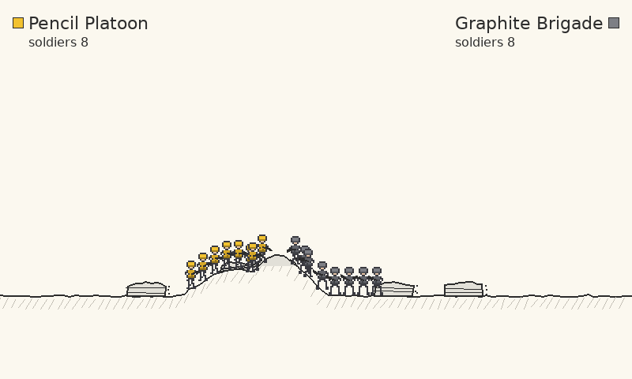

The winner, announced on the paper before the next battle starts:

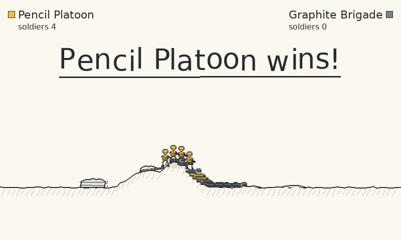

Joining. While a device has no seat, a sticky note invites it to press START (Enter on the
keyboard). A player who presses it gets a card where he chooses a side (Random, Platoon or
Brigade), then a soldier:

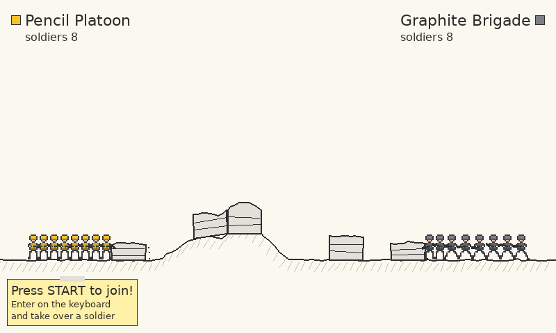

Choosing a soldier: a pencil ring highlights one of the side's computer soldiers, LEFT and RIGHT
move it, and START takes him:

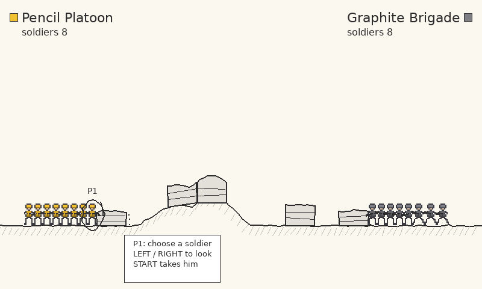

The debug seats view (F3): a tag over every soldier names his driver, and a panel lists each
army's drivers and the latest joins, takeovers and leaves:

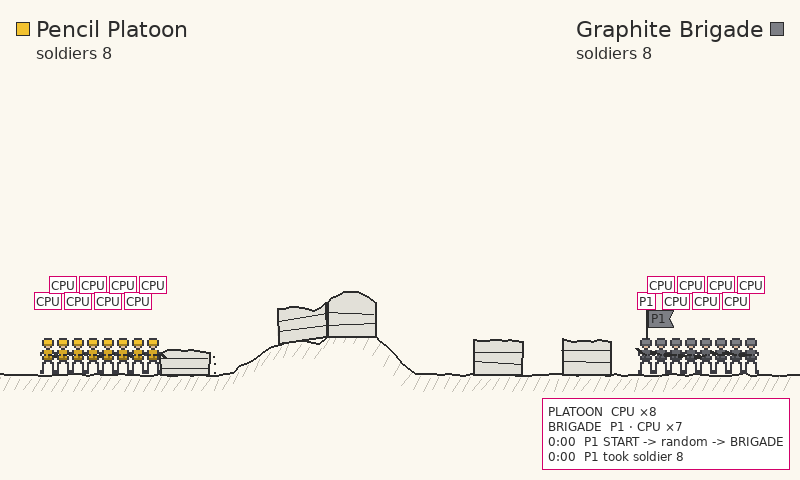

## Where it is going: concept art

These pictures are **concept art** from the brainstorm, not the game. They show the full vision:
a battlefield wider than the screen, tunnels, planes and air drops, and bigger guns. None of this
is in the MVP (see `plans/future-features.md`, entry 54).

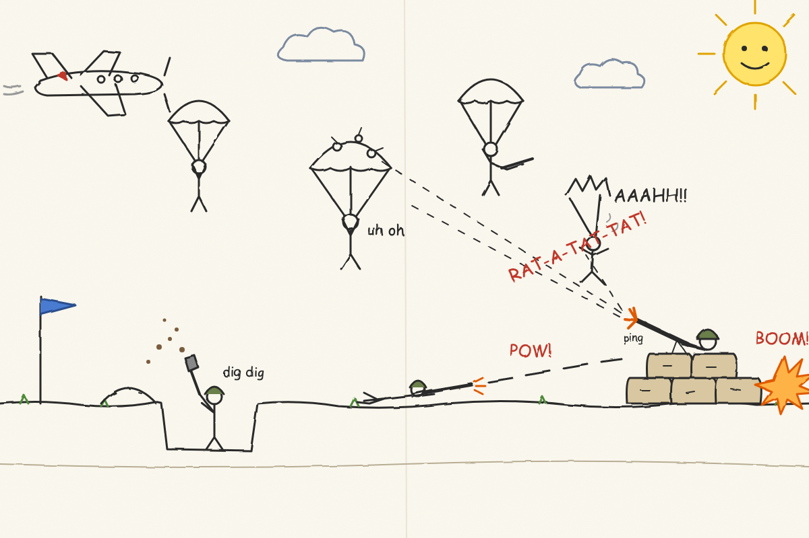

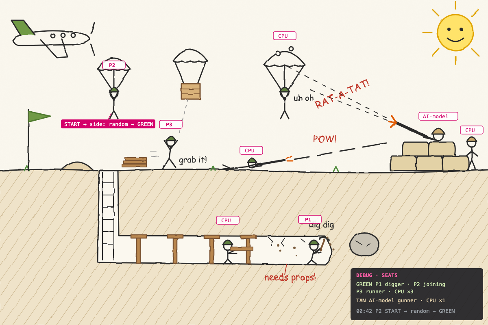

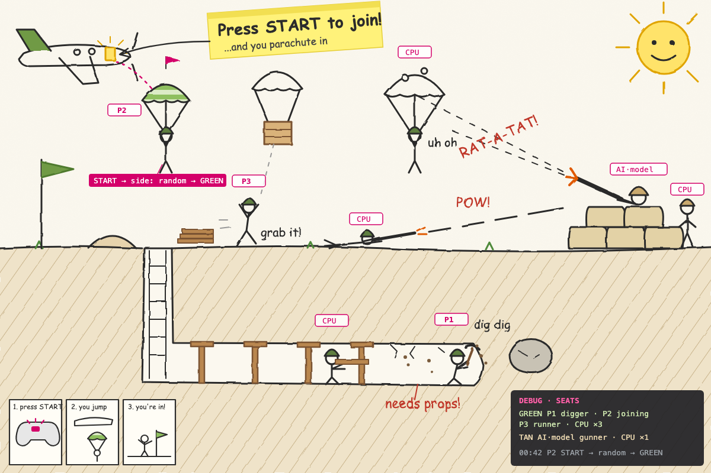

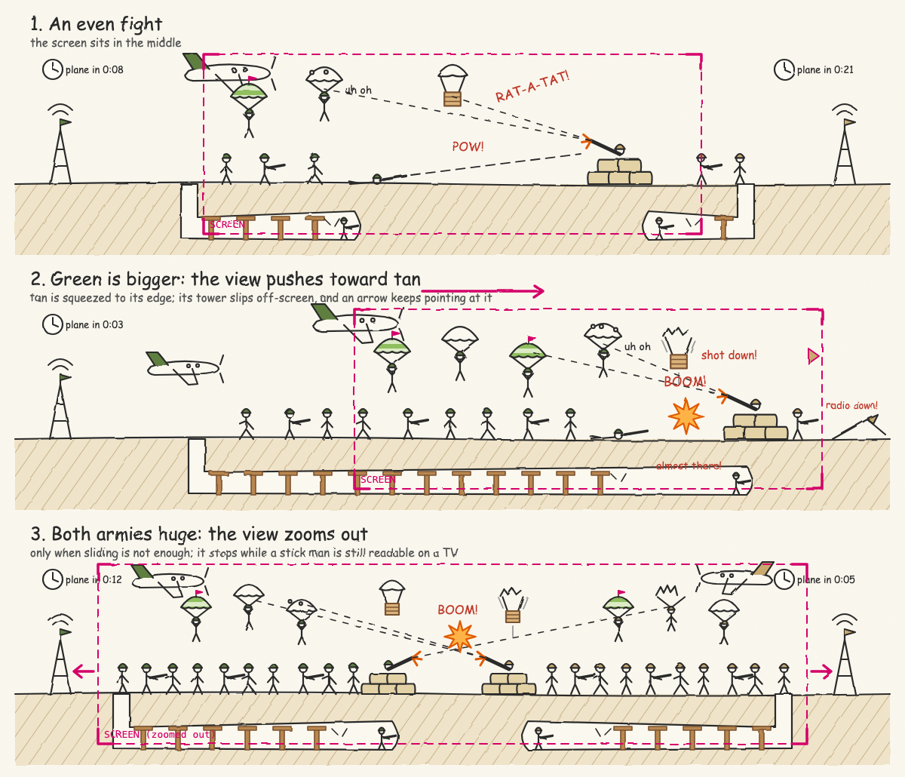

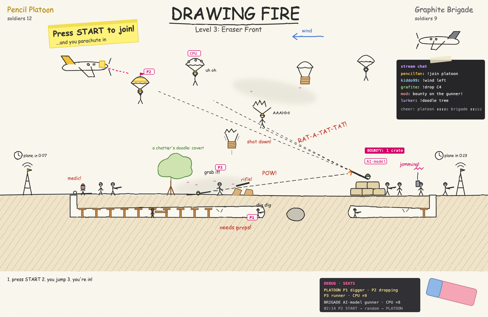

## Running it

```bash
uv run drawing-fire                      # the console script (pyproject.toml [project.scripts])
uv run drawing-fire --debug-overlay      # start with the debug seats view (F3 toggles it)
uv run drawing-fire --random-seed 7      # another battlefield and other battles
uv run drawing-fire --record-trace run.jsonl.gz   # record the session
uv run drawing-fire --replay-trace run.jsonl.gz   # watch it again, exactly
uv run python scripts/simulate_drawing_fire.py --seeds 20   # headless battles: lengths and winners
nox -s browser -- drawing-fire           # the browser build
```

`main()` (`game.py`) is `GameEngine(game=DrawingFireScene).start()`. The scene adds no options of
its own; all its options are the engine's. The battlefield fits the window (800x480 by default),
and `--random-seed` decides the terrain, the sandbags and every soldier's choices.

### Controls

The keyboard and mouse count as one device, and each game controller as another. Nothing is
bound in an `ActionMap`: `players.py` reads every control from the frame's polled input
(`current_input()`), the keys by scancode, so a key is its physical position on every layout.

| Input | Keyboard and mouse | Controller |
|---|---|---|
| Join (a device with no seat) | Enter or keypad Enter | Start |
| Choose a side, choose a soldier | LEFT/RIGHT: A or the left arrow, D or the right arrow; Enter takes | D-pad left/right or the left stick; Start takes |
| Move | A or the left arrow, D or the right arrow | Left stick |
| Aim | The mouse: the soldier aims from his chest at the pointer | Right stick, at any angle (the aim stays put while the stick rests) |
| Fire | Left mouse button (held: he fires whenever his pistol is ready) | Right trigger, or the right shoulder button |
| Leave | Hold Escape for a second (60 frames) | Hold Back for a second, or unplug the controller |
| Quit the game | Q (on its release) | |
| Debug seats view | F3 (the engine's debug overlay) | |

W and S do nothing in the MVP (there is no jump or crouch). Escape never quits: the base `Scene`
quits on the release of Q or Escape, and `DrawingFireScene.on_key_up_event` ignores Escape's
release, because Escape is the keyboard's Back. There is no pause. Battles never stop for
anyone: players drop into and out of them, and the next one starts on its own.

## Where things live

| File | What it holds |
|---|---|
| `glitchygames/examples/drawing_fire/__init__.py` | Re-exports `main` (the `drawing-fire` console script's entry point) |
| `glitchygames/examples/drawing_fire/game.py` | `DrawingFireScene` (the frame: seats, drivers, the battle, the victory countdown; rendering; the debug seats view), `Phase`, `seats_panel_lines`, `main` |
| `glitchygames/examples/drawing_fire/battle.py` | The rules: `Battle`, `Soldier`, `Sandbag`, `Bullet`, `Intent`, `Side`, `ARMY_NAMES`, the events `SoldierKilled` and `SandbagFlattened`, and the tuned numbers |
| `glitchygames/examples/drawing_fire/terrain.py` | `Terrain` (a ground y for every x) and `build_terrain` (flat paper with a few seeded hills) |
| `glitchygames/examples/drawing_fire/drivers.py` | The computer driver: `muster_battle` (a battle and every soldier's memory and own random stream), `computer_intents`, `computer_intent`, `ComputerSoldier` |
| `glitchygames/examples/drawing_fire/players.py` | Player input: `Device`, `KEYBOARD`, `connected_devices`, `device_intent` (a device's input as an `Intent`), `Button`, `ButtonEdges` (presses and holds per device) |
| `glitchygames/examples/drawing_fire/seats.py` | `Seats`: joining, choosing a side and a soldier, the takeover on death, leaving, the seat log; `PlayerSeat`, `Stage`, `SideChoice`, `LEAVE_HOLD_FRAMES` |
| `glitchygames/examples/drawing_fire/swatches.py` | Swatches, the mechanic this game proves (written to move into the engine) |
| `glitchygames/examples/drawing_fire/drawing.py` | The pencil look: `wobble`, the terrain, sandbags, soldiers in their liveries (`ARMY_LIVERIES`), bullets, the HUD and the victory banner |
| `glitchygames/examples/drawing_fire/seat_drawing.py` | The join note, the seat cards, the soldier highlight, and the debug seat tags and panel |
| `glitchygames/examples/drawing_fire/sprites/soldier.toml` | The soldier sprite (stand, walk and down), with its `[swatches.livery]` parts |
| `scripts/simulate_drawing_fire.py` | Headless computer-against-computer battles across seeds (the tuning tool) |
| `tests/examples/drawing_fire/` | The tests, one file per module, plus the simulation's |
| `tests/fixtures/replays/drawing-fire/golden.jsonl.gz` | The golden replay (1,614 frames) |
| `scripts/record_golden_traces.py` | `drawing_fire_script` and `DrawingFireMouse` (the golden replay's player) |
| `scripts/record_scripted_session.py` | `drawing_fire_controls` (the controls tail: Q) and the command that records the fixture |

## One frame

Drawing Fire has one scene, `DrawingFireScene`, and one sheet of paper: the field never scrolls.
Its `dt_tick(dt)` does everything that decides what happens, in this order:

1. **Input.** It reads the frame's snapshot (`current_input()`), updates `ButtonEdges` (how many
   frames each device has held START, BACK, LEFT and RIGHT) and lists the connected devices (the
   keyboard first, then each controller by id).
2. **Seats.** `Seats.update` plays the joins, side and soldier choices and leaves
   ([Seats](#seats-joining-dying-and-leaving)).
3. **Drivers.** In a battle, the computer decides an `Intent` (move, aim, fire) for **every**
   living soldier, a player's included, so the soldier's memory and random stream stay current
   and he is handed back cleanly. Then each playing player's device intent replaces his soldier's.
4. **The battle.** `Battle.step(dt, intents)` applies every intent the same way, whoever drives
   the soldier: it moves soldiers (sandbags stop them), fires pistols that are ready, flies the
   bullets, and returns what happened. A `SoldierKilled` moves a player whose soldier it was to
   another soldier.
5. **The winner.** When one army is gone, the phase becomes `VICTORY` and the banner shows for
   `VICTORY_SECONDS` (3 s). Then `start_battle()` builds the next battle: new terrain, sandbags
   and soldiers from fresh seeded streams, and every joined player chooses a soldier again.

`render(screen)` draws it all from the model, straight onto the screen: the paper and ground (on
the background, drawn once per battle), the sandbags, the fallen and then the standing soldiers,
the bullets, the HUD, the seats' note, cards and highlight, and the banner. The soldiers are not
sprites in `all_sprites`.

## The battle

`battle.py` holds the rules and nothing else: no drawing, no input, no randomness. Each army
starts with `SOLDIERS_PER_SIDE` (8) soldiers spread through its fifth of the field, each with a
pistol. The numbers were tuned with the simulation (design section 4.7):

| Constant | Value | Meaning |
|---|---|---|
| `SOLDIER_HEALTH` | 6 | Hits a soldier takes before he falls |
| `PISTOL_COOLDOWN` | 1.5 s | Between a soldier's shots |
| `PISTOL_RANGE` | 420 px | How far a bullet flies before it falls away (the computer fires only within it) |
| `BULLET_SPEED` | 600 px/s | |
| `WALK_SPEED` | 60 px/s | |
| `SANDBAG_HEIGHT`, `SANDBAG_WIDTH` | 34 px, 48 px | A sandbag blocks walking while it stands |
| `SAND_PER_HIT` | 0.25 | A sandbag loses sand per hit, sags, and is flattened at none |

With these, 200 seeded battles split evenly between the armies, lasting 46 s on average. Hills
block bullets, so the computer neither stands nor fires until the ground leaves a clear line to
its target.

## The computer driver

`drivers.py` turns the battle into an `Intent` for one soldier, as a person reads the screen. A
soldier targets the nearest enemy (and keeps him unless another is nearer by
`TARGET_SWITCH_MARGIN`), advances until the enemy is within his own stand-off distance, takes
cover behind a sandbag when the enemy is in range and in sight, shoots a sandbag that blocks his
way, keeps his spacing from his friends, and fires when his pistol is ready, after a reaction
delay, with an aim error held for the whole shot.

All the computer's randomness (stand-off, reaction delay, aim error) comes from **one random
stream per soldier** (`drawing_fire.soldier.<battle>.<id>`), so a player taking a soldier over
never shifts anyone else's randomness, and battles replay exactly.

## Seats: joining, dying and leaving

`seats.py` keeps every player's seat (`PlayerSeat`: his name, P1 or P2, his device, his stage,
his side and soldier). It reads `ButtonEdges`, never pygame, and its only randomness is its own
stream, `drawing_fire.seats`.

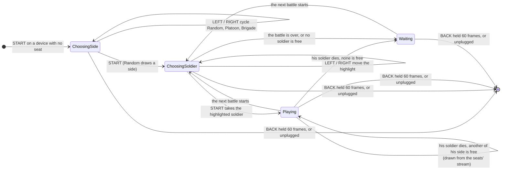

- Each device does at most one thing a frame, so the START that opens a seat never also confirms
  its side.
- The highlight starts on the free soldier nearest the middle of the field, passing over a
  soldier another chooser of the same side is on. It stays on its soldier by id while he moves.
- A player who leaves frees his name. His soldier goes back to the computer at once, or to a
  waiting player of his side.
- The seat log keeps the latest eight joins, takeovers and leaves with their game time, for the
  debug panel (`P1 START → PLATOON`, `P1 took soldier 7`, `P1 died → soldier 4`, `P1 left`).

## Swatches: the mechanic this game proves

The soldier sprite is drawn once, in neutral colours. Its file lists the parts that can be
recoloured, beside its palette:

```toml
[swatches.livery.helmet]
colors = ["h", "H"]      # the base colour, then its shades
role = "primary"
```

`swatches.py` reads these sets (`load_swatch_sets`), and a `Scheme` gives colours to the parts
by role (`primary`, `secondary`) or by name. `recolor_surface` swaps them in by exact RGB: a
part's base colour becomes the scheme's colour, and each shade keeps its brightness relative to
the base, so the helmet's shadow comes out a darker yellow for the Platoon and a darker grey for
the Brigade. `RecoloredFrames` builds each scheme's frames once and keeps them. The sprite file
never changes.

In the game, `drawing.load_soldier_frames` loads the frames with the engine's `AnimatedSprite`
loader, scales them up by whole pixels (so the exact colours survive), adds mirrored copies for
a soldier facing left, and `draw_soldier` asks for his army's livery
(`ARMY_LIVERIES[soldier.side]`). Nothing in `swatches.py` names the game: it is written to move
into `glitchygames/sprites/`. What that would take is entry 55 in `plans/future-features.md`.

## The pencil look

Everything is drawn with pygame primitives onto the surface it is given, from the model. A
hand-drawn line wanders by `wobble(x, y, salt)`, a deterministic hash of where it is, never a
random stream, so the same picture is drawn every frame and in every replay. Text is rendered
once per content, fonts are made once. The colours are the paper (`PAPER_COLOR`), the pencil
(`PENCIL_COLOR`), a light hatching under the ground, and the two armies' colours: pencil yellow
`(242, 194, 48)` and graphite grey `(125, 127, 133)`.

## How it uses the engine

| Engine feature | How Drawing Fire uses it |
|---|---|
| Game time and `dt` | Movement, cooldowns, bullets and the victory countdown use the scene's `dt` (capped at `MAX_FRAME_SECONDS`, 0.05 s, after a hitch); the seat log uses `game_time` |
| Random streams | Terrain, sandbags, the seats and one stream per soldier per battle, all from `random_stream` (seeded from `--random-seed`, kept in recordings) |
| Polled input | Every control is read from `current_input()` (keys by scancode, the mouse, controller axes and buttons), never from pygame, so a replay serves the same input |
| Sprite loading | `AnimatedSprite` loads the soldier's frames; swatches recolour them |
| Debug overlay | `DrawingFireScene.debug_draw(surface, camera)` draws the seat tags and the seats panel when the overlay is on (F3) |
| Recording and replay | `--record-trace` and `--replay-trace` work as for every game; see below |
| Browser build | `nox -s browser -- drawing-fire` (`scripts/build_browser_bundle.py` `GAMES`). It has no touch layout yet (exempt in `tests/test_browser_touch_controls.py` until its dual-stick controls settle) |

### Recording, replay and the golden replay

Everything that decides what happens runs on the frame's `dt`, the seeded streams and the
polled input, so a `--record-trace` recording replays exactly with `--replay-trace`.

The golden replay `tests/fixtures/replays/drawing-fire/golden.jsonl.gz` was recorded through the
real engine loop by `scripts/record_scripted_session.py --game drawing_fire --frames 1600`. The
keyboard plays the whole session (`drawing_fire_script`): Enter opens a seat at frame 30, the
right arrow moves the side card to the Platoon and Enter confirms it, D and A move the soldier
highlight and keypad Enter takes soldier 7 at frame 131. The player fires with the left mouse
button (held, let go, held again), the mouse following the nearest enemy (`DrawingFireMouse`),
walks right with D, steps back with the left arrow and A, then walks through the Brigade's line
with the right arrow and stands there. He is shot down at frame 915 and takes over soldier 4,
dies again at frame 1235 when his side has no soldier left to take, and waits through the
Brigade's victory. The next battle starts with him choosing a soldier; he holds Escape from frame
1500 and leaves at frame 1560. The
controls tail (`drawing_fire_controls`) then quits with Q. With the tail, the fixture holds 1,614
frames.

Because the game reads its controls from the polled input, which a posted event never changes in
SDL, the recorder lays the input it posted over each live snapshot (`PostedPolledInput`), as a
real keyboard and mouse would. The replay serves the recorded snapshots.

`tests/replay/test_golden_replays.py` checks that every control the game reads is exercised: its
keys by scancode, the mouse's motion and left button, and Q. The controller's controls are
excused (`UNEXERCISED_CONTROLS`, `NO_GAMEPAD_IN_THE_SESSION`), because the scripted session runs
on the dummy driver, which has no gamepad. Drawing Fire is in `GAMES_WITHOUT_A_PAUSE`, so its
replay is checked never to reach the pause screen instead of pausing and resuming.

Two limits, both noted in `plans/future-features.md` entry 54:

- The soldiers, bullets and sandbags are drawn, not sprites, and the game posts no events, so a
  replay compares only the scene, the frame count and the game's own QUIT. It would not notice a
  battle that played out differently.
- The fixture is about 190 KB, over the 100 KB the other games keep: the first frame holds every
  random stream's state (19 of them, twice), about 125 KB compressed on its own.

The pytest plugin `glitchygames/testing/replays.py` replays the fixture in a child process
(`drawing-fire --replay-trace ... --headless`), and the test fails unless it exits `SUCCESS`.
Re-record the fixture only deliberately (the commands are in the script's docstring), never just
to make a failing replay pass, and check that the new recording still holds a death (replay it
and read the seat log).

## Tests

The tests use real pygame on the dummy driver; what is drawn is checked by its pixels.

| File | What it pins |
|---|---|
| `tests/examples/drawing_fire/test_battle.py` | Mustering, walking and sandbags, pistols and cooldowns, bullets (hills, range, no tunnelling), hits and deaths, sandbags losing sand, sandbag placement, the winner |
| `tests/examples/drawing_fire/test_terrain.py` | Seeded hills over a flat baseline, any screen width, the ground between pixels |
| `tests/examples/drawing_fire/test_drivers.py` | The computer driver's rules: targets, stand-offs, cover, sandbags, spacing, held aim, each soldier's own stream |
| `tests/examples/drawing_fire/test_players.py` | Keyboard and mouse, and controller, input as intents; dead zones; button edges |
| `tests/examples/drawing_fire/test_seats.py` | Joining, choosing a side and a soldier, the highlight, takeovers on death, waiting, leaving, two players |
| `tests/examples/drawing_fire/test_swatches.py` | Reading swatch sets and their errors, schemes, shades, recolouring, the frame cache |
| `tests/examples/drawing_fire/test_drawing.py` | The pencil look by its pixels: wobble, terrain, sandbags, soldiers in their liveries, bullets, HUD, banner |
| `tests/examples/drawing_fire/test_game.py` | The scene: battles, victory and the next battle, players driving soldiers, the seats drawn, the debug seats view, Escape never quitting |
| `tests/examples/drawing_fire/test_simulation.py` | `scripts/simulate_drawing_fire.py`'s headless battles |
