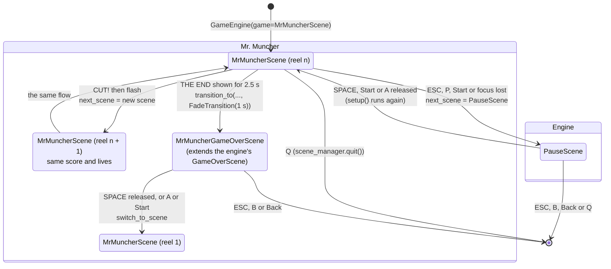
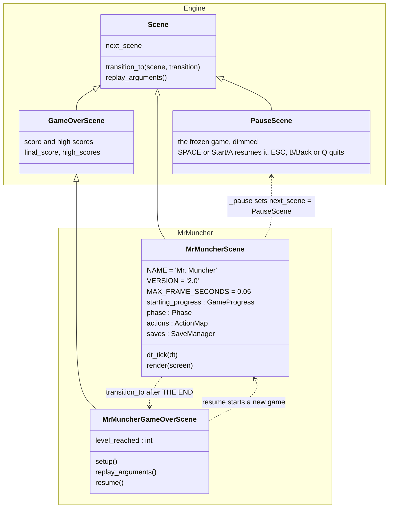
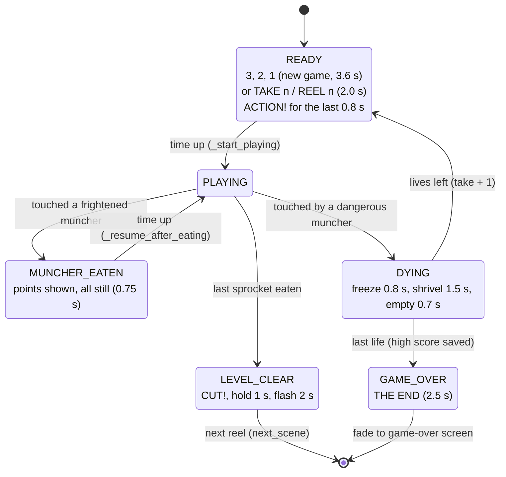
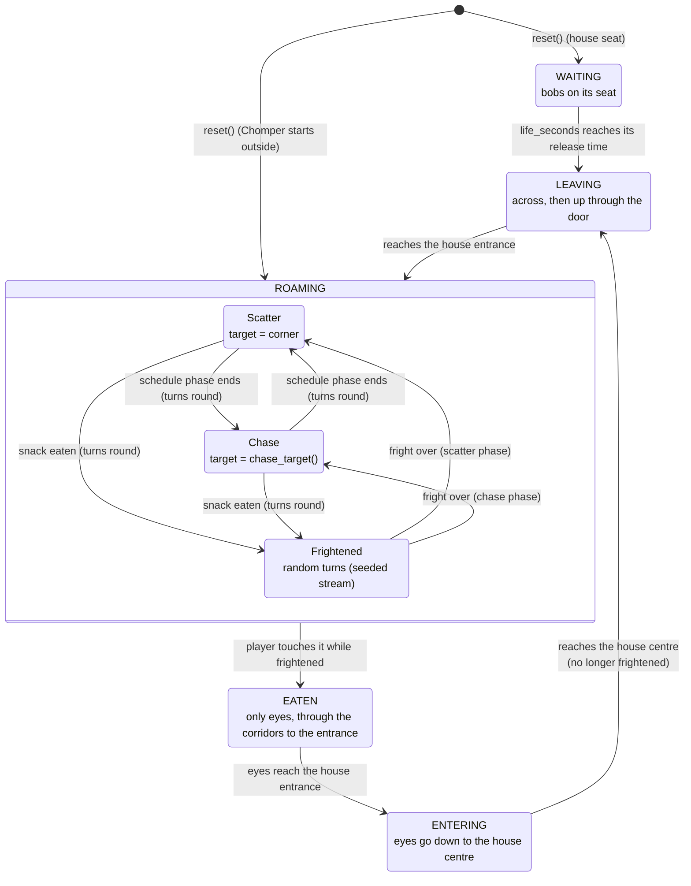
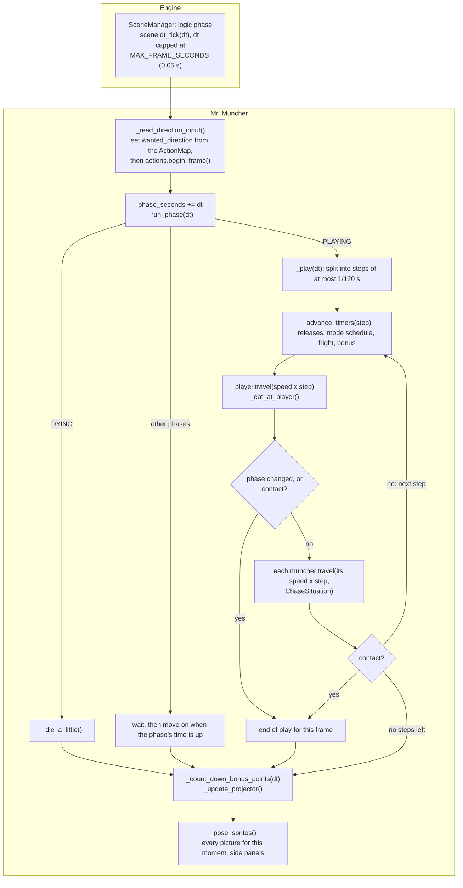
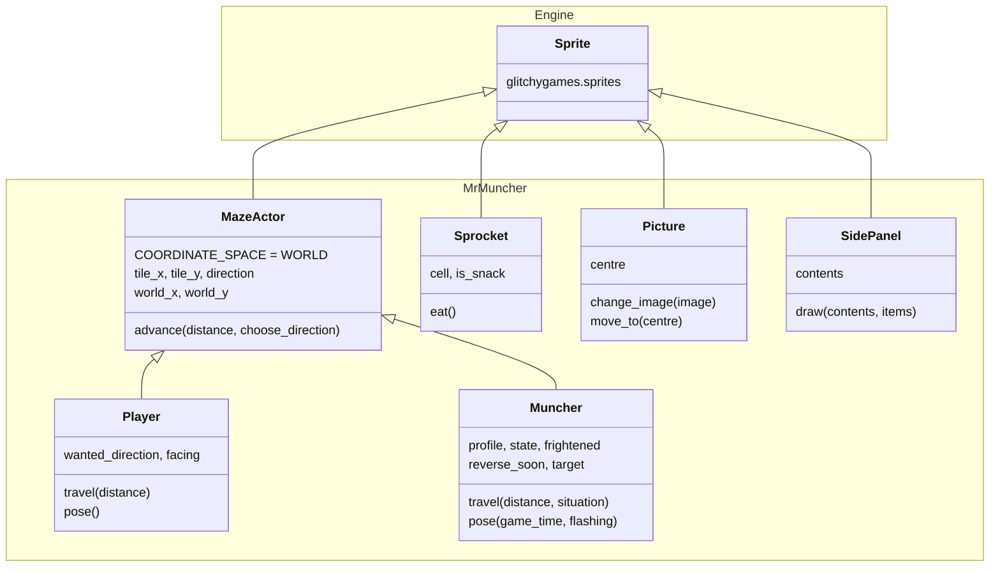
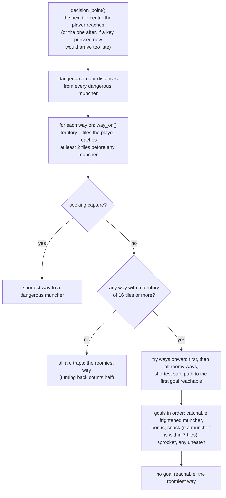

# Mr. Muncher Architecture

Mr. Muncher is a maze chase set in a cinema, written as one of the engine's example games. You
are Mr. Muncher, a red-and-white popcorn bucket. You eat the **sprockets** (small dots drawn like
the holes along a film strip) to finish the **reel**, while four **munchers** (spiky fuzzballs)
hunt you. A **snack** (a wrapped candy) gives you a sugar rush: for a few seconds the munchers
turn dull blue and run away, and you can eat them. Each life is a **take**, a cleared maze is a
**CUT!**, and the last life ends with **THE END**.

This page explains how the game is built, for a developer who wants to understand it or write a
game like it. Everything here comes from `src/games/mr-muncher/src/mr_muncher/`. The module
docstrings there are the detailed reference.

## Running it

```bash
uv run mr-muncher                      # the console script (pyproject.toml [project.scripts])
uv run mr-muncher --debug-overlay      # start with the debug overlay (F3 toggles it, F4 cycles panels)
uv run mr-muncher --record-trace run.jsonl.gz   # record the session
uv run mr-muncher --replay-trace run.jsonl.gz   # watch it again, exactly
```

`main()` (`game.py`) is just `GameEngine(game=MrMuncherScene).start()`. The scene does not
define an `args()` class method, so the game adds no options of its own (the engine logs `Game
does not implement arguments`). All its options are the engine's. These are the ones that
matter here:

| Option | Effect on Mr. Muncher |
|---|---|
| `--resolution WxH` (default `800x480`) | The maze is scaled to fit (see [Layout](#layout-and-the-side-panels)). At 800x480 the tiles are 20 px and the maze starts at x = 130 |
| `--target-fps` | The scene sets no `TARGET_FPS`, so the default is 60.01. Movement uses `dt`, so the frame rate does not change the game's speed |
| `--input-mode {auto,joystick,controller}` | Which gamepad events reach the `ActionMap` (both families in `auto`) |
| `--debug-overlay` | Shows each muncher's target tile (see [Debug overlay](#debug-overlay)) |
| `--random-seed INT` | Seeds the frightened munchers' random turns |
| `--screen-shake-intensity`, `--rumble-intensity` | Scale the shake and rumble when a muncher catches you |
| `--live-voice-pool` | The projector sound needs one free live voice |
| `--record-trace`, `--replay-trace`, `--headless` | Recording and replay (see [Engine features](#how-it-uses-the-engine)) |

### Controls

Every keyboard control is bound **by scancode** (`ActionMap.bind(scancode=...)`), so it is
tied to a key's physical position and works the same on every keyboard layout.

| Input | Action | Where it is handled |
|---|---|---|
| Arrow keys, or W A S D | Steer. A direction pressed early is remembered and taken at the next junction | `ActionMap` (`move_up`, `move_left`, `move_down`, `move_right`) |
| Gamepad D-pad buttons | Steer | `ActionMap` (`CONTROLLER_BUTTON_DPAD_*`) |
| Gamepad left stick, pushed past 0.5 | Steer | `ActionMap` (`CONTROLLER_AXIS_LEFTX/LEFTY`, `STICK_THRESHOLD`) |
| Joystick hat (a pad whose D-pad is a hat) | Steer, in the direction pushed | `on_joy_hat_motion_event` (no `ActionMap`) |
| ESC, P, or gamepad Start | Pause (not after the game is over) | `ActionMap` (`pause`) |
| Window loses focus | Pause | `on_window_focus_lost_event` |
| Q | Quit (on the press) | `ActionMap` (`quit`), then `scene_manager.quit()` |
| On the pause screen: SPACE or gamepad Start or A / ESC or gamepad B or Back / Q | Resume (on release, after a press there) / quit (on the press) / quit (on release) | The engine's `PauseScene` (both gamepad event layers) |
| On the game-over screen: SPACE (release), gamepad A or Start / ESC or gamepad B or Back | New game / quit | `MrMuncherGameOverScene` and `GameOverScene` |

Note that ESC pauses the game, but ESC on the pause screen quits. The pause and game-over
screens are engine scenes and check key codes (`event.key`), not scancodes.

## Its package

Mr. Muncher is a package of its own beside the engine, `src/games/mr-muncher/` (distribution
`mr-muncher`, import package `mr_muncher`), the first game moved out of the engine. How such a
package is laid out, installed, tested and built, and how a game is moved into one, is in
[Games as Their Own Packages](../architecture/game_packages.md).

Its recordings name it `games.mr_muncher.game:MrMuncherScene`, its golden replay is
`src/games/mr-muncher/tests/fixtures/replays/golden.jsonl.gz`, and its browser bundle ships
`mr_muncher.zip`.

## Where things live

| File | What it holds |
|---|---|
| `src/games/mr-muncher/src/mr_muncher/__init__.py` | Re-exports `main` (the `mr-muncher` console script's entry point) |
| `src/games/mr-muncher/src/mr_muncher/maze.py` | `MAZE_LAYOUT` (the maze as text), tile characters, `Direction`, `DIRECTION_PREFERENCE`, `Maze` (a frozen pydantic model: tile questions, wrapping, distances) |
| `src/games/mr-muncher/src/mr_muncher/levels.py` | `LevelSettings` and `settings_for_level` (the difficulty ramp), the scatter/chase schedule helpers, the frightened flash |
| `src/games/mr-muncher/src/mr_muncher/actors.py` | `MazeGeometry` (tiles to pixels), `MazeActor` (tile-to-tile movement), `Player`, `Muncher`, `MuncherProfile`, `Personality`, `MuncherState`, `ChaseSituation`, `chase_target` |
| `src/games/mr-muncher/src/mr_muncher/game.py` | `MrMuncherScene` (one reel: phases, scoring, input, saves, sound, drawing), `Phase`, `GameProgress`, `MrMuncherGameOverScene`, `main` |
| `src/games/mr-muncher/src/mr_muncher/drawing.py` | Every picture, drawn with pygame primitives and cached with `functools.cache`: maze, bucket, munchers, eyes, sprockets, snacks, bonus reel, film-strip panels |
| `src/games/mr-muncher/src/mr_muncher/scenery.py` | The sprites that never move (`Sprocket`, `Picture`, `SidePanel`) and the text helpers (`bundled_font`, `fitted_font`, `render_text`) |
| `src/games/mr-muncher/src/mr_muncher/sounds.py` | The sound effects and jingles as synth `SoundRecipe`s |
| `src/games/mr-muncher/src/mr_muncher/autopilot.py` | `Autopilot`, a bot that plays the game. The golden replay's script and the tests use it |
| `src/games/mr-muncher/tests/test_mr_muncher.py` | The scene: game flow, scoring, input, saves, screens, whole games |
| `src/games/mr-muncher/tests/test_mr_muncher_maze_and_actors.py` | The parts: maze, levels, actors, pictures, scenery, sounds, autopilot |
| `src/games/mr-muncher/tests/fixtures/replays/golden.jsonl.gz` | The golden replay (2,072 frames) |
| `scripts/golden_inputs.py` | `mr_muncher_script` and `MuncherSteering` (the autopilot pressing arrow keys) |
| `scripts/record_scripted_session.py` | `mr_muncher_controls` (the golden replay's controls tail) and the command that records the fixture |

## Scenes and how they switch

A game is a chain of scenes. Each reel is a new `MrMuncherScene`, built from a `GameProgress`
(a frozen pydantic model holding the reel number, score, lives left and whether the extra life
has been given). The scene keeps the progress it started with as `starting_progress`.

In the diagram, the Engine box holds the engine's built-in `PauseScene`; the Mr. Muncher box
holds the game's own scenes (`MrMuncherGameOverScene` extends the engine's `GameOverScene`, see
[Scene classes](#scene-classes)).



- **Next reel**: `_go_to_next_level` sets `next_scene` to a new `MrMuncherScene` with
  `GameProgress(level + 1, score, lives, extra_life_awarded)`. It does this only once (it
  checks that `next_scene` is still `None`).
- **Game over**: `_show_game_over_screen` fades (1 s `FadeTransition`) to
  `MrMuncherGameOverScene`. This screen shows the engine's GAME OVER layout (score and high
  score table) plus a headline, either `NEW HIGH SCORE!  Reel N` or `You reached reel N`.
  `resume()` always starts a new game with `switch_to_scene(MrMuncherScene(...))`, because the
  previous scene depends on how the screen was reached.
- **Pause**: the engine's `PauseScene` shows a frozen screenshot of the game. When play
  resumes, the scene's `setup()` runs again. That is why `setup()` shows the ready message only
  while the phase is still `READY`.

### Scene classes

Mr. Muncher's scenes are two classes in `src/games/mr-muncher/src/mr_muncher/game.py`:
`MrMuncherScene` and `MrMuncherGameOverScene`. `Scene` and the built-in `PauseScene` and
`GameOverScene` come from the engine (`glitchygames.scenes`). In the diagram, the Engine box is
what every game gets; the Mr. Muncher box is what this game adds. Solid arrows are inheritance,
pointing at the base class; dotted arrows are how the game uses an engine class.



Unlike PaddleSlap, `MrMuncherScene` names `PauseScene` itself: `_pause` sets
`next_scene = PauseScene(options=self.options)`, except once the game is over.

### Phases inside a reel

Inside one scene, `Phase` decides what each frame does. `_run_phase` runs the current phase;
each waiting phase moves on once `phase_seconds` (game time since the phase began) is up. Because
the phase clocks run on game time, a paused game also pauses its countdowns.



The ready message (`_ready_message_text`) depends on the moment:

| Situation | `ready_seconds` | Message | Cue sound |
|---|---|---|---|
| New game (reel 1, score 0) | 3.6 (`INTRO_READY_SECONDS`) | `3`, `2`, `1` (2.8 s split three ways), then `ACTION!` | `countdown_beep` for each number, then `action` |
| A later life | 2.0 (`READY_SECONDS`) | `TAKE n`, then `ACTION!` | `action` |
| A later reel | 2.0 | `REEL n`, then `ACTION!` | `action` |

The message is drawn again only when its text or colour changes (`message_shown`), and each cue
plays once, when its text first appears.

## The maze

### Layout as text

`MAZE_LAYOUT` is a tuple of strings, one per row of tiles: 27 columns by 24 rows. It is
symmetric from left to right, every corridor is one tile wide, there are no dead ends, and every
open tile can be reached from every other. The tests check all four properties.

```text
###########################
#o...........#...........o#
#.####.#####.#.#####.####.#
#.####.#####.#.#####.####.#
T.........................T
#.####.##.#######.##.####.#
#......##....#....##......#
#.####.#####.#.#####.####.#
#.#....##         ##....#.#
#.#.##.## ###-### ##.##.#.#
#...##.   #HHHHH#   .##...#
###.##.## #HHHHH# ##.##.###
#......## #HHHHH# ##......#
#.####.## ####### ##.####.#
#.#....##         ##....#.#
#.#.##.#####.#.#####.##.#.#
#...##.......#.......##...#
#.####.#####.#.#####.####.#
#o..##.......P.......##..o#
###.##.##.#######.##.##.###
#......##....#....##......#
#.##########.#.##########.#
T.........................T
###########################
```

| Character | Meaning | Player may stand on it |
|---|---|---|
| `#` | Wall | No |
| `.` | Sprocket (252 of them) | Yes |
| `o` | Snack (4 of them) | Yes |
| space | Empty corridor | Yes |
| `T` | Tunnel mouth: munchers slow down here | Yes |
| `H` | Inside the munchers' house | No |
| `-` | The house door: munchers pass through it, the player never does | No |
| `P` | Player start (an empty corridor tile) | Yes |

`Maze` is a frozen pydantic model. Its validator rejects a layout that is not a rectangle or that
does not have exactly one `P`. It knows nothing about pixels. Positions are in **tile units**:
the centre of the tile in column `c`, row `r` is `(c, r)`, so an actor standing on a tile centre
has whole-number coordinates.

- **Tunnels.** `Maze.tile` wraps columns, and treats rows outside the maze as wall. Only rows 4
  and 22 are open at both edges, so they are the two wrapping tunnels. `wrap_x` moves an x that
  has gone more than half a tile past an edge to the other side. `tile_distance` measures the
  short way round, so two positions at opposite ends of a tunnel count as close.
- **The house.** The door is at (13, 9). `house_entrance` is the corridor tile above it (13, 8),
  where munchers leave and come back. `house_centre` is two tiles below the door (13, 11).
- **Geometry.** `MazeGeometry` (`actors.py`) holds `tile_size`, `left` and `top`, and converts a
  position in tiles to pixels (`pixel_centre`). `maze_geometry` (`game.py`) chooses the tile
  size.

### Grid movement and turn buffering

Both the player and the munchers are `MazeActor`s. They move only along corridors, and they
choose a direction only when they stand exactly on a tile centre (`is_at_tile_centre`: both
coordinates are whole numbers).

`MazeActor.advance(distance=..., choose_direction=...)` walks a distance from one tile centre to
the next. Each time it reaches a centre, or starts on one, it calls `choose_direction` to decide
the way on (`None` means stop). When a step reaches a centre, the coordinate is rounded so it
lands exactly on it. Because the walk goes centre to centre, a long frame cannot skip past a
turn.

The player's turn buffering (`Player.travel` and `_choose_direction`):

1. `wanted_direction` is the way the player last asked for.
2. **Reversing happens at once**, even between centres. If the wanted direction is the opposite
   of the current one, the player turns round on the spot.
3. On each tile centre the player takes the wanted direction if it is open. Otherwise it goes
   straight on if it can, and stops against a wall if it cannot. The wanted direction stays
   remembered until a junction opens that way.
4. A new life starts heading left with left wanted, as in the arcade game.

How input sets `wanted_direction` (`_read_direction_input`, at the start of each `dt_tick`):
a direction **just pressed** wins (if two are pressed in one frame, the first of up, left, down,
right wins). If no direction was just pressed and the wanted direction's key was **just
released** while another direction is still held, the held one becomes wanted, as with a held
joystick. Releasing the last key keeps the wanted direction. Then `actions.begin_frame()` clears
the frame's presses and releases.

## The munchers

There are four munchers (`muncher_profiles`). The chaser comes first in the list, because the
flanker aims relative to it.

| Name | Colour | `Personality` | Chase target | Scatter corner | Starts |
|---|---|---|---|---|---|
| Chomper | purple | `CHASER` | The player's tile | (24, -3), top right | Outside, above the door, roaming left |
| Snapper | green | `AMBUSHER` | 4 tiles ahead of where the player faces | (2, -3), top left | House centre |
| Gnasher | orange | `FLANKER` | The pivot 2 tiles ahead of the player, mirrored away from Chomper: `2 * pivot - chaser` | (26, 24), bottom right | House, left seat |
| Nibbles | magenta | `SHY` | The player's tile while farther than 8 tiles from it, else its own corner | (0, 24), bottom left | House, right seat |

The scatter corners lie outside the maze, so a scattering muncher circles the block of walls
nearest its corner.

### Choosing a turn

At each tile centre, a roaming muncher (`Muncher._choose_direction`):

1. Never turns back by itself. The way it came is removed from the options; it is used only at
   a dead end, and this maze has none.
2. Considers only open corridor tiles (the same test as the player's, so roaming munchers never
   walk back into the house).
3. If **frightened**, picks one of the options at random from the seeded stream
   `random_stream('mr_muncher.munchers')`, so a replay makes the same choices.
4. Otherwise it takes the option whose next tile is closest in a straight line (`tile_distance`,
   tunnel-aware) to its **target**. On a tie the order is up, left, down, right
   (`DIRECTION_PREFERENCE`, the arcade game's order).

The target (`_target`): the house entrance for eyes, the scatter corner while scattering,
`chase_target(...)` while chasing. The target is stored on `muncher.target` for the debug
overlay. The munchers learn about the game through a `ChaseSituation` that the scene builds for
each step: the player's tile and facing, Chomper's tile, and whether the munchers are chasing.

### Muncher state machine

`MuncherState` is where a muncher is in its life. Being frightened is a separate flag
(`frightened`), because a muncher waiting in the house or walking out can be frightened too.



| State | Movement | Speed | Can touch the player |
|---|---|---|---|
| `WAITING` | `_bob`: up and down 0.35 tiles around its seat | `house_speed` | No |
| `LEAVING` | `_walk_out`: across to the door's column, then up to the entrance | `house_speed` | Yes |
| `ROAMING` | `advance` through the corridors, turning as above | `tunnel_speed` on a `T` tile, else `frightened_speed` if frightened, else `hurry_speed` (Chomper only, with few sprockets left), else `muncher_speed` | Yes |
| `EATEN` | `advance` towards the house entrance | `eyes_speed` | No |
| `ENTERING` | `_walk_in`: down to the house centre | `eyes_speed` | No |

A **change of mode turns every roaming muncher round**. When the schedule's phase changes, or a
snack starts a fright, the scene sets `reverse_soon`, and the muncher reverses on its next step,
even between tile centres. This is the only time a muncher reverses.

### Scatter, chase and fright timing

The scene keeps three clocks per life, all in game time and all reset when a life starts
(`_reset_actors`). `_advance_timers` advances them on every step:

- `life_seconds` decides when each muncher waiting in the house is released (`release_seconds`,
  in house order: Snapper, Gnasher, Nibbles).
- `mode_seconds` drives the scatter/chase schedule. It **stops while the munchers are
  frightened**, so a fright does not use up a scatter phase. `munchers_chase(schedule=...,
  elapsed_seconds=...)` gives the mode: phases alternate scatter, chase, scatter, ..., starting
  with scatter, and after the last phase the munchers chase for good. `mode_phase_index`
  detects the change of phase that turns them round.
- `frightened_seconds_left` counts down a fright. When it reaches zero, `_end_fright` clears
  every muncher's `frightened` flag.

A snack (`_start_fright`) frightens every muncher that is not eyes, resets the count of
munchers eaten during this fright (which sets their points), and turns the roaming munchers
round. Frightened munchers **flash** white and blue for the last 2 s of the fright (or all of
it, if the fright is shorter), switching every quarter second (`frightened_is_flashing`).

## Levels and the difficulty ramp

`settings_for_level(level)` returns a frozen `LevelSettings`. Each reel is a little faster and
meaner than the one before, up to reel 8 (`LAST_RAMP_LEVEL`); after that, every reel plays like
reel 8. Speeds are in tiles per second.

| Setting | Reel 1 | Each reel adds | From reel 8 on |
|---|---|---|---|
| Player speed | 7.5 | +0.15 | 8.55 |
| Muncher speed (fraction of the player's speed) | 0.82 | +0.018 (at most 0.95) | 0.946 (8.09 tiles/s) |
| Fright length | 8.0 s | -0.9 s (never below 2.0 s) | 2.0 s |
| Chomper hurries when this few sprockets are left | 20 | +5 | 55 |
| Bonus reel points | 100, 300, 500, 700, 1000, 2000, 3000, 5000 (reels 1 to 8) | | 5000 |
| Scatter/chase schedule (s) | 9, 15, 9, 15, 7, 20, 5, then chase | | 5, 20, 5, 20, 3, 30, 1, then chase (from reel 2) |
| House release times (s) | 0.5, 4.0, 8.0 | | 0.5, 2.5, 5.0 (from reel 2) |

Other speeds are fixed fractions of the player's speed: frightened munchers 0.55, munchers on a
tunnel tile 0.50, munchers moving in or out of the house 0.45, eyes 2.0. During a sugar rush the
player is 1.1 times faster, and a hurrying Chomper is 1.08 times faster than the other munchers.

## Scoring, the bonus reel and lives

| Event | Points | Also |
|---|---|---|
| Sprocket | 10 | One of two crunch sounds, alternating |
| Snack | 50 | Starts a fright (`sugar_rush` sound) |
| Frightened muncher | 200, 400, 800, 1600 (doubling for each one eaten in the same fright) | Everything stops for 0.75 s while the points show (`camera_flash` sound). Mr. Muncher and the eaten muncher are hidden meanwhile |
| Bonus film reel | The reel's `bonus_points` | Shown for 2 s (`eat_bonus` sound) |

- **The bonus reel** appears on the tile three rows below the house centre (`message_cell`,
  where the messages show too) after the 70th and the 170th sprocket of a reel
  (`BONUS_SPROCKET_COUNTS`), and stays 9.5 s unless eaten.
- **Extra life**: one, the first time the score reaches 10,000 (`extra_life` sound). The game
  starts with 3 lives, counting the one in play.
- **Contact**: a muncher touches the player when their centres are closer than 0.6 tiles
  (`CONTACT_DISTANCE_TILES`, tunnel-aware). Only munchers that are roaming or leaving the house
  count. The first muncher found touching settles the step: it is eaten if frightened,
  otherwise the player is caught.
- **High scores** use the engine's saves: `open_saves(app_name='mr-muncher')`, save name
  `high_scores`, stored as `{'scores': [{'score': ..., 'level': ...}, ...]}`, best first, the
  best 10 kept. The game is added to the table when the last life is lost. The panel's HIGH
  SCORE is the larger of the best saved score and the current score. In a replay the saves are
  an in-memory sandbox seeded from the recording, so a replay never touches real saves.

## One frame

The engine runs `dt_tick` (logic) before it processes the frame's events, and `update()` (render
phase) after positioning. Mr. Muncher does all its work in `dt_tick` and does not override
`update()`. `MAX_FRAME_SECONDS = 0.05`: after a hitch, such as dragging the window, logic
advances at most 50 ms in one frame.

In the diagram, the Engine box is the scene manager calling the scene; everything in the
Mr. Muncher box is the game's own `dt_tick`.



- **Sub-steps.** `_play` splits the frame into `ceil(dt / (1/120))` equal steps (two at 60 FPS,
  at most six after a capped hitch), so no actor moves far enough in one step to pass through
  another. In each step the player moves and eats first, and contact is checked both after the
  player moves and after the munchers move.
- **The pose rule.** Every sprite's picture is chosen in `dt_tick`, after its state is decided
  (`_pose_sprites`): the bucket's chomp (four mouth steps per tile travelled), the dying
  animation (24 steps), each muncher's body, frightened or flashing picture or eyes, the skirt's
  wave (every 0.15 s of game time), and the snacks' twinkle. The side panels are redrawn only
  when what they show changes.
- **Input timing.** Key events are handled after `dt_tick`, so a key pressed in frame N changes
  `wanted_direction` in the `dt_tick` of frame N + 1. The autopilot allows for this delay (see
  below).

## Drawing

### Sprites and background

The **maze is not made of sprites**. When a scene is built, `_draw_maze_backgrounds` blits
`drawing.maze_picture(...)` onto the scene's background, and onto a copy for the level-clear
flash (white trim on lighter velvet). Everything that changes is a sprite in the scene's
`LayeredDirty` group, drawn in layer order:

| Layer | Sprites | Space |
|---|---|---|
| 0 `SPROCKET_LAYER` | `Sprocket` (sprockets and snacks; an eaten one is made invisible) | Screen |
| 1 `BONUS_LAYER` | `Picture` named `Bonus` (the film reel) | Screen |
| 2 `MUNCHER_LAYER` | `Muncher` x 4 | World |
| 3 `PLAYER_LAYER` | `Player` | World |
| 4 `POPUP_LAYER` | `Picture`s `MuncherPoints`, `BonusPoints` | Screen |
| 5 `MESSAGE_LAYER` | `Picture` `Message` (3, 2, 1, ACTION!, TAKE n, CUT!, THE END) | Screen |
| 6 `PANEL_LAYER` | `SidePanel` x 2 (film-strip edges with the score, lives, bonus, control hints) | Screen |

In the diagram, the Engine box is the engine's `Sprite` (`glitchygames.sprites`); the
Mr. Muncher box holds the game's sprite classes (`actors.py` and `scenery.py`). Solid arrows are
inheritance, pointing at the base class.



The actors are **world-space sprites** (`COORDINATE_SPACE = CoordinateSpace.WORLD`). They keep
their positions in tiles, report `world_x`/`world_y` in pixels (the picture's top-left corner),
and the engine places their rects every frame. Hiding one uses `hidden = True`, never
`visible`, which the engine owns for world sprites. The camera never moves (the scene sets no
follow target), so world pixels are screen pixels. The still sprites are screen space and place
their own rects.

`render()` is overridden: it blits the whole background (the flash copy on alternate quarter
seconds during the level-clear flash), clears the group with that same background, draws every
sprite, and sets `self.rects = None` so the whole screen is presented.

### Pictures

`drawing.py` draws every picture with pygame primitives. Shapes are drawn four times larger
(`SUPERSAMPLE`) and smooth-scaled down, which smooths their edges. The maze is drawn twice as
large (`MAZE_SUPERSAMPLE`) because its blur is the costly part. Every function is cached with
`functools.cache`, because the game asks for the same few pictures every frame, so callers must
not draw on the surfaces they get back.

The maze picture: each open tile is drawn as a black square widened by 0.2 of a tile on each
side, the wall shape is blurred, and it is cut at two thresholds. The first gives the gold trim
with rounded corners, the second the velvet inside it. The door is a bar across its tile.

### `make_opaque` on the backgrounds

After the maze is blitted onto each background, `_draw_maze_backgrounds` calls
`make_opaque(surface=background)` (`src/glitchygames/opacity.py`). The reason is
[BUGS.md #142](https://github.com/terrysimons/glitchygames/blob/main/BUGS.md). On a display
with per-pixel alpha (macOS cocoa), a plain `pygame.Surface` takes the display's format,
including its alpha channel. Alpha-blending a per-pixel-alpha picture such as the smooth-scaled
maze onto it leaves alpha 0 in those pixels. Every sprite later blended over such a pixel would
be copied unblended, and the window shows alpha 0 as black. Making the backgrounds opaque once,
when the scene is built, keeps the sprites' blending correct. The engine also makes every
presented frame opaque (`SceneManager._show_frame`), but that happens too late to fix blending
inside the frame.

### Layout and the side panels

`maze_geometry` makes the tiles as large as the screen's height allows (`height // 24`), unless
the side panels would then be narrower than 100 px (`(width - 200) // 27`). Tiles are never
smaller than 8 px. The maze is centred. The two `SidePanel`s fill the space to its left and
right, drawn as film-strip edges with sprocket holes. The left panel shows the title, SCORE,
HIGH SCORE and REEL; the right one the spare lives (up to four bucket icons), this reel's BONUS,
and the control hints. `fitted_font` chooses the largest bundled Bitstream Vera size (from the
wanted size down to 8) at which each panel's longest text fits.

## Sound

`sounds.py` defines every sound as a synth `SoundRecipe` (`src/glitchygames/audio/recipes.py`).
`shared_sound_bank()` builds one `SoundBank(ALL_RECIPES)` for the whole process
(`functools.cache`), and `setup()` calls `sounds.prerender()`, so no sound is rendered in the
middle of a frame.

| Recipe | When it plays |
|---|---|
| `crunch_one`, `crunch_two` | A sprocket or snack is eaten (alternating, so a run of them never repeats exactly) |
| `sugar_rush` | A snack starts a fright (two clapperboard clacks and a rising shimmer) |
| `camera_flash` | A frightened muncher is eaten |
| `eat_bonus` | The bonus reel is eaten |
| `film_snap` | The dying animation starts (the film snaps, then a sad trombone) |
| `level_clear` | The last sprocket is eaten |
| `extra_life` | The score reaches 10,000 |
| `countdown_beep` | Each number of a new game's 3, 2, 1 (a 1 kHz film-leader beep) |
| `action` | ACTION! (a clack and a major chord) |
| `the_end` | THE END |

Behind play runs the **projector**, a live voice (`scene_manager.live_audio.create_voice(...)`)
of low-pass filtered noise with a tremolo, so it flutters like a projector's shutter.
`_update_projector` changes its cutoff and flutter rate only when they change: brighter and
faster as the sprockets run out (500 to 1200 Hz, 20 to 30 Hz), slow and low while the munchers
are frightened (300 Hz, 8 Hz), and racing while eyes are going home (2000 Hz, 40 Hz). It starts
at ACTION!, stops when the player is caught, when the reel is cleared, and in `cleanup()`. If no
live voice or no audio is available, the game logs a warning and plays without it.

## The autopilot

`autopilot.py` is a simple bot that plays Mr. Muncher. It reads the scene the way a person reads
the screen, and never changes it. `Autopilot.choose_direction(scene=...)` returns the direction
to ask for in each frame. It has two uses:

- **Steering the golden replay.** `scripts/golden_inputs.py: mr_muncher_script` wraps it
  in `MuncherSteering`, which holds the arrow key for the direction the autopilot wants
  (pressing it again if the player still wants another way after 4 frames). With
  `seek_capture_after_seconds=22.0` it walks into a muncher once, so the recording includes a
  death and the next take.
- **Bot playtests in the tests.** `src/games/mr-muncher/tests/test_mr_muncher.py::TestWholeGames` lets it
  play a last life until game over (setting `wanted_direction` directly), and
  `TestAutopilot` in `src/games/mr-muncher/tests/test_mr_muncher_maze_and_actors.py` checks its choices.

How it decides:



`INPUT_DELAY_SECONDS` (2/60 s) is the delay described under [One frame](#one-frame): a key
pressed now changes the player's direction about two frames later, so the autopilot decides
that far ahead. A frightened muncher is prey only if the player can reach it with at least
0.75 s of the fright left.

The game has no bundled attract-mode demo. The arcade showcase in
`plans/2026-10-23-arcade-showcase.md` is a design draft. Because the golden script is steered
by the autopilot, a demo could be recorded with
`scripts/record_scripted_session.py --game mr_muncher --script-only --output PATH`.

## How it uses the engine

| Engine feature | How Mr. Muncher uses it |
|---|---|
| Game time and `dt` | All movement and timers use the scene's (capped) `dt`. Phase clocks, the skirt's wave and the snacks' twinkle use `game_time`, so they stop while the game is paused |
| Random streams | The only randomness is the frightened munchers' turns, drawn from `random_stream('mr_muncher.munchers')` (seeded from `--random-seed`, kept in recordings) |
| Scene starts | `replay_arguments()` returns `{'progress': starting_progress.model_dump()}` and the scene accepts a mapping as `progress`, so a recording can rebuild any reel as it began. `MrMuncherGameOverScene.replay_arguments()` returns the final score, the table and the reel reached |
| Saves | High scores through `open_saves` (a sandbox in a replay) |
| `ActionMap` | Scancode bindings for the keyboard, D-pad and stick bindings for gamepads, built by `MrMuncherScene._create_action_map(input_mode=...)`. The golden replay test reads the bindings from the same function |
| Pause screen | The engine's `PauseScene`, which also shows the paused game in the debug overlay (`debug_subject`) |
| Transitions | `FadeTransition` to the game-over screen |
| Screen shake and rumble | `CAUGHT_SHAKE`: a 0.4 s `NOISE` shake of strength 6 on `ShakeTarget.SCREEN`, with gamepad rumble (low 0.8, high 0.4), when a muncher catches the player |
| Live audio and synth | The projector voice and the recipe bank (see [Sound](#sound)) |
| World space | The actors are world sprites, and the engine positions their rects |
| Opacity | `make_opaque` on the maze backgrounds (see [above](#make_opaque-on-the-backgrounds)) |

### Debug overlay

`MrMuncherScene.debug_draw(surface, camera)` adds the game's own annotation to the engine's
debug overlay (`--debug-overlay` or F3). For every muncher that is roaming or leaving the house
and has a target, it draws a cross in the muncher's colour on the target tile and a thin line
from the muncher to it. This shows each personality's aim live: for example, Snapper's cross
four tiles in front of the bucket, or Nibbles' cross jumping to its corner when it gets close.

### Recording, replay and the golden replay

Everything that decides what happens runs on game time and the seeded stream, so a
`--record-trace` recording replays exactly with `--replay-trace`.

The golden replay `src/games/mr-muncher/tests/fixtures/replays/golden.jsonl.gz` was recorded through the
real engine loop by `scripts/record_scripted_session.py --game mr_muncher --frames 1950`. Its
1,950 scripted frames cover the countdown, a pause with ESC at frame 600 and a resume with SPACE
at frame 660, a snack, munchers and the bonus eaten, and a death at about frame 1650 followed by
the next take's READY. The script is cut at 1,950 frames to keep the fixture under 100 KB.

Then comes the **controls tail** (`mr_muncher_controls`), which presses the controls the script
does not use: it taps W, A, S and D (the autopilot steers with the arrows), pauses with P and
resumes, and ends with the game's own Q. The recording's last frame holds the QUIT event that the
game itself posted, so a replay in which Q no longer quits diverges. With the tail, the fixture
holds 2,072 frames. `tests/replay/test_golden_replays.py` checks that every bound control is
exercised. The gamepad controls (D-pad, stick, Start and the hat, listed as `steer`) are
excused in `UNEXERCISED_CONTROLS`, because the scripted session runs on the dummy driver,
which has no gamepad.

The pytest plugin `src/glitchygames/testing/replays.py` replays the fixture in a child process
(`mr-muncher --replay-trace ... --headless`), and the test fails unless it exits `SUCCESS`.
Re-record the fixture only deliberately (the commands are in the script's docstring), never just
to make a failing replay pass.

## Tests

Both test files use real pygame, the real 800x480 display and real files (saves go to
`tmp_path`). What is drawn is checked by its pixels. The tests patch only sound playback, where
a test is about which sound plays.

`src/games/mr-muncher/tests/test_mr_muncher_maze_and_actors.py` covers the parts:

| Class | What it pins |
|---|---|
| `TestMazeLayout` | Symmetry, at least two ways on from every corridor tile, everything reachable, one-tile corridors, the sprocket, snack and house counts |
| `TestMazeQuestions` | Wrapping columns, wall outside the rows, the player kept out of the house and door, tunnels, short-way distance, layout validation |
| `TestLevels` | Reel 1 values, the ramp, its end at reel 8 and the shortest fright, no reel 0, scatter then chase, the flash |
| `TestPlayerMovement` | Exact landing on tile centres, walls, buffered turns, immediate reversing, the tunnel, `next_cell_ahead`, `reset` |
| `TestChaseTargets` | Each personality's target, the four profiles |
| `TestMuncherStates` | Waiting, bobbing, walking out, eyes going home and back out, scatter and chase targets, never turning back, mode reversal, seeded frightened turns, dead ends |
| `TestMuncherSpeeds` | Every speed, only Chomper hurrying |
| `TestPlayerPictures`, `TestMuncherPictures`, `TestPictures`, `TestScenery` | The pictures by their pixels, fitted fonts, sprockets, pictures and panels |
| `TestSounds` | Every recipe renders, two crunches |
| `TestAutopilot` | Corridor distances, the decision point, each goal, avoiding danger, traps, seeking capture once |

`src/games/mr-muncher/tests/test_mr_muncher.py` covers the scene: layout (`TestLayout`), the countdown and
messages (`TestStartingALevel`), input including joystick and controller modes, the hat, pause
and Q (`TestInput`), eating, the bonus, the extra life and clearing a reel (`TestEating`),
releases, mode reversal, doubling points, catches with their shake and the game's end
(`TestMunchers`), the projector (`TestProjector`), the target crosses (`TestDebugOverlay`), the
game-over screen (`TestGameOverScreen`), whole games through the frame loop (`TestWholeGames`:
a cleared reel leads to `REEL 2` with the score kept, and a game over leads to a new game), and
`main()` replaying the golden fixture headless.

## API reference

The `mr_muncher` package's API reference is its own page, [mr_muncher](../mr_muncher/index.md),
generated for every workspace member's package (`scripts/gen_ref_pages.py`).
