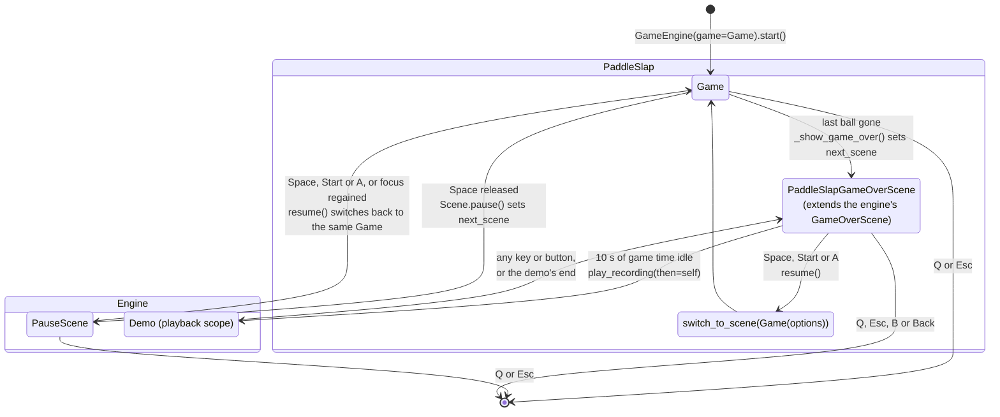
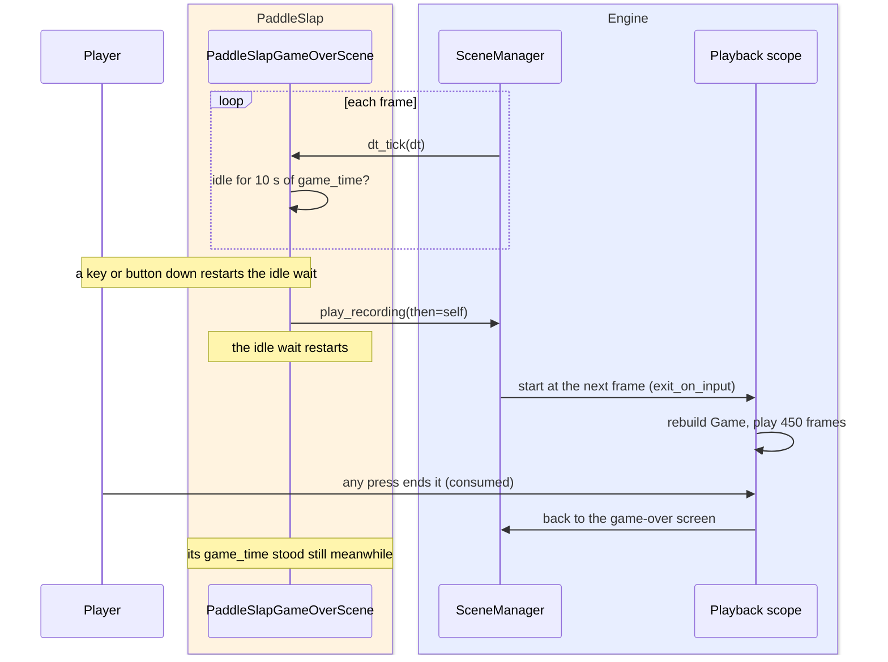
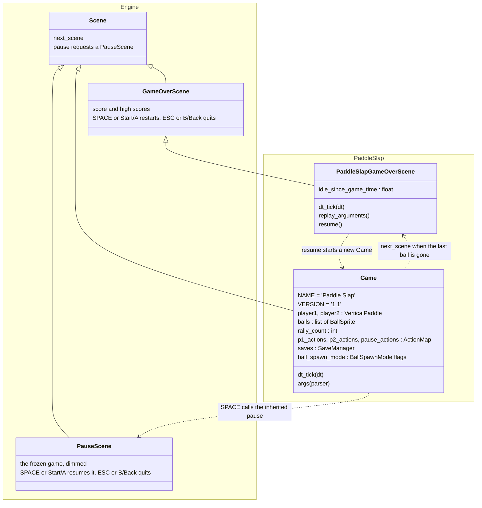
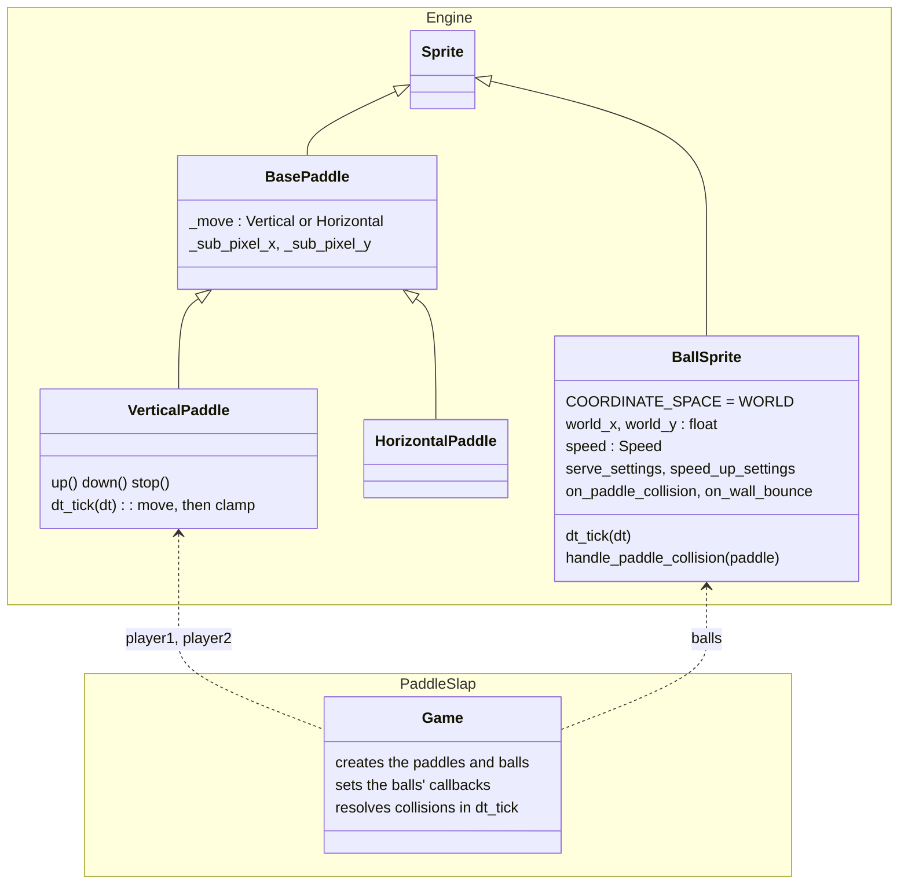
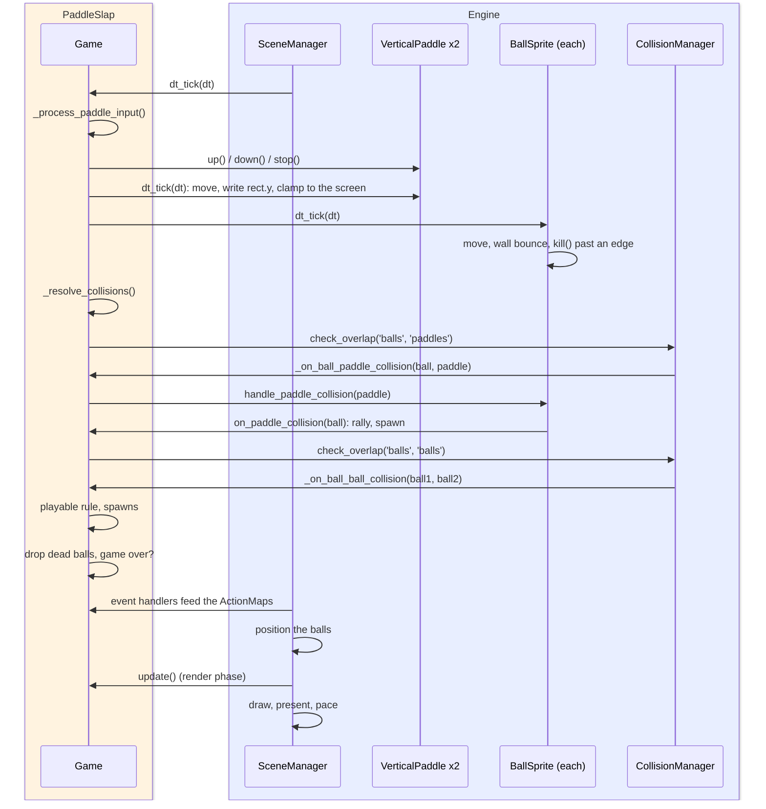
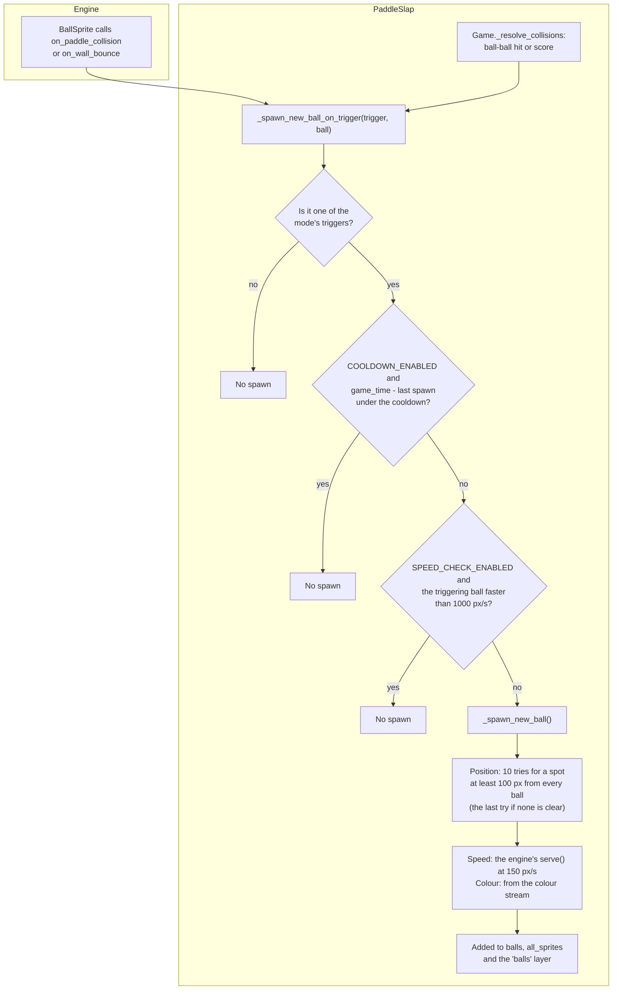
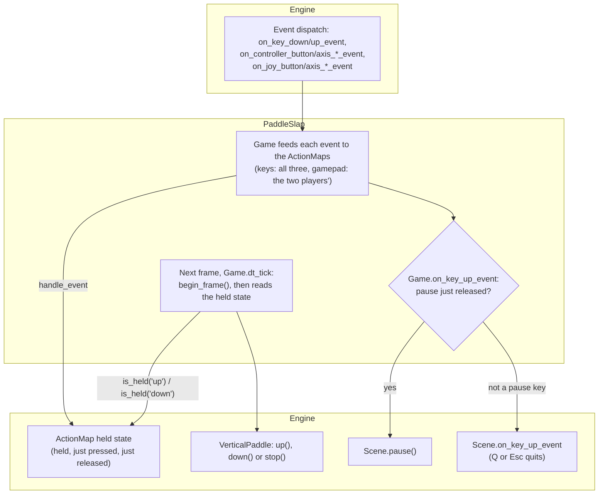

# PaddleSlap Architecture

PaddleSlap is the smallest example game in GlitchyGames: two paddles, one or more balls, and no
title screen. It is a two-player Pong in which the players share one score, the **rally count**
(every paddle hit by any ball adds one), and the game ends when the last ball has left the court.
Paddle hits can spawn more balls, so a long rally fills the court.

It is the reference for a game built from the engine's ready-made parts: `BallSprite` and
`VerticalPaddle` from `glitchygames.game_objects`, the collision manager's layers, `ActionMap`
input, the save store, and the built-in pause and game-over scenes. It is also the engine's
oldest regression subject: it has a golden trace, a golden replay and a bundled attract-mode demo.
This page shows how it is put together, from its scenes down to one frame.

## Running it

```bash
uv run paddleslap                          # one ball, extra balls spawned by paddle hits
uv run paddleslap --balls 3                # start with three balls
uv run paddleslap --ball-spawn-mode none   # never spawn: a classic one-ball rally
uv run paddleslap --random-seed 42         # the same serves, spawns and colours every run
```

The game adds these options to the engine's own (`Game.args()`; the engine's options, such as
`--target-fps`, `--resolution` and `--input-mode`, are in [Argument System](../architecture/argument_system.md)):

| Option | Default | Meaning |
| --- | --- | --- |
| `-b`, `--balls N` | `1` | Balls on the court when the game starts |
| `--ball-spawn-mode MODE` | `paddle_only` | When extra balls appear: `paddle_only`, `wall_only`, `ball_only`, `frequent`, `rare`, `none` (see [Ball spawning](#ball-spawning)) |
| `-v`, `--version` | off | Prints `Paddle Slap 1.1` and exits before the game starts (argparse's `version` action) |

The game sets no `TARGET_FPS` and no `MAX_FRAME_SECONDS`, so it runs at the engine's default
60.01 FPS and its logic gets the raw frame time.

### Controls

| Action | Player 1 (left) | Player 2 (right) |
| --- | --- | --- |
| Paddle up | `W` position, D-pad up, left stick up | `Up` arrow, D-pad up, left stick up |
| Paddle down | `S` position, D-pad down, left stick down | `Down` arrow, D-pad down, left stick down |
| Gamepad | the pad with instance id 0 | the pad with instance id 1 |

| Scene | Key | Effect |
| --- | --- | --- |
| Game | `Space` position (on release) | Pause |
| Game | `Q` or `Esc` (on release) | Quit (the base `Scene` posts `QUIT`) |
| Pause | `Space`, or a gamepad's Start or A (press, then release) | Resume |
| Pause | `Esc` or a gamepad's B or Back (on press), `Q` (on release) | Quit |
| Pause | window focus regained (after 0.5 s paused) | Resume |
| Game over | `Space`, or a gamepad's Start or A (press, then release) | New game |
| Game over | `Esc` or a gamepad's B or Back (on press), `Q` (on release) | Quit |
| Game over | nothing for 10 s of game time | Play the attract-mode demo; any key or button ends it |

The paddle and pause keys are bound by **scancode** (a physical key position, the same place on
every layout: AZERTY players press `Z`/`S`). The quit keys and the pause and game-over screens'
`Space` and `Esc` are the engine's built-in scenes' **key codes**. Gamepads only move paddles: the
pause and game-over screens answer the keyboard only (a button press on the game-over screen just
restarts its idle wait).

## Scenes

PaddleSlap has two scenes of its own and one built in.

| Scene | Module | Role |
| --- | --- | --- |
| `Game` | `src/games/paddleslap/src/paddleslap/__init__.py` | The court: paddles, balls, collisions, rally count, high scores |
| `PauseScene` | `src/glitchygames/scenes/builtin_scenes/pause_scene.py` | The engine's pause screen: the game's last frame dimmed with PAUSED over it |
| `PaddleSlapGameOverScene` | `src/games/paddleslap/src/paddleslap/__init__.py` | `GameOverScene` (score, top 5 high scores) plus the attract-mode demo, and a resume that always starts a new `Game` |

In the diagram, the Engine box holds what the engine provides (its pause screen and the playback
scope the demo runs in); the PaddleSlap box holds the game's own scenes.



- **Pause and game over switch at the end of the frame.** Both set `next_scene` instead of
  switching at once, so the scene manager switches after the frame renders. Pausing during event
  processing would otherwise freeze the previous frame's picture (the comment on `Scene.pause()`).
  `PauseScene` shows `previous_scene.screenshot`; `resume()` switches back to the same `Game`
  object, so the rally goes on where it was.
- **A new game is always a `Game`.** `GameOverScene.resume()` restarts the type of the scene
  manager's `previous_scene`, which a playback scope can change (BUGS.md #81), so
  `PaddleSlapGameOverScene.resume()` names `Game` explicitly.
- **Rebuilding the game-over screen.** `PaddleSlapGameOverScene.replay_arguments()` returns
  `final_score` and a copy of `high_scores`, so a recording that starts on this screen can rebuild
  it (scene starts, in [Gameplay Recording and Replay](../architecture/gameplay_replay.md)).

### The attract-mode demo

PaddleSlap has no title screen (a game starts serving at once), so its idle screen is the
game-over screen. `PaddleSlapGameOverScene.dt_tick` compares its `game_time` with
`idle_since_game_time`; after `GAME_OVER_IDLE_SECONDS` (10.0) it plays the bundled recording
`PADDLESLAP_DEMO_PATH` (`src/games/paddleslap/src/paddleslap/demos/rally.jsonl.gz`, package data) with
`SceneManager.play_recording(path=..., then=self)`. In the diagram, the PaddleSlap box is the
game's own screen and the Engine box is what plays the demo; the player is outside both.



- The demo is an ordinary recording played in a playback scope: real input reaches only its exit
  check, saves are a sandbox, and the live game-over screen is stashed, not cleaned up.
- The press that ends a demo never reaches the game-over screen, so starting a new game after a
  demo takes a second press (the class docstring).
- A demo that cannot play is logged at WARNING ("No demo: ...") and nothing starts. A divergence
  ends it with a WARNING `demo diverged: ...`.

## Its package

PaddleSlap is a package of its own beside the engine, `src/games/paddleslap/` (distribution
`paddleslap`, import package `paddleslap`). How such a package is laid out, installed, tested and
built, and how a game is moved into one, is in
[Games as Their Own Packages](../architecture/game_packages.md).

PaddleSlap is one module, so `Game` is defined in the package itself (`paddleslap/__init__.py`):
its recordings name it `games.paddleslap:Game`, which a `Game` defined in a submodule would
change. Its golden replay is `src/games/paddleslap/tests/fixtures/replays/golden.jsonl.gz`, its bundled demo ships inside the package
(`src/games/paddleslap/src/paddleslap/demos/rally.jsonl.gz`, package data), its golden trace stays with the engine's trace tests
(`tests/world/golden/paddleslap.jsonl.gz`), and its browser bundle ships `paddleslap.zip`.

## Classes

PaddleSlap's own code is two classes in `src/games/paddleslap/src/paddleslap/__init__.py`: `Game` and
`PaddleSlapGameOverScene`. Everything else it uses comes from the engine: `Scene` and the
built-in `PauseScene` and `GameOverScene` (`glitchygames.scenes`), `Sprite`
(`glitchygames.sprites`), and the paddles and balls of the engine's game-object library
(`glitchygames.game_objects`). In the diagrams, the Engine box is what every game gets; the
PaddleSlap box is what this game adds. Solid arrows are inheritance, pointing at the base class;
dotted arrows are how the game uses an engine class.

### Scenes



`Game` never names `PauseScene`: its pause action calls `Scene.pause()`, which it inherits, and
that requests the engine's `PauseScene` for the end of the frame. PaddleSlap's game-over screen
extends the engine's, adding the attract-mode demo after an idle wait and always restarting a new
`Game` (the engine's `resume()` restarts whatever scene came before, BUGS.md #81).

### Sprites



PaddleSlap defines no sprite classes: both paddles are the engine's `VerticalPaddle`
(`src/glitchygames/game_objects/paddle.py`) and every ball is its `BallSprite`
(`src/glitchygames/game_objects/ball.py`). The game creates them, wires the balls' callbacks
(`on_paddle_collision`, `on_wall_bounce`) to its rally count and sounds, and resolves collisions
in `Game.dt_tick`. `HorizontalPaddle` is not used by PaddleSlap; it is shown because it shares
`BasePaddle`.

## Sprites and how they are drawn

| Sprite | Space | Size and image | Who writes `rect` |
| --- | --- | --- | --- |
| `VerticalPaddle` ×2 | Screen (no `COORDINATE_SPACE`) | 20×100 white rectangle; left at x = 0, right at x = screen width − 20, vertically centred | The paddle itself: `dt_tick` rounds its float `_sub_pixel_y` into `rect.y`, then clamps it to the screen (stopping it at an edge) |
| `BallSprite` | World (`CoordinateSpace.WORLD`) | 20×20 image with colour key 0 and a filled circle of radius 5 in the middle; colour set through the `color` property, which redraws the circle | The engine: each frame `position_world_sprites` writes `rect` from the snapped `world_x`/`world_y` |

- **The camera never moves.** `Game` sets no follow target and no `camera_target()`, so the
  camera stays at the origin: world and screen coordinates are the same and the balls are drawn
  exactly where their logic left them (`TestWorldBallsInTheFrame` in
  `tests/world/test_frame_integration.py`). The balls are world sprites anyway, so the engine is
  the only writer of their `rect`: game logic reads `world_x`/`world_y`, `drawn_center()` or the
  collision rect, never `rect` (which holds where the ball was last drawn).
- **Pixel snapping.** The ball's own `pixel_snap_mode` (default `NEAREST_HALF_UP`, the scene's
  default too) rounds its sub-pixel position for drawing and for collision alike.
- **Background.** The court is `BLACK`, named on purpose: a scene that sets no background shows
  the engine's test pattern.
- **Dirty rendering.** All sprites live in one `pygame.sprite.LayeredDirty` (`all_sprites`). The
  ball sets `dirty = 2` (always redrawn); paddles set `dirty = 1` every tick.
- **Pose.** Neither sprite changes its image with its state (a ball's image changes only when its
  colour is set), so the pose rule has nothing to order here. Collision resolution, the other half
  of that rule, runs in `dt_tick` (below).

### Hitboxes

The collision manager has two layers, `balls` and `paddles` (the debug overlay's hitbox panel
draws them). Hitboxes are the default visible-pixel trim (`src/glitchygames/collision/bounds.py`):

- A ball's hitbox is its **visible circle's 10×10 box**, offset (5, 5) from the drawn position,
  not its 20×20 image. `BallSprite._visible_rect()` returns that box with its offset, and every
  ball test uses it: walls, paddles and other balls meet the circle the players see.
- A paddle's hitbox is its whole 20×100 rectangle.

## One frame

The engine's frame order is in the [Bitmappy page](../architecture/bitmappy.md#bootstrap-main-loop)
and `CLAUDE.md`. What PaddleSlap does inside it (the PaddleSlap box is the game's one scene class;
the Engine box is the engine's scene manager, game objects and collision manager):



- **Logic before events.** `dt_tick` runs before the frame's events are pumped, so it reads
  the held state the ActionMaps reached at the end of the previous frame; a press shows up in
  the next frame's `dt_tick`.
- **Collisions in `dt_tick`, after every sprite moved.** The engine positions the balls after
  `dt_tick` and before `update()` renders, so a bounce, or a ball spawned this frame, is drawn
  this frame (the comment in `Game.dt_tick`). `update()` resolves nothing
  (`test_update_resolves_no_collisions`).
- **A dead ball stays in the `balls` layer until `_resolve_collisions` removes it**, so
  `_on_ball_paddle_collision` skips balls that are no longer `alive()`.
- **The paddle's screen clamp runs in its `dt_tick`.** A paddle moved past the top or bottom edge
  is clamped (and stopped) in the same `dt_tick`, so this frame's collisions see it on screen
  (the pose rule keeps `update()` for visual work; `HorizontalPaddle` clamps the same way).

### Ball versus wall

`BallSprite._handle_boundary_collisions` bounces the ball off the top and bottom walls only
(PaddleSlap constructs every ball with `bounce_top_bottom=True, bounce_left_right=False`). A wall
counts as hit when the visible box touches it **while the ball moves toward it**, so a ball still
touching a wall the frame after a bounce does not bounce again. A hit flips the vertical speed,
plays the bounce sound, applies a `WALL_BOUNCE` speed-up if configured (PaddleSlap's is not) and
calls `on_wall_bounce`. `_keep_inside_playfield` then mirrors any overshoot back inside.

A ball whose visible box is entirely past the left or right edge calls `kill()`: that is a score.

### Ball versus paddle

The collision manager pairs overlapping collision rects (an AABB broad phase), and
`BallSprite.handle_paddle_collision(paddle)` does the exact test and the response:

1. **Circle against rectangle.** The ball is the circle inscribed in its visible box; the
   nearest point of the paddle rectangle to its centre must be within the radius (touching
   counts). Otherwise nothing happens.
2. **Which face.** `_entered_paddle_from_left` looks at where the visible box was before this
   frame's move (`speed.x` × the last tick's dt back). If it was clear of the paddle on one side,
   the ball came in from that side, even when a long frame carried its centre past the paddle's
   centre; if it already overlapped, the side of the paddle's centre the ball's centre is on
   decides.
3. **Response.** The ball is placed with its visible edge flush against that face, its
   horizontal speed points away from the paddle, the paddle's slap sound plays, a
   `PADDLE_BOUNCE` speed-up is applied, the speed is clamped to `max_speed`, and
   `on_paddle_collision(ball)` is called. PaddleSlap's callback counts the rally hit and may
   spawn a ball.

### Ball versus ball

`_handle_ball_collisions` ticks the per-pair cooldowns, then asks the collision manager for
overlapping `balls`/`balls` pairs. `_on_ball_ball_collision` handles each pair:

| Step | Method | What it does |
| --- | --- | --- |
| 1 | cooldown check | A pair that collided in the last 10 frames (either order) is skipped |
| 2 | `_calculate_ball_distance` | Centre distance of the two collision rects; they collide within the sum of the half widths |
| 3 | separating check | Skipped if the balls are moving apart and no longer overlap |
| 4 | `_apply_elastic_collision` | Equal-mass elastic exchange: swap the velocity components along the collision normal, keep the tangential ones (momentum and kinetic energy conserved) |
| 5 | `_cap_ball_speeds` | Each ball's speed capped at 500 px/s |
| 6 | `_separate_overlapping_balls` | Move both balls apart along the normal (by at least 3 px in total, at least 1 px on each significant axis), in `world_x`/`world_y` |
| 7 | record | Cooldown of 10 frames for the pair; the pair is kept for the two steps below |

After the pass, two game rules apply to every pair that collided this frame:

- **`_keep_collided_balls_playable`**: exact physics can leave a ball almost stopped, almost
  vertical (it bounces between the walls and never reaches a paddle) or flat (it slides along a
  wall). The ball's angle from horizontal is moved into its `ServeSettings` band (15° to 60°) and
  its speed raised to at least the serve speed, keeping each component's sign (a zero component
  points away from the partner). This is deliberately not physics and not part of
  `_apply_elastic_collision`, whose physics the collision tests check.
- **`_spawn_new_balls_for_ball_collisions`**: one spawn attempt per pair, if ball-ball hits are a
  spawn trigger; the speed check uses the pair's faster ball. It runs outside the collision
  manager's pass, so spawned balls never join it.

### Serves and speed-ups

| Setting | Value | Used by |
| --- | --- | --- |
| `PADDLESLAP_SERVE` | `ServeSettings()`: 250 px/s, 15° to 60° from horizontal, either side, either vertical direction, 50 px margin | Opening balls (`reset()` in the constructor picks a random position and serve) |
| `PADDLESLAP_SPAWN_SERVE` | `ServeSettings(speed=150.0)` | Spawned balls in a mode with `RANDOM_SPEED` (`serve()` keeps the position the game chose) |
| fixed spawn speed | `Speed(250.0, 125.0)` | Spawned balls in a mode without `RANDOM_SPEED` (no listed mode) |
| `PADDLESLAP_SPEED_UP` | `PADDLE_BOUNCE` trigger, `LOGARITHMIC` curve, `BOTH` axes, multiplier 1.15, `max_speed` 500 px/s | Every ball |

The logarithmic curve gives big early boosts that taper off, `s0 × (1 + 0.15 × ln(1 + n))` after
`n` paddle hits, and scaling both axes keeps the angle the paddle set. Paddles move at
400 px/s.

## Ball spawning

`BallSpawnMode` (`src/glitchygames/game_objects/ball.py`) is a set of bit flags: **triggers** (which
events may spawn), **conditions** (cooldown, speed check, random position, speed and colour) and
**frequency** (the cooldown length). `--ball-spawn-mode` picks one combination:

| Option | Triggers | Cooldown | Other flags |
| --- | --- | --- | --- |
| `paddle_only` (default) | paddle hit | 2.0 s | speed check, random position, speed and colour |
| `wall_only` | wall bounce | 2.0 s | as above |
| `ball_only` | ball-ball hit | 2.0 s | as above |
| `frequent` | all four (paddle, wall, ball, score) | 0.5 s | as above |
| `rare` | paddle hit | 5.0 s | as above |
| `none` | none | | the rally is still counted |

Every trigger goes through `_spawn_new_ball_on_trigger`, so all triggers share one cooldown and
one speed check. In the diagram, the Engine box is the engine's `BallSprite` reporting paddle hits
and wall bounces through its callbacks; the PaddleSlap box is the game's spawn rule in `Game`
(which serves each new ball with the engine's `BallSprite.serve()`):



- The cooldown counts `Scene.game_time`, so it stops while the game is paused or behind the
  game-over screen (`test_spawn_cooldown_counts_game_time_only`).
- A score spawns before the game-over check, so in `frequent` mode the last ball scoring brings a
  replacement (when the cooldown and speed check allow it) instead of ending the game.
- Each new ball is connected to the same paddle-hit and wall-bounce callbacks, so spawned balls
  spawn too.

## Input

Each player has an `ActionMap` (`src/glitchygames/input/action_map.py`) with `up` and `down`; a third
holds `pause`. `_create_action_maps` binds, per player, a scancode, a D-pad button and the left
stick's vertical axis at a ±0.3 threshold, filtered to the gamepad with **instance id** 0 (player 1)
or 1 (player 2). The keyboard bindings have no instance filter. In the diagram, the Engine boxes are
the engine's event dispatch (top) and its `ActionMap`, `VerticalPaddle` and base `Scene` (bottom);
the PaddleSlap box is what `Game`'s handlers and `dt_tick` add between them:



- **Movement is frame-driven.** Handlers only update the ActionMaps; the paddles are moved by
  `_process_paddle_input` at the top of `dt_tick`, from the held state.
- **Input mode.** The ActionMaps take the engine's `--input-mode` (default `auto`: a mapped pad's
  controller events and any other device's joystick events, each press once). PaddleSlap handles
  both families, so a pad works in every mode.
- **Instance ids, not player slots.** SDL numbers devices in the order they appear, so the first
  pad connected drives the left paddle; a pad that is unplugged and plugged back in gets a new
  instance id and no longer matches its binding.
- **Key repeat.** PaddleSlap leaves SDL's key repeat off: movement reads held state and pause
  acts on the release, so nothing needs repeated key-downs (they would only fill event batches
  and recordings).
- **Polling.** PaddleSlap never polls pygame: everything it knows about input comes through
  events, which recordings hold, so a replay serves the same input.

## Sound

Two sound effects, loaded with `glitchygames.game_objects.load_sound` from
`src/glitchygames/game_objects/snd_files/` at volume 0.25 (`pygame.mixer.Sound`, not the synthesiser):

| Sound | File | Played when |
| --- | --- | --- |
| `SFX.BOUNCE` | `sfx_bounce.wav` | A ball bounces off a wall (the ball's own sound), or two balls collide (the first ball's sound) |
| `SFX.SLAP` | `sfx_slap.wav` | A ball hits a paddle (the paddle's sound, played by `handle_paddle_collision`) |

## Score and saves

- `rally_count` counts paddle hits by any ball; it is the game's only score, shared by both
  players. `_spawn_new_ball_with_speed_check` counts the hit whatever the spawn mode.
- At game over, `_save_high_score` loads the `high_scores` slot of the `paddleslap` save store
  (`open_saves(app_name='paddleslap')`), appends the rally, keeps the ten best (best first) and
  saves it. Live, that is `high_scores.json` in the platform's save directory
  (`~/Library/Application Support/paddleslap/` on macOS, `~/.local/share/paddleslap/` on Linux,
  `%APPDATA%\paddleslap\` on Windows). The game-over screen shows the final score and the top
  five.
- In a replay or a demo the store is a `MemorySaveManager` seeded from the recording, so the
  real high scores are never touched (the recordings start from an empty `paddleslap` store).

## Engine features it uses

| Feature | How PaddleSlap uses it |
| --- | --- |
| Random streams | Serves draw from `ball.serve` (`SERVE_RANDOM_STREAM`), spawn positions from `paddleslap.spawn`, ball colours from `paddleslap.colors`: separate streams, so a colour draw never moves where the next ball spawns. `--random-seed` fixes them all |
| `Scene.game_time` | The spawn cooldown and the game-over idle wait |
| Collision layers | `balls` and `paddles`, `check_overlap` for the broad phase |
| World space | The balls (identity camera); the paddles stay screen space |
| Save store | High scores (`open_saves`) |
| Built-in scenes | `PauseScene`, `GameOverScene` |
| Playback scope | The attract-mode demo (`play_recording`) |
| Debug overlay | F3 and F4 work as in every game; the hitbox panel shows the two layers. The ball keeps `speed`, not a physics body, so the physics panel has nothing to draw |
| Not used | Screen shake, rumble, live synth voices, instant replay, ghosts, camera follow |

### Recordings that pin it

| Recording | What it is | Checked by |
| --- | --- | --- |
| `tests/world/golden/paddleslap.jsonl.gz` | Golden trace: the scripted run recorded before the world-space change, by `scripts/record_golden_traces.py` | `tests/world/test_golden_traces.py` compares every sprite's rect and visibility frame by frame; each difference must be explained by one `ExpectedDifference` |
| `src/games/paddleslap/tests/fixtures/replays/golden.jsonl.gz` | Golden replay: 622 frames at 800×480, seed 20261018, recorded through the real engine loop by `scripts/record_scripted_session.py --game paddleslap --frames 600` | The replay plugin (`src/glitchygames/testing/replays.py`) replays it with `paddleslap --replay-trace ... --headless` and fails unless it exits `SUCCESS`; `tests/replay/test_golden_replays.py` checks the fixture set and the controls rule |
| `src/games/paddleslap/src/paddleslap/demos/rally.jsonl.gz` | Bundled demo: 450 frames of `Game`, recorded with `--frames 450 --script-only` (before the script's pause, no quit) | `tests/replay/test_bundled_demos.py` replays it headless and plays it through `play_recording` inside a running game |

The golden script (`paddleslap_script` in `scripts/golden_inputs.py`) steers both paddles
with a `PaddleTracker`: each paddle holds its up or down key to follow the nearest ball moving
toward it, with a 12 px dead zone. It pauses with `Space` at frame 450 and resumes at frame 510.
The golden replay then adds the controls tail (`paddleslap_controls`): `Q` and `Esc` pressed and
released, so the recording ends on the game's own `QUIT` and a replay in which either key no longer
quits diverges.

Re-record only deliberately, after finding out why a replay diverged (the commands are in the
docstring of `scripts/record_scripted_session.py`). Replay performance for both recordings is in
[Replay Performance](../quality/performance.md).

## Tests

| File | What it pins |
| --- | --- |
| `src/games/paddleslap/tests/test_paddleslap.py` | The game: construction, options and spawn modes, random streams (colours, spawn positions, global `random` untouched), serves and speed-ups, same-frame paddle bounces, collisions in `dt_tick` (not `update()`), dead balls, spawn triggers and the shared cooldown, ball-ball edge cases (500 px/s cap, playable-ball rule), high scores, the game-over demo and idle wait, scancode bindings, gamepads, and `main()` replaying the golden recording |
| `tests/collision/test_ball_paddle_collision.py` | `handle_paddle_collision`: the circle-versus-rectangle test, the face decision and the response, on real surfaces |
| `tests/game_objects/test_ball*.py`, `test_multi_ball_*.py`, `test_collision_*.py`, `test_diagonal_collision.py`, `test_zero_speed.py` | `BallSprite`: wall bounces, speed-up curves and schedules, serves, multi-ball physics at many frame rates, energy conservation |
| `tests/game_objects/test_paddle.py`, `test_paddle_dt_tick.py` | Paddles: sub-pixel movement and the screen clamp |
| `tests/game_objects/test_game_over_scene.py`, `tests/scenes/builtin_scenes/` | The built-in game-over and pause screens |
| `tests/world/test_frame_integration.py` (`TestWorldBallsInTheFrame`), `tests/world/test_positioning.py` | The balls are drawn at their world positions in the frame they move or spawn |
| `tests/world/test_golden_traces.py`, `tests/replay/test_golden_replays.py`, `tests/replay/test_bundled_demos.py` | The recordings above |

## Where things live

| File | Contents |
| --- | --- |
| `src/games/paddleslap/src/paddleslap/__init__.py` | `Game`, `PaddleSlapGameOverScene`, `main()` (the `paddleslap` console script), the serve, speed-up and demo constants |
| `src/games/paddleslap/src/paddleslap/__main__.py` | `python -m paddleslap` |
| `src/games/paddleslap/src/paddleslap/demos/rally.jsonl.gz` | The bundled attract-mode demo |
| `src/glitchygames/game_objects/ball.py` | `BallSprite`, `BallSpawnMode`, `ServeSettings`, `SpeedUpSettings` and their enums |
| `src/glitchygames/game_objects/paddle.py` | `BasePaddle`, `VerticalPaddle`, `HorizontalPaddle` |
| `src/glitchygames/game_objects/sounds.py`, `snd_files/` | `SFX`, `load_sound`, the two WAV files |
| `src/glitchygames/scenes/builtin_scenes/pause_scene.py` | `PauseScene` |
| `src/glitchygames/scenes/builtin_scenes/game_over_scene.py` | `GameOverScene`, `TextSprite` |
| `src/glitchygames/input/action_map.py` | `ActionMap` |
| `scripts/golden_inputs.py`, `scripts/record_golden_traces.py` | The golden script (`paddleslap_script`, `PaddleTracker`) and the golden trace recorder (on the engine's harness, `src/glitchygames/replay/tools/golden_traces.py`) |
| `scripts/record_scripted_session.py` | The golden replay and demo recorder, on the engine's scripted-session recorder (`src/glitchygames/replay/tools/scripted_sessions.py`); the controls tail, `paddleslap_controls`, is in `scripts/golden_inputs.py` |
| `src/games/paddleslap/tests/fixtures/replays/golden.jsonl.gz` | The golden replay |
| `tests/world/golden/paddleslap.jsonl.gz` | The golden trace baseline |
| `src/games/paddleslap/tests/test_paddleslap.py`, and the move's: `test_paddleslap_logical_names.py`, `_install_location.py`, `_entry_points.py`, `_package_data.py`, `_recording_history.py` | The game's tests |
