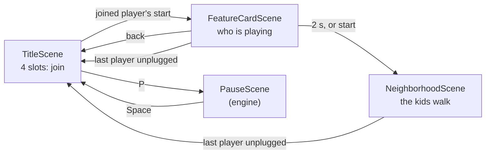

# Zombies Ain't My Neighbors Architecture

Zombies Ain't My Neighbors is a late-night creature-feature run-and-gun for up to four players,
on the keyboard or gamepads. Four kids at a sleepover put on their VR headsets, and the monsters
of a cancelled horror show climb out of the TV and into the neighborhood. Every sprite, sound and
note of music is to be written in the engine's own formats.

It is being built feature by feature. So far: the title screen, four player slots each blinking
PRESS START in its player's colour, joined from the keyboard or any of up to four pads; a TV
title card, FEATURE PRESENTATION; and the neighborhood, a yard larger than the screen where each
joined player walks their own kid (Dex, Marisol, Theo, June: 32x48 SNES-era sprites written by
the game's own rig, `zombies_aint_my_neighbors/art/`) under one camera that keeps the group on
screen. Four old TV sets in the yard push Lawn Zombies out through their screens every 6 to 9
seconds (3 per set, 10 in all); a zombie that touches a kid knocks it out, and the kid gets back
up and blinks, untouchable, for two seconds. There are no weapons yet: for now, dodge. The design, its decisions and the engine wishlist
are in the master plan, `plans/2026-11-14-zombies-aint-my-neighbors.md`.

Its package: `src/games/zombies-aint-my-neighbors/`, a workspace member
([Games as Their Own Packages](../architecture/game_packages.md)).

## Running it

```bash
uv run zombies-aint-my-neighbors
uv run zombies-aint-my-neighbors --input-mode joystick   # read every pad on the joystick layer (see below)
uv run zombies-aint-my-neighbors --verify                # replay its golden, headless
```

The game adds no options of its own; the engine's are in
[Argument System](../architecture/argument_system.md).

### Controls

| Action | Keyboard | Gamepad |
| --- | --- | --- |
| Join (a device that holds no slot) | `Enter` or keypad `Enter` | `START` |
| Begin (a joined device), and skip the feature card | `Enter` or keypad `Enter` | `START` |
| Back from the feature card to the title | `Backspace` | `BACK` |
| Walk (the neighborhood) | `WASD` or the arrows (by position) | left stick or d-pad |
| Pause (every screen) | `P` position; `Enter` in the neighborhood | `START` in the neighborhood |
| Resume from the pause screen | `Space` | `START` or `A` |
| Quit | `Q` or `Esc` (on release) | `B` or `Back` on the pause screen |

In `--input-mode joystick`, START is read by its game-controller number on the raw joystick
layer. Many pads number their buttons differently there (on Xbox-layout pads that number is
often Back or View), so another button may join and START may do nothing; the engine's
`ActionMap` documents the same caveat. Leave the input mode at `auto` to use the controller
mapping. A per-device lookup of START's raw button is on the master plan's Engine wishlist.

The keys are bound by position (scancodes), so they sit in the same place on every layout. The
game never uses `Space` or `Esc` for its own actions: the engine's shared pause and game-over
screens use them, in the browser too. In the browser, on-screen **Start** and **Pause** buttons
press `Enter` and `P`.

## The screens



Both screens are `RosterScene`s (`roster_scene.py`): they keep the **join roster** and read the
same controls (one `ActionMap`, `RosterScene._create_action_map`). Each says what a start press
means (`_press_start`) and what an unplugged pad means (`_device_left`). `RosterScene` is a
`PadTolerantScene` (`pad_tolerant.py`), which deliberately ignores the pad events the screens
don't use (sticks, hats, touchpads, sensors, raw device events), so `--no-unhandled-events`
never trips on a pad.

The title is the game's class for now, so its golden replay stays in one scene, as
`tests/replay/test_golden_replays.py` requires. When gameplay arrives, the golden moves to the
gameplay scene.

## The neighborhood

`NeighborhoodScene` (`neighborhood.py`) gives each joined slot its kid (`kid.py`), an animated
world sprite. Each player's direction comes from their own device (`controls.py`): the keyboard's
WASD or arrows, or a pad's d-pad or left stick (past the engine's `axis_deadzone`), read on the
controller layer when the pad has one and on the joystick layer otherwise (joystick mode, which
scripted sessions force). Kids walk 120 px a second, never faster diagonally, inside a 1600x960
yard, a mown checkerboard lawn; the group never spans more than the screen less 24 px a side, and the camera (no smoothing)
aims at the middle of the group's bounding box, so everyone is always on screen. Kids are drawn
in order of their feet. A kid faces the nearest of eight directions: down, up and left, and the
diagonals down-left and up-left (three-quarter views), each drawn; right, down-right and
up-right show their left-hand frames mirrored, each frame flipped once
into a cache the scene owns, with `hitbox_flip_x` set. A pad unplugged here takes its kid with
it; with nobody left, the game goes back to the title.

Built from options alone, as a recording's first scene is, the neighborhood has the keyboard as
P1. The game has two golden replays: the title's (`golden.jsonl.gz`) and the neighborhood's
(`golden-neighborhood.jsonl.gz`); `main` (`launcher.py`) starts a replay on the scene its
recording names, as Brave Adventurer's launcher does.

## The join roster

`JoinRoster` (`roster.py`) is a frozen pydantic model: four slots, each free or held by one
device, the keyboard or a pad by its SDL instance id. `join` puts a device in the lowest free
slot; a device never holds two slots, and a fifth device is ignored; `leave` frees a slot. The
title and the card pass the roster between them as a constructor argument, and give it to a
replay as JSON (`replay_arguments`).

Pads already plugged in when the game starts are never announced to a scene (the engine
synchronises them before any scene exists), so joining reads only the press's instance id.

The engine tells only the active scene that a device left, so a pad unplugged on the pause
screen is caught when the title or the card resumes: setting a screen up again drops every
joined pad the engine no longer sees (`RosterScene.setup`).

## Drawing

Every on-screen thing is a sprite (`TextPicture`, `text.py`). Every image, the title, each slot
in each state and each player label, is rendered once in `setup()`; a frame only picks which
image a slot shows and whether it is shown, so no frame renders text. Free slots blink together,
half a second shown and half hidden, from `Scene.game_time`, so a replay blinks exactly as the
recording did.

| Player | Colour |
| --- | --- |
| P1 | ghoul green `(92, 230, 92)` |
| P2 | pumpkin orange `(255, 140, 26)` |
| P3 | séance violet `(176, 97, 255)` |
| P4 | TV-glow cyan `(51, 214, 255)` |

The text uses the bundled Bitstream Vera Bold for now; the sprite feature, which starts with an
audited character BOM, may replace it.

## Tests

The member's tests (`src/games/zombies-aint-my-neighbors/tests/`) run on the real display and
check pixels. Pad tests use the engine's stand-in pad (`tests/input/stand_in_devices.py`)
through the real devices door, plugged in and out mid-run. Its golden replay
(`tests/fixtures/replays/golden.jsonl.gz`) joins the keyboard after one blink cycle, pauses and
resumes, opens the feature card with keypad Enter and comes back with Enter, then quits.
