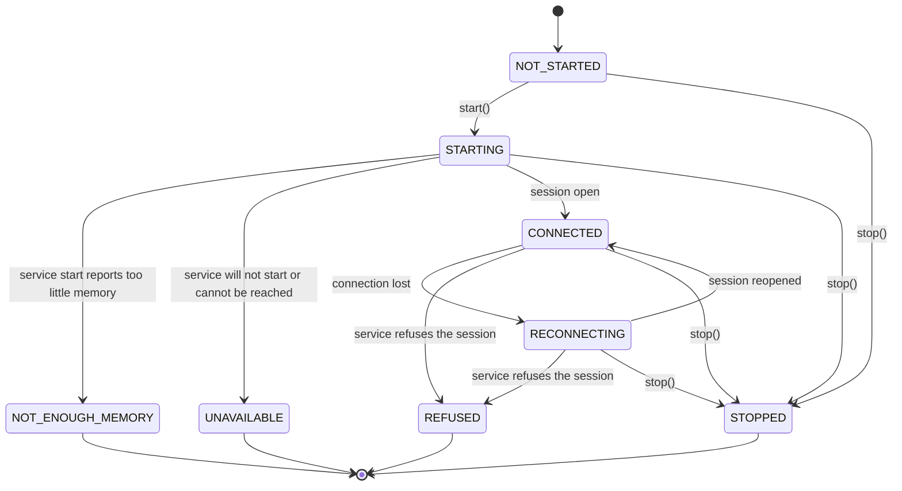
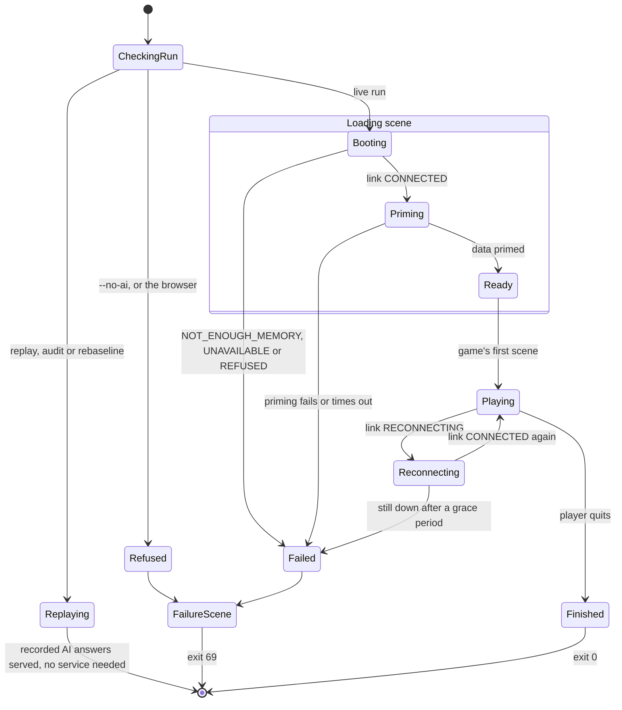
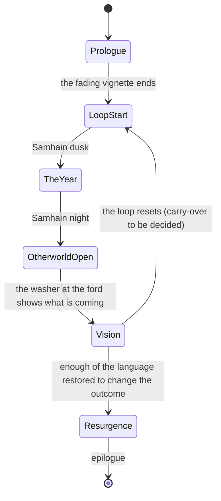
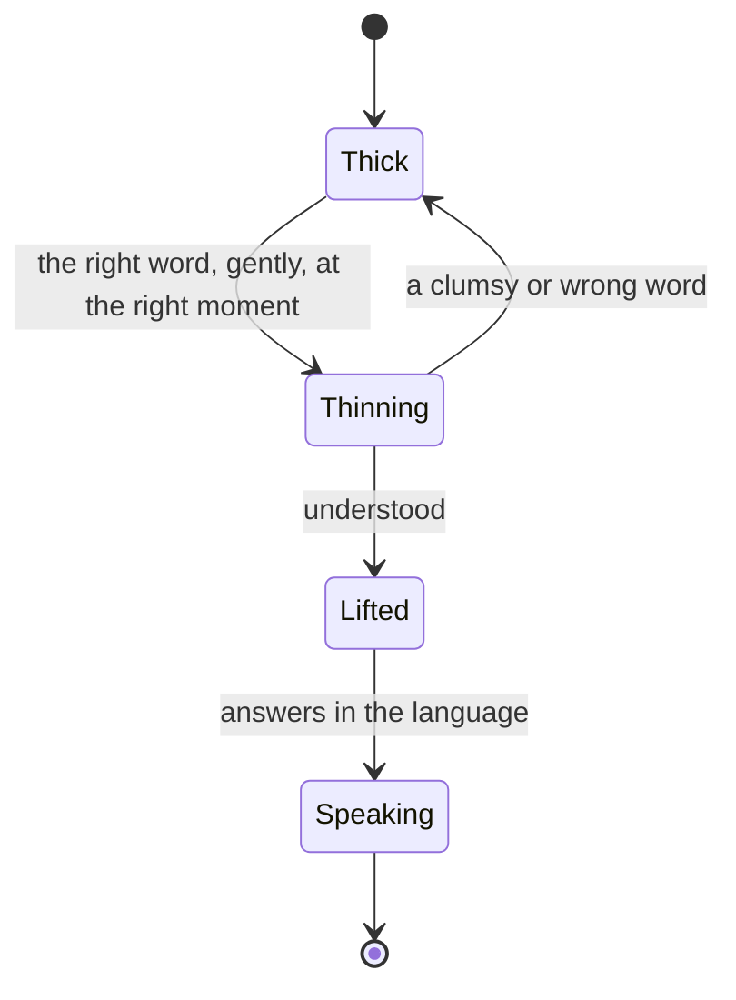

# Spare-Credits Exploration: Plan

- **Date:** 2026-11-23
- **Status:** Brainstorm in progress (plan mode). Nothing approved for building yet.
- **Conversation:** [2026-11-23-spare-credits-exploration-conversation.md](2026-11-23-spare-credits-exploration-conversation.md)
  is the running record of the brainstorm, starting with the user's opening message, kept as a
  reference for this plan.

Marking: **(user)** the user decided it; **(my call)** proposed by me and approved, or a
default the builder may revisit; unmarked text explains or connects them.

## 1. Intent

- **(user)** Spend spare credits on something fun.
- **(user)** Claude is in charge of its own agents and may spend as much as it wants exploring
  the space.
- **(user)** Stay in plan mode for a while before building.
- **(user)** Work happens on a new branch (`docs/spare-credits-exploration-plan`); this plan and
  the conversation record live side by side in `plans/`.

The game, as the user has described it so far:

- **(user)** An original video game. Slime Forest Adventure (a game that teaches Japanese through
  RPG play) was only the opening reference to start the conversation; most of its ideas are not
  to be borrowed, and the game has its own look and feel.
- **(user)** The game is not going to be about Japanese at all; what it is about is the user's to
  explain.
- **(user)** Gameplay starting point: the feel of 16-bit console RPGs such as Final Fantasy VI
  and Chrono Trigger, as a frame for the conversation, not a game to remake.
- **(user)** An RPG with a really amazing skill tree. Its contents are the user's to explain
  later; no assumptions about them until then.
- **(user)** A language-learning game, for a language other than Japanese.
- **(user)** A time loop carries the learning: repetition happens because the player replays the
  game, and the loop is wired to the different learning mechanisms in a gamified way.
- **(user)** The feeling to evoke is discovery of meaning and of learning, while replaying.
- **(user)** The image (metaphorical, or literal, since it is a fantasy RPG): a grayscale world
  devoid of color; a hero arc where discovery, happenstance, curiosity or something climactic, as
  in many JRPGs, with grand music, cutscenes and drama, unfolds into the rediscovery of a dying
  language that had all but disappeared from the world, with hints to why it disappeared.
- **(user)** The tone: mystery, curiosity and a magic in the power of words and culture; a
  feeling of connectedness to a completely different way of seeing the world.
- **(user)** The time loop is a very pragmatic and functional part of the world.
- **(user)** The time loop is the first feature to use AI as an integral part. AI will be integral
  to the gameplay intricacies and the storytelling of this game. (Recorded as stated; details are
  the user's to give.)
- **(user)** The skill tree is dynamic and has no fixed nodes, so language discovery happens
  organically, as it would in a real, truly immersive situation.
- **(user)** Why it must be dynamic: as you learn the language you use it to learn more, so each
  player goes on their own language journey, literally (through the world) and figuratively
  (through the language).
- **(user)** AI helps steer things, design the skill tree's mechanics and emergent properties,
  ask clarifying questions, test possibilities, and so on.
- **(user)** AI likely plays a part both while the game is made and while it is played; where
  exactly is an area to research, consider, test and brainstorm.
- **(user)** The dying language is Irish (Gaeilge, `ga`). The design works for any language,
  Japanese included; each language gets its own arc, starting with Irish.
- **(user)** The historical wound for the Irish arc is the Great Hunger of 1845-1852, which the
  user holds was not a famine but a massacre.
- **(user)** Also the centuries of militaristic occupation by the British: the vibe of an
  imperial army with its barracks, and a commander with a cruel, zealous villain's attitude that
  evokes Cromwell. Never referenced directly; evoked through stand-ins, the way the film Kneecap
  evokes real people and movements.
- **(user)** Tone: tongue-in-cheek, nudge-nudge-wink-wink stand-ins, while being super respectful
  and mindful of the real tragedy. The Troubles are in view as well.
- **(user)** How to hold both (proposed by Claude, confirmed as "exactly the vibe"): the humor
  aims at power (the empire, its pompous commander, its bureaucracy), never at the people who
  suffered; the grief is played straight.
- **(user)** *The Boondock Saints* as a source of humor: distinctly Irish and Boston-Irish, Irish
  yet unique.
- **(user)** The otherworld is where the culture, through its language, has been sealed off.
  Zelda-style collection could unlock further sections of a skill-tree-like part of the game
  (an idea). What the player unlocks is the resurgence of the Irish language.
- The Irish arc, written as a template any language's arc can follow:
  [2026-11-23-spare-credits-exploration-1-language-arc-ga.md](2026-11-23-spare-credits-exploration-1-language-arc-ga.md).
- **(user)** The point is acquisition through immersion in a simulated environment, rather than
  something chunky and static (which is how Slime Forest Adventure feels, though it is super
  useful and the user sees why it was made that way).
- **(user)** Very fun, even addictive-feeling, with the right amount of tension and frustration
  against success and exhilaration.
- **(user)** The language is both spoken and written, and it has its own script.
- **(user)** Single player. Give some thought to situations where multiplayer could improve
  playability and addictiveness.
- **(user)** This is a creative brainstorming session: we make a bunch of small demos and feel
  things out. The grayscale world is one idea to play around with, not the only one.
- **(user)** Brainstorm (ideas welcome; open-minded about alternatives):
  - The language has been lost to time. Hardly anybody outside the country knows of it, and
    what outsiders know is corrupted, like an unkind game of telephone.
  - Through strife or intentional cultural annihilation, the pain and hurt to the psyche mean
    that even descendants of those displaced deny the truth of what happened to them.
  - That denial can show in the game as animosity: a dark cloud forming around a character.
  - The hero has a deep emotional connection to their ancestry (backstory later) and is attuned
    to "sense" this, loosely: through sight, hearing others' thoughts, magic, and so on. That
    starts to weave the story and the mechanics together.
  - Very few native speakers remain. Knowledge outside the small communities is corrupted or
    misguided, and over time the language fades from existence.
  - One example: a vignette or in-engine video (a replay, for instance) of time passing, the
    language fading from existence and the color fading from the world with it.
  - The user has one very specific idea for how the hero comes to it, still to be told.
- **(user)** The user is explaining the mechanics first, then what they are going for. Claude
  listens and holds guesses until both are told.
- **(user)** Research notes stay outside the repository; this plan refers only to the ideas.

### Deferred questions: re-ask when the user signals

**(user)** Record every deferral and re-ask these when the user signals, later on. Asked
2026-11-23; status as the user gave it.

| # | Question | Status |
|---|----------|--------|
| 1 | Why this game, and who is it for? | After the framework is sorted to the user's liking |
| 2 | Where does a player start, and how far does it take them? | Not about Japanese; the user explains later |
| 3 | What is the story or situation? | The user explains later |
| 4 | Where does the learning happen in play? | The user is still considering it |
| 7 | Where does it run, and with what controls? | The user is thinking about it |
| 8 | What should it look and sound like? | The user is thinking about it |
| 9 | How big is the first version; what does success look like? | The user has an answer, after explaining in their own way |
| 10 | What would make it a failure even if it technically works? | The user is thinking about it |
| 11 | Where does it live: inside glitchygames or its own project? | Not sure yet |
| 12 | Does it have a name? | Not yet |
| 15 | What carries over from one loop to the next (the player's memory only, or also the skill tree, notes, items)? | Deferred: re-ask later |

Areas to research, consider, test and brainstorm (named by the user):

- Where AI acts at design time and where at play time. Constraint to weigh: today the engine
  turns the AI service off in replays and the browser, and replays must repeat exactly, so AI at
  play time needs its answers recorded and served back on replay.
- The grayscale world, literal or metaphorical, as one idea among others.
- Situations where multiplayer could improve playability and addictiveness (the game stays single
  player).
- Small demos to feel things out.

Claude's brainstorm ideas (proposals, not decisions):

- Speech in the language shows as distorted script and muffled sound, and comes into focus as
  the player learns it, so the corruption is something the player sees and hears.
- What outsiders tell the hero is partly wrong; the tension is in finding out which "facts" are
  corrupted, by checking them against the few real speakers.
- The dark cloud reacts to language: the right word, gently, at the right moment thins it; a
  clumsy or wrong one thickens it. Learning as a way of reaching someone.
- The fading vignette as an exact replay of a living village losing color and words; later loops
  could replay the player's own earlier runs as "echoes".
- Because the language is real and the story touches real harm, the research includes how to
  portray it with the community's voice.

Answered: 13 (Irish, Gaeilge), 14 (immersion; fun, even addictive), 16 (spoken and
written, own script), 17 (play with it, not the only idea), 18 (single player). Struck by the
user: 5 (which parts of Japanese) and 6 (how the player answers).

### Engine requirements

- **(user)** AI is required for this game, because the dynamic tree depends on it.
- **(user)** A game can opt in to requiring AI. If the AI services are down, the game fails.
- **(user)** A loading intro for games that require AI: a new scene type showing whatever the
  engine (or the game itself) wants while the AI boots: the service starting at launch, data
  priming and so on.
- **(user)** Only opted-in games get this. Games passive to the AI keep working as they do today:
  the AI can interact with them, and the game is unaware.
- **(user)** These are two modes of Lucid Circuit's design (`plans/lucid-circuit.md`):
  - **Passive:** games that do not opt in still work with Lucid Circuit, provided they meet the
    constraints it already relies on (for example, no raw pygame calls to get the display; only
    the engine's doors). This is the work Lucid Circuit has done so far.
  - **Participating:** an opt-in, game-participating AI experience. It allows even more creative
    avenues to test, try and play with. This game is the first participating game.

  The participating mode becomes a Lucid Circuit sub-plan when it is designed.

Where the participating mode departs from Lucid Circuit's current rules (to weigh in the design; the reasons are in
its master plan):

| Rule today | What a required-AI game changes |
|------------|----------------------------------|
| The live game never waits for AI | The game waits at launch, behind the loading scene; during play the tree still must not stall a frame, so AI answers arrive asynchronously |
| The service dying mid-play leaves the game running, with AI unavailable | An opted-in game fails. How (a message scene, then exit) is to design |
| AI failure never changes the exit code | An opted-in game exits with `ExitCode.SERVICE_UNAVAILABLE` (69), which already means "a required service (the local AI service) ... cannot be reached" |
| `--no-ai` turns AI off | For an opted-in game, `--no-ai` is refused with a clear message |
| No AI in replays | Still true: AI answers are recorded as input, so a replay serves them back with no service. The requirement check is skipped in replays |
| No AI with `--headless`, in tests or in the tools that record goldens | Tests and goldens for an opted-in game need a stand-in service or recorded AI answers |
| No AI in the browser (it cannot start processes) | An opted-in game cannot run in the browser unless it reaches a service some other way |

### State machines

**(user)** All of this is designed as state machines and drawn as state diagrams. **(my call,
proposed)** The diagrams use Mermaid `stateDiagram-v2`, as the docs site already does. In code,
each machine is an explicit set of states with a transition table, and its tests check every
allowed transition and refuse every other. Diagram 1 is drawn from the code as built. The others
are first drafts to react to.

**1. Lucid Circuit's link, as built** (`LinkState` in `src/glitchygames/ai_link.py`). This is
the passive mode today: whatever state the link ends in, the game plays on.

**2. A participating game's run** (draft). The loading scene covers booting and priming. Every
failure ends at one failure scene and exit code 69 (`SERVICE_UNAVAILABLE`).

Open in this draft: how long the grace period is (and what the player sees during it), and
whether `--no-ai` on a participating game refuses with exit 64 (options refused) or 69.

**3. The time loop** (draft, any language's arc). What carries over at the reset is deferred
question 15.

**4. A sealed mound** (draft). Opening one grows a section of the dynamic tree.

```mermaid
stateDiagram-v2
    [*] --> Sealed
    Sealed --> Readable: the player knows enough words to read the seal
    Readable --> Open: the seal word spoken
    Open --> Explored: the mound's pieces of language collected
    Explored --> Restored: the tree section grows; speakers and color return in the world
    Restored --> [*]
```

**5. A person's cloud of denial** (draft).

## 2. Goals, non-goals, anti-goals

To be filled in.

## 3. Approaches

To be filled in once the user has described what they want.

## 4. Design

To be filled in.

## 5. Agent budget and orchestration

To be filled in: how the exploration fans out across agents, and what each returns.
