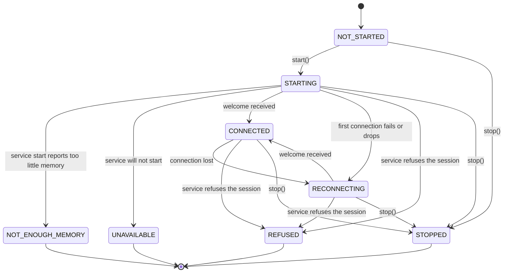
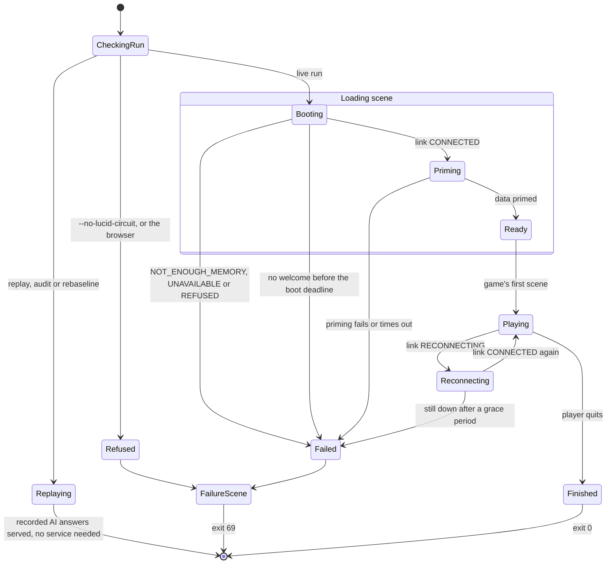

# Lucid Circuit: Passive and Participating Modes

- **Date:** 2026-11-23
- **Status:** Brainstorm draft. Nothing here is approved for building.
- **Master plan:** [lucid-circuit.md](lucid-circuit.md). This sub-plan covers the engine and
  platform side only: how a game relates to the AI. Nothing in it is specific to any one game.
- **Origin:** the owner's decisions while brainstorming the first game to need it, a language
  game ([2026-11-23-spare-credits-exploration.md](2026-11-23-spare-credits-exploration.md)).
  That game's plan holds everything game-specific and points here for the engine side. The
  layering runs one way: games depend on Lucid Circuit, and Lucid Circuit never knows any
  particular game.

Marking: **(user)** the owner decided it; **(my call, proposed)** Claude's proposal, open to
change; unmarked text explains or connects them.

## 1. The two modes

**(user)** Lucid Circuit has two modes of design.

- **Passive:**
  - Games that do not opt in still work with Lucid Circuit, as they do today: the AI can
    interact with them, and the game is unaware.
  - They must meet the constraints Lucid Circuit already relies on: for example, no raw pygame
    calls to get the display, and input, time, randomness and saves only through the engine's
    doors.
  - This is the work Lucid Circuit has done so far.
- **Participating:**
  - A game opts in to a game-participating AI experience, which allows even more creative
    avenues to test, try and play with.
  - It requires AI: if the AI services are down, the game fails.
  - While the AI boots (the service starting at launch, data priming and so on), it shows a
    loading intro: a new scene type that represents whatever the engine, or the game itself,
    wants to show.

**(user)** Clean separation in this layer, planned up front.

## 2. Where the participating mode departs from today's rules

These rules exist for reasons recorded in the master plan. Each change applies to participating
games only; passive games keep every rule as it is.

| Rule today | What a participating game changes |
|------------|-----------------------------------|
| The live game never waits for AI | The game waits at launch, behind the loading scene. During play no frame may stall, so AI answers still arrive asynchronously |
| The service dying mid-play leaves the game running, with AI unavailable | A participating game fails, after a grace period (section 3) |
| AI failure never changes the exit code | A participating game exits with `ExitCode.SERVICE_UNAVAILABLE` (69), which already means "a required service (the local AI service) ... cannot be reached" |
| `--no-lucid-circuit` turns AI off | For a participating game, `--no-lucid-circuit` is refused with a clear message |
| No AI in replays | Still true: AI answers are recorded as input, so a replay serves them back with no service running. The requirement check is skipped in replays |
| No AI with `--headless`, in tests, or in the tools that record goldens | Tests and goldens for a participating game need a stand-in service or recorded AI answers |
| No AI in the browser (it cannot start processes) | A participating game cannot run in the browser unless it reaches a service some other way |

## 3. State machines

**(user)** Designed as state machines and drawn as state diagrams. **(my call, proposed)** The
diagrams use Mermaid `stateDiagram-v2`, as the docs site already does. In code, each machine is
an explicit set of states with a transition table, and its tests check every allowed transition
and refuse every other. Diagram 1 is drawn from the code as built; diagram 2 is a first draft.

### 3.1 The link, as built (the passive mode today)

From `LinkState` in `src/glitchygames/ai_link.py`. Whatever state the link ends in, a passive
game plays on.

Two facts from the code that matter for the participating mode:

- An unexpected error on the link's thread, from any state, lands in `UNAVAILABLE`.
- A service that starts but never answers leaves the link in `RECONNECTING` indefinitely,
  retrying. So a participating game cannot wait for a final state at boot: it needs its own
  boot deadline (3.2).

### 3.2 A participating game's run (draft)

The loading scene covers booting and priming. Every failure ends at one failure scene and exit
code 69.

Not yet rendered, so the Mermaid syntax is unchecked. The transitions that cross the loading
scene's boundary may draw awkwardly.

## 4. The mascot (brainstorm)

**(user)** Lucid Circuit gets a small, cute, animated mascot, for example on the participating
mode's loading scene.

- Eighteen candidates were drawn in five clusters (machines, lab elementals, arcane-tech
  familiars, living signals, neon light). Each is a 32x32 sprite at the `16-bit+` profile, with
  two looping animations: `idle`, and `thinking` for the loading scene. The contact sheet:
  [data/lucid-circuit-mascots/2026-11-23-contact-sheet-16-bit-plus.png](data/lucid-circuit-mascots/2026-11-23-contact-sheet-16-bit-plus.png).
- **(user)** The owner likes the owl (candidate 7): an arcane-tech familiar with circuit-board
  feathers, vacuum-tube eyes and a rune on its chest that lights up while the AI thinks. Its
  working name, "Valve", is also a game company's name, so it is not a candidate.
- **(user)** Names the owner likes, all recorded:
  - **Nixie:** a Nixie tube is a glowing vacuum tube; a nixie is a water spirit of folklore
    (usually female in the tales).
  - **Triode:** the classic three-part vacuum tube.
  - **Ohm:** the unit of resistance, and the meditative "om" of a wise owl.
  - **Hertz:** the unit of frequency, after its pulsing eyes.
  - **Grimwire:** a grimoire that is also wiring.

  **(user)** The choice was between Nixie and Grimwire. Each got its own design, inspired by the
  owl, with a full character sheet: basic animations in all eight directions and ten emotes.
- **(user)** Then every liked name got its own owl (Triode, Ohm, Hertz), and the owner asked for
  more, on both the technical and the magic side, "the variability in style" being the point:
  - Units and components: Kelvin, Henry, Watt, Farad, Joule, Diode, Relay, Fuse, Patch.
  - Arcane tech: Hex, Qubit, Ferro, Byte.
  - Magic: Retort, Argent, Athanor, Augur, Nyx, Cantrip, Wyrd, Cinder, Bramble, Tempest, Lich,
    Strix, Glamour.
  - From Irish folklore, chosen by the owner for the demo: Púca and Ogham.

  33 owls in all, each on a different real owl species for silhouette, with the same 34
  animations at `16-bit+`. **(user)** No name from another work (Quicksilver became Argent).
  Names to avoid as trademarks: Valve, Tesla.
- The sprites live in the Mascot demo (`src/demos/mascot-demo/`, branch `feature/mascot-demo`),
  each file naming its own owl, with its character sheet beside the demo. The pick of one mascot
  is still the owner's call.

## 5. Open questions

- How a game opts in (a class attribute on the game, a `[tool.glitchygames]` setting, or
  something else).
- How long the boot deadline and the mid-play grace period are, and what the player sees
  during the grace period.
- Whether `--no-lucid-circuit` on a participating game refuses with exit 64 (options refused) or 69.
- What the loading scene's contract is: what the engine provides, and what the game may
  override.
- What "data priming" covers, and who supplies it: the game, or the platform.
- How tests and goldens get AI answers: a stand-in service, or recorded answers only.
